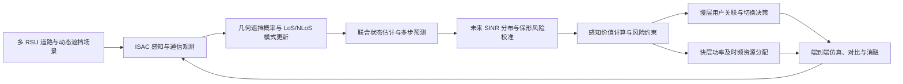

# 硕士学位研究生开题报告_动态遮挡车联网ISAC
北京交通大学

# 硕士学位研究生选题报告及论文工作计划

## 面向动态遮挡车联网的感知价值驱动多 RSU ISAC 预测式用户关联与资源协同优化研究

**研究生：** 待填写　　**学号：** 待填写  
**学院：** 待填写　　**专业：** 待填写  
**研究方向：** 待填写　　**入学日期：** 待填写  
**填表日期：** ______年____月____日

---

## 开题报告专家组成员审核表

| 角色 | 姓名 | 职称 | 所在单位 |
| --- | --- | --- | --- |
| 主席 | 待填写 | 待填写 | 待填写 |
| 成员1 | 待填写 | 待填写 | 待填写 |
| 成员2 | 待填写 | 待填写 | 待填写 |
| 成员3 | 待填写 | 待填写 | 待填写 |
| 成员4（如需） | 待填写 | 待填写 | 待填写 |

备注：按附件2要求，专家组由3—5名具有硕士生导师资格的教师组成，导师回避；具体名单应与学院考核秘书确认。

### 学院学位分委员会意见

________________________________________________________________________________

签名：________________________　　年____月____日

### 学院意见

________________________________________________________________________________

签名：________________________　　年____月____日

---

## 选题基本信息

**选题名称：** 面向动态遮挡车联网的感知价值驱动多 RSU ISAC 预测式用户关联与资源协同优化研究

**选题和导师科研项目的关系、项目级别、类别及经费来源：** 待根据导师实际承担的科研项目填写。本报告不预设或虚构项目编号、项目级别及经费来源。

**论文类型：** 建议选择“（2）应用研究”，最终以导师及学院认定为准。

---

## 报告正文

> 本正文按照附件2规定的五个部分组织；正文论述方式参考刘家豪开题报告，按研究背景、国内外研究现状、系统模型、研究内容、关键问题、技术方案、预期目标和工作计划展开。

## 1. 论文选题依据

### 1.1 论文选题的意义

随着第五代移动通信（5G）网络持续演进以及第六代移动通信（6G）研究不断推进，未来无线网络不仅需要提供高速率、低时延和高可靠的数据传输能力，还需要具备对周围物理环境进行感知、定位、跟踪和重构的能力。通感一体化（Integrated Sensing and Communication，ISAC）通过共享频谱、波形、天线及信号处理资源，使通信与感知由相互独立的功能逐步转向协同设计，被认为是构建感知型无线网络的重要技术方向[1-3]。

车联网（Internet of Vehicles，IoV）是 ISAC 的重要应用场景。车辆高速移动、道路环境复杂、网络拓扑快速变化，且车辆之间、车辆与路侧单元（Road Side Unit，RSU）之间的无线链路容易受到大型车辆、道路设施及建筑物遮挡。在毫米波等高频段，遮挡可能引起链路增益快速下降，造成信干噪比（Signal-to-Interference-plus-Noise Ratio，SINR）突变、通信中断以及波束失配。传统基于当前接收信号强度或固定门限的用户关联和切换策略，往往在链路质量明显下降后才触发切换，难以及时应对动态遮挡。

多 RSU 协同能够利用不同站点在空间位置、视角和链路传播条件上的差异，为车辆提供空间分集和连续覆盖。ISAC 感知功能还可以获取车辆及遮挡物的距离、角度、速度等信息，为链路状态预测和用户关联提供先验。然而，感知并非无成本：感知波束、发射功率、时频资源的增加通常会提高观测信噪比、改善测量精度，但也会占用本可用于通信的资源。因此，系统需要回答的不仅是“能否感知到车辆或遮挡物”，还包括“增加多少感知资源能够降低多少未来通信风险，以及这种收益是否足以抵消资源代价”。

现有感知辅助通信研究通常利用感知结果改善波束预测、链路选择或资源调度，但感知资源对测量噪声、状态后验不确定性、未来 SINR 分布和通信中断风险的连续影响仍有进一步统一建模的空间。本课题拟构建“感知资源—测量信息量—状态后验协方差—链路模式概率—未来 SINR 风险—关联与资源决策”的闭环模型，使感知资源分配成为通信可靠性优化的一部分，而不是独立于通信决策的辅助模块。

本课题的研究意义主要体现在以下三个方面：第一，在理论建模方面，将车辆运动状态、动态遮挡几何和 LoS/NLoS 链路模式纳入统一的切换状态空间模型，研究感知不确定性向链路可靠性风险的传播机制；第二，在方法方面，结合非线性状态估计、概率预测与保形预测校准，提升未来 SINR 风险评估的可信度；第三，在系统优化方面，将感知资源改变测量精度的作用显式纳入多 RSU 用户关联和资源分配模型，探索感知投入与通信可靠性之间的可量化权衡，为动态车联网中的预测式切换和协同资源调度提供方法支撑。

### 1.2 国内外研究现状

#### 1.2.1 概述

ISAC 研究已从早期的雷达与通信波形共存，逐步发展到波形、波束、信号处理、网络协同和跨层资源管理的联合设计。Liu 等对面向 6G 的双功能无线网络进行了系统综述，指出感知与通信既存在共享资源带来的集成增益，也存在相互辅助带来的协调增益[1]。近年的车联网 ISAC 综述进一步将资源分配、波束管理、覆盖增强以及高移动性下的鲁棒性列为重要研究方向[2]。

围绕本课题，相关研究可归纳为四类：一是车联网 ISAC 与多 RSU 协同感知通信；二是动态遮挡、LoS/NLoS 链路演化与移动目标跟踪；三是非线性状态估计、不确定性传播和预测区间校准；四是预测式用户关联、资源优化及多智能体强化学习。上述研究为本课题提供了模型和算法基础，但各研究方向的耦合关系仍需进一步分析。

#### 1.2.2 研究现状

（1）车联网 ISAC 与多 RSU 协同研究

在 ISAC 基础理论方面，Liu 等从双功能无线网络角度总结了 ISAC 的应用场景、性能权衡、波形设计和接收信号处理方法，为通信与感知共享资源的联合设计提供了理论基础[1]。Ma 等于 2026 年发表的车联网 ISAC 综述指出，高移动性、快速变化的网络拓扑、遮挡鲁棒性和资源分配是车联网 ISAC 面临的重要问题[2]。

在感知辅助车联网通信方面，Mu 等研究了 ISAC 使能的车辆预测波束成形，并利用深度学习提高车辆网络中的波束预测能力[3]。Du 等进一步考虑车辆扩展目标特性，研究了 V2I 场景下的动态预测波束成形，分析了感知阶段与通信阶段时间分配对平均通信速率的影响[4]。这些研究说明，利用车辆感知结果辅助通信波束管理具有可行性，但其重点主要集中在单链路或单 RSU 的波束预测和分配。

在多基站协同与遮挡鲁棒性方面，Cui 等研究了毫米波网络中的多视角协同 ISAC，通过多基站协作应对动态遮挡，并将感知任务调度建模为机会约束整数规划问题，进一步设计强化学习求解方法[5]。Li 等于 2026 年研究了面向 V2V 检测和跟踪的分布式 ISAC 资源分配，将检测约束、跟踪精度和通信资源纳入两级分布式优化框架[6]。这些工作表明，多节点协同、动态遮挡和资源分配已成为研究热点。

在车联网资源优化方面，Liu 等提出基于深度强化学习的 IoV-ISAC 联合信道、功率和带宽分配方法，体现了强化学习在动态资源管理中的应用价值[7]。总体而言，已有研究分别从多 RSU 协同、遮挡鲁棒性、感知任务分配和通信资源优化等角度取得进展，但对于“感知资源改变测量精度，进而改变未来链路风险，并反过来影响用户关联”的闭环量化仍有进一步研究空间。

（2）动态遮挡与 LoS/NLoS 链路状态建模

无线链路的 LoS/NLoS 状态会受到建筑物、树木和移动车辆等障碍物影响。Boban 等研究了 V2V 链路 LoS 遮挡在时间和空间上的演化，采用包含 LoS、静态物体导致的 NLoS 以及移动物体导致的 NLoS 的三状态离散马尔可夫链描述链路演化，并根据真实交通环境获得状态转移概率[8]。该研究说明，链路模式具有时间相关性，且移动遮挡物是影响车联网传播状态的重要因素。

在定位与跟踪方面，Fritsche 等针对混合 LoS/NLoS 环境下的移动终端跟踪推导了贝叶斯 Cramér-Rao 下界（BCRB），分析了跳变马尔可夫模式下测量噪声混合分布对状态估计性能的影响[9]。这类研究为混合传播模式下的理论性能界分析提供了基础。

上述工作已经涉及动态遮挡和马尔可夫链，因此本课题不将“采用马尔可夫模型描述 LoS/NLoS 切换”本身作为创新点。拟进一步研究的是：将 ISAC 感知得到的车辆和遮挡物几何状态及其不确定性作为转移概率的条件变量，使链路模式转移概率能够随遮挡几何、相对运动和状态估计协方差动态变化，并将该概率与多 RSU 状态估计及后续 SINR 风险预测相连接。

（3）非线性状态估计与不确定性校准

车辆运动和无线观测之间通常具有非线性关系。Cubature Kalman Filter（CKF）利用球面—径向容积准则近似计算非线性贝叶斯滤波中的多维积分，已成为非线性状态估计的一类常用方法[10]。针对未知测量噪声、异常值和模型失配，Yun 等提出了基于变分贝叶斯的鲁棒 CKF 方法，对状态、噪声协方差及异常测量相关变量进行联合估计[11]；Tian 等进一步研究了未知测量丢失和多步时延条件下的变分贝叶斯鲁棒容积卡尔曼滤波[12]。

上述研究说明，变分贝叶斯与 CKF 的结合已有较成熟的研究基础。因此，本课题拟将 VI-CKF 作为混合状态估计的实现工具，而不将“VI 与 CKF 结合”作为独立创新。具体研究重点是如何在车辆运动状态、动态遮挡状态和离散链路模式之间建立有物理含义的耦合关系，并通过模式条件估计和协方差传播为未来链路风险提供可信输入。

另一方面，基于单一参数分布假设计算中断概率，可能受到模型失配和交通场景变化影响。保形预测（Conformal Prediction，CP）能够在适当交换性假设下，对任意预测器输出的区间或集合进行有限样本覆盖率校准[13]。Su 等将生成式信道模型与保形预测结合，构造信道不确定集合并用于鲁棒波束成形，展示了保形方法在无线不确定性量化中的应用潜力[14]。本课题拟将其用于未来 SINR 单侧下界校准，并重点处理车辆轨迹数据的时间相关性，采用轨迹级或时间块级校准单元，避免将相邻时间样本随机拆分造成数据泄漏。

（4）预测式用户关联与强化学习资源优化

传统移动性管理通常依据当前 RSRP、RSRQ 或 SINR 触发切换，难以充分利用车辆运动和遮挡物状态进行提前决策。Du 等的 V2I 预测波束成形研究以及 Li 等的 NLoS 预测波束和功率分配研究，分别从车辆扩展目标、非视距传播和功率分配角度体现了预测式通信设计的价值[4,15]。

在 ISAC 资源管理方面，Liu 等采用深度强化学习联合分配信道、功率和带宽[7]；Li 等研究了车联网中的协同感知、通信和计算资源分配[16]；Zhao 等提出了面向 IoV 的感知、计算与通信一体化系统设计及资源分配方法[17]。这些工作表明，强化学习和分层优化能够处理动态场景下的离散关联与连续资源分配问题。

多智能体近端策略优化（Multi-Agent Proximal Policy Optimization，MAPPO）采用集中训练、分布式执行（CTDE）等设计，可作为多 RSU 协同决策的候选算法。Yu 等对 PPO 在合作式多智能体任务中的表现进行了系统研究，给出了 MAPPO 类方法的实现经验和实验依据[18]。但若每个仿真步都调用高复杂度非凸优化器，训练成本会显著增加，因此需要设计轻量级快时间尺度求解器或训练阶段的代理模型，并在最终评估阶段使用真实优化器验证。

#### 1.2.3 发展趋势

（1）从静态链路模型向动态几何驱动的传播状态建模发展。随着毫米波及更高频段在车联网中的应用，移动遮挡造成的链路状态突变将更加突出。未来链路预测需要同时利用车辆运动、障碍物几何和多 RSU 观测，而不是仅依赖固定转移矩阵或历史 RSRP 序列。

（2）从点估计向概率预测和可靠性校准发展。仅输出车辆位置或 SINR 的单一预测值，难以直接支撑高可靠通信决策。研究趋势是进一步传播状态估计误差和模式不确定性，形成未来 SINR 分布、预测区间和可检验的风险指标，并通过校准方法提高预测可靠性。

（3）从感知辅助通信向感知资源主动调控发展。感知资源不仅决定感知精度，也会通过状态估计精度影响未来通信决策。需要将感知功率、波束、时频资源与通信可靠性放入同一优化框架，研究感知资源的边际收益和资源机会成本。

（4）从单时间尺度优化向分层、在线和协同决策发展。用户关联与切换具有相对较慢的决策周期，功率、带宽和时频资源则需要快速调整。采用慢层策略决策与快层优化相结合的结构，有利于兼顾策略适应性和资源分配可行性。

综合来看，已有研究已分别覆盖车联网 ISAC、多 RSU 协同、动态遮挡、状态估计、保形预测和强化学习资源分配等方向。本课题的研究切入点不是简单叠加这些算法，而是尝试建立可验证的跨层闭环：利用感知后验更新链路模式概率和 SINR 风险，再由风险约束驱动多 RSU 关联与感知—通信资源分配。该研究切入点仍需在开题后继续开展针对性查新，尤其需要确认是否已有工作实现了完全相同的“感知资源—后验不确定性—校准风险—预测式关联”闭环。

## 2. 论文研究方案

### 2.1 研究目标及研究内容

#### 2.1.1 系统模型

本课题考虑城市道路或园区道路中的多 RSU 车联网 ISAC 场景。道路沿线部署 M 个具有通信和感知能力的 RSU，服务 K 辆联网车辆，并存在 J 个可能遮挡无线链路的动态障碍物。动态障碍物主要考虑大型货车、公交车等具有明显遮挡效应的车辆；建筑物等静态障碍物由道路地图或场景几何预先给定。每个 RSU 配备多天线阵列，采用 OFDM 或等效共享时频资源的 ISAC 信号，在为车辆提供下行通信的同时，利用回波或通信感知观测获取车辆及遮挡物的距离、角度和径向速度等信息。

系统中每辆车可处于多个 RSU 的候选覆盖范围内，慢时间尺度上选择一个主服务 RSU，并允许其他 RSU 参与协同感知；当预测到当前链路未来可靠性下降时，系统可以提前触发用户关联调整。为降低初期建模复杂度，第一阶段以单主服务链路和多 RSU 协同感知为主，不将多连接数据面传输作为必做内容。

定义车辆及相关遮挡物的连续运动状态为 x_t，包含位置、速度及必要的加速度变量；定义车辆 i 与 RSU k 之间的离散传播模式为 m_{k,i,t}，初步取值为 LoS 和 NLoS。系统的连续状态演化可表示为：

\[
x_t = f(x_{t−1}) + w_t， w_t ~ N(0,Q_t) \tag{2-1}
\]

其中，f(·) 为车辆运动状态转移函数，可根据仿真需求采用近似匀速或近似匀加速模型；w_t 为过程噪声。对于车辆 i 与 RSU k 的链路，ISAC 观测模型表示为：

\[
z_{k,i,t} = h_{k,i}(x_t,m_{k,i,t};u^s_{k,i,t}) + v_{k,i,t} \tag{2-2}
\]

其中，z 表示距离、角度、多普勒或其他可用观测；u^s 表示感知波束、功率、时长和带宽等资源；v 为测量噪声，其协方差 R(u^s) 随感知资源及观测几何变化。该设置是本课题闭环建模的基础：感知资源变化会改变观测精度，进而改变状态估计后验。

动态遮挡几何建模方面，将 RSU 与车辆之间的视距线段记为 ℓ_{k,i,t}，第 j 个动态障碍物的占据区域记为 O_{j,t}。定义链路被动态障碍物遮挡的概率为：

\[
b_{k,i,t} = P{ ℓ_{k,i,t} ∩ O_{j,t} ≠ ∅，对至少一个 j 成立 } \tag{2-3}
\]

其中，车辆和障碍物位置并非完全确定，而是由状态估计后验分布描述。因此，b_{k,i,t} 可通过后验采样、几何相交概率计算或近似积分获得，而不是只根据单一位置点作确定性判断。

在此基础上，构造几何条件驱动的 LoS/NLoS 转移矩阵：

\[
T_{k,i,t}=\begin{bmatrix}1-p_{LN}(\phi_t) & p_{LN}(\phi_t) \\p_{NL}(\phi_t) & 1-p_{NL}(\phi_t)\end{bmatrix} \tag{2-4}
\]

其中，φ_t 可由遮挡概率 b、遮挡概率变化率、车辆与障碍物相对速度、链路距离及状态协方差等特征组成。p_{LN} 和 p_{NL} 可通过逻辑回归、浅层神经网络或基于几何规则的参数化函数进行估计，并保证转移矩阵每行概率和为 1。与固定马尔可夫矩阵相比，该模型允许转移概率随当前感知到的遮挡几何和不确定性动态变化。

无线信道采用 LoS/NLoS 条件化模型描述。对车辆 i 与 RSU k 的通信链路，接收 SINR 可表示为：

\[
γ_{k,i,t} = P^c_{k,i,t}|h_{k,i,t}|² / (I_{k,i,t}+N_0) \tag{2-5}
\]

其中，P^c 为通信发射功率，h 为包含路径损耗、阴影衰落、小尺度衰落及 LoS/NLoS 模式影响的等效信道系数，I 为同频干扰，N_0 为噪声功率。链路模式变化将导致信道增益和 SINR 分布发生变化。信道参数可参考 3GPP TR 38.901 的典型场景模型，并叠加显式的动态车辆遮挡几何模型[20]。

#### 2.1.2 研究目标

（1）构建面向动态遮挡车联网的多 RSU ISAC 系统模型，明确车辆运动、动态障碍物、LoS/NLoS 链路模式、感知观测及通信信道之间的关系。

（2）建立由感知几何状态和状态不确定性驱动的链路模式转移模型，设计连续运动状态与离散链路模式联合估计方法，实现车辆状态、遮挡状态和传播模式的在线概率估计。

（3）建立状态后验不确定性向未来 SINR 分布及通信中断风险的传播模型，并利用轨迹级或时间块级保形预测对未来 SINR 下界进行校准。

（4）建立感知资源影响测量精度、后验协方差和通信风险的显式数学关系，构建感知价值驱动的多 RSU 预测式用户关联与感知—通信资源协同优化模型。

（5）通过仿真与消融实验，验证几何条件转移、概率风险校准和感知资源闭环对链路可靠性、切换性能及系统资源效率的影响。

#### 2.1.3 研究内容

**研究内容一：**动态遮挡条件下车辆运动与无线链路的联合状态估计及概率预测

首先，建立车辆运动状态、动态遮挡物状态和 LoS/NLoS 传播模式之间的切换状态空间模型。车辆运动状态由连续状态方程描述，传播模式由离散状态变量描述，二者通过遮挡几何特征耦合。通过计算 RSU—车辆视距线段与障碍物占据区域的相交概率，获得链路遮挡概率；再将遮挡概率、相对速度、距离及估计协方差作为条件特征，动态更新 LoS/NLoS 转移概率。

其次，研究连续状态与离散模式的联合估计。拟采用“模式概率更新 + 模式条件 CKF 状态估计 + 变分贝叶斯噪声参数更新”的实现方式：在每个时间步，根据几何条件转移矩阵预测链路模式先验；根据不同模式下的观测似然更新模式后验概率；在各模式条件下使用 CKF 估计车辆和遮挡物连续状态；对于未知或缓慢变化的测量噪声协方差，利用变分贝叶斯框架进行在线修正。VI-CKF 在本课题中主要承担非线性联合估计工具的作用，研究重点在于几何条件链路模式转移与连续状态后验之间的耦合。

再次，分析状态估计精度的理论参考界。以混合 LoS/NLoS 跳变马尔可夫系统的 BCRB 研究为基础，分析不同观测资源、模式转移概率和遮挡不确定性对估计精度下界的影响[9]。需要强调，滤波器输出的后验协方差与 BCRB 并不相同：前者用于在线预测与决策，后者用于性能基准和理论分析。

最后，基于联合后验进行多步状态和链路模式预测。将预测得到的车辆位置、遮挡物几何及模式概率输入物理信道模型，形成未来 SINR 的条件分布，为研究内容二提供预测输入。

**研究内容二：**不确定性传播与未来 SINR 风险的保形校准

首先，研究连续状态不确定性和离散链路模式不确定性的联合传播。对于不同传播模式 m，分别获得条件状态均值 μ_m 和协方差 P_m，并利用全概率公式计算混合后验均值和总协方差：

\[
P_t = Σ_m π_{m,t}[P_{m,t}+(μ_{m,t}−μ_t)(μ_{m,t}−μ_t)^T] \tag{2-6}
\]

该表达式将模式内状态估计误差与不同模式之间的均值差异同时纳入总不确定性，避免仅使用单一模式下的协方差而低估链路预测风险。

其次，建立未来 SINR 概率预测模型。对 LoS/NLoS 等传播模式进行条件化，综合车辆位置后验、遮挡物状态、信道参数不确定性和干扰估计，获得未来 SINR 的混合分布：

\[
p(γ_{t+h}|D_t) = Σ_m π_{m,t+h} ∫ p(γ|x,m,u^c)q(x|m,D_t)dx \tag{2-7}
\]

其中，D_t 表示当前及历史观测，u^c 表示通信资源决策。若采用物理模型与数据驱动模型相结合的方式，可先由路径损耗、遮挡和多普勒等物理关系产生主预测，再使用时空图神经网络（ST-GNN）学习多 RSU 预测残差。考虑硕士论文工作量，ST-GNN 定位为可选增强模块，必做方案以物理模型和概率状态估计为主。

再次，研究保形预测对 SINR 预测结果的校准。设基础预测器给出未来 SINR 预测值 γ̂_n，校准样本的非一致性分数定义为 s_n=γ̂_n−γ_n。根据校准集分数的有限样本分位数 q_{1−ε}，构造单侧下预测界：

\[
L^{CP}_{t+h} = γ̂_{t+h} − q_{1−ε} \tag{2-8}
\]

在校准单元满足交换性等适用条件时，该下界可获得边际覆盖率保证。考虑车联网轨迹数据存在时间相关性，拟以完整车辆行程或连续时间块作为校准单元，并将训练集、校准集和测试集按车辆轨迹或场景划分，避免相邻时间样本随机拆分造成信息泄漏。实验中同时报告实际覆盖率、预测区间宽度、不同速度和遮挡强度下的覆盖偏差；对分布漂移场景单独进行鲁棒性测试。

最后，将校准后的未来 SINR 下界转换为可靠性风险约束的输入。例如，对服务链路要求：

\[
L^{CP}_{i,k,t+h} ≥ γ_i^{min} \tag{2-9}
\]

该约束是机会约束的一种保守可计算近似，不应将其解释为对任意非平稳时间序列均无条件成立的保证。对于需要直接评估概率的场景，也可利用校准后的预测样本估计中断概率 P_out=P(γ<γ_min)。

**研究内容三：**感知价值驱动的多 RSU 预测式用户关联与资源协同优化

首先，建立感知资源与观测精度之间的关系。定义 RSU k 对车辆 i 的感知资源为 u^s_{k,i}={p^s_{k,i},τ^s_{k,i},B^s_{k,i},w^s_{k,i}}，分别表示感知功率、感知时长、感知带宽和感知波束。测量噪声协方差写为 R_{k,i}(u^s)，其具体函数形式根据测距、测角和多普勒估计的 CRB 或链路级仿真进行标定。为便于理论分析，可先采用局部线性化近似：

\[
J^s_t(u^s) = Σ_{k,i} H_{k,i,t}^T R^{-1}_{k,i}(u^s)H_{k,i,t} \tag{2-10}
\]

其中，H 为观测函数对连续状态的局部雅可比矩阵，J^s 为感知观测带来的 Fisher 信息矩阵。在线性高斯近似下，后验协方差可用信息形式近似表示为：

P̃_{t|t}(u^s) ≈ [P^{-1}_{t|t−1}+J^s_t(u^s)]^{-1}                         （2-11）

式（2-11）用于揭示感知资源影响后验不确定性的数学关系；实际在线预测和风险评估仍使用 VI-CKF 输出的后验协方差，不将该局部近似直接替代滤波器递推。

其次，定义感知资源价值。设不分配新增感知资源时的预测中断概率为 P_out(0)，分配资源 u^s 后的预测中断概率为 P_out(u^s)，感知资源成本为 C_s(u^s)，则单位感知成本带来的风险降低量定义为：

\[
VoI(u^s) = [P_out(0)−P_out(u^s)] / C_s(u^s) \tag{2-12}
\]

该指标用于量化感知资源的边际通信收益。优化器不需要额外重复奖励同一项风险下降，而是通过通信风险项和感知资源成本项共同完成权衡；VoI 可用于解释资源分配结果、设计感知任务优先级和开展消融实验。

再次，建立双时间尺度优化结构。慢时间尺度以 RSU 为智能体，采用集中训练、分布式执行的 MAPPO 框架，决策用户关联、预测式切换和感知任务优先级；快时间尺度根据慢层决策，求解感知功率、感知时频资源、通信功率和 PRB 分配。初始仿真可将慢层周期设置为 100–500 ms、快层周期设置为 1–10 ms，具体数值根据车辆速度、信道变化和仿真帧结构调整，不将其作为标准规定值。

慢层智能体的观测包含本 RSU 覆盖车辆的状态估计、后验协方差、LoS/NLoS 模式概率、校准 SINR 下界、队列负载和历史关联信息。动作包含车辆关联、切换触发和感知任务选择。通过动作掩码或可行匹配层处理 RSU 容量、用户唯一主关联和切换约束。快层优化器根据慢层动作输出连续资源分配结果，并将实际求解后的系统效用返回给 MAPPO 作为奖励。

联合优化目标拟考虑加权通信速率、切换成本、通信尾部风险和资源消耗。令 x_{k,i} 表示车辆 i 是否关联 RSU k，u^s、u^c 分别表示感知和通信资源，ℓ_i 表示通信风险损失，则可建立如下总体优化模型：

max_{x,u^s,u^c}  Σ_i ω_i E[R_i] − λ_H N_H − λ_R Σ_i CVaR_α(ℓ_i) − λ_E P_total                         （2-13）

主要约束包括：

\[
P(γ_i < γ_i^{min}|D_t,x,u^s,u^c) ≤ ε_i， Σ_i(p^s_{k,i}+p^c_{k,i}) ≤ P_k^{max} \tag{2-14}
\]

\[
Σ_i τ^s_{k,i}+τ^c_k ≤ T_k， Σ_i B^s_{k,i}+B^c_k ≤ B_k， Σ_k x_{k,i}=1 \tag{2-15}
\]

其中，CVaR 用于衡量通信风险损失分布的尾部严重程度，机会约束用于限制链路中断概率；二者分别刻画尾部风险和可靠性门限。为降低内层求解复杂度，快层优先采用低复杂度功率分配、贪心时频分配或固定迭代次数的连续凸近似（SCA）。训练阶段可使用离线求解样本训练资源分配代理模型，最终测试仍调用真实快层优化器验证策略效果。

### 2.2 拟解决的关键问题及难点

本课题拟重点解决以下两个核心科学问题，并围绕模型实现和算法求解处理相应技术难点。

**科学问题一：**感知不确定性如何沿“车辆运动状态—动态遮挡状态—LoS/NLoS 链路模式—未来 SINR”传播，并转化为可校准的通信中断风险？

该问题涉及连续运动状态与离散传播模式的耦合。车辆和遮挡物的位置估计存在误差，导致视距线段是否与障碍物相交也具有概率性；传播模式的变化又会影响路径损耗、阴影衰落和 SINR 分布。难点在于构造具有物理解释的几何条件转移概率，并避免模式不确定性和状态协方差在多步预测中被低估。拟采用几何相交概率、模式条件滤波、全概率协方差传播和保形预测校准逐步解决。

**科学问题二：**在感知与通信共享功率、时频和波束资源的条件下，如何量化感知资源的边际价值，并以较小资源代价最大程度降低未来通信风险？

该问题的难点在于感知资源会同时影响测量精度、通信资源预算和后续链路预测风险，形成跨时间尺度耦合；同时，用户关联和切换包含离散变量，功率与时频分配包含连续或混合变量，整体问题具有非凸和高维特征。拟采用慢层 MAPPO 与快层轻量优化相结合的结构，通过快层求解结果计算慢层奖励，并利用动作掩码、可行匹配和代理模型降低训练成本。

除上述科学问题外，还需重点处理以下技术难点：

（1）几何遮挡概率计算与模式转移参数学习：需要在保证几何含义的同时控制计算复杂度，并通过固定转移矩阵、距离相关模型等基线验证改进效果。

（2）混合状态估计的数值稳定性：VI-CKF 涉及连续状态、离散模式和噪声参数的近似联合推断，需要合理设置先验、迭代次数和协方差正定约束。

（3）时间相关数据的预测校准：普通随机样本拆分可能破坏时序依赖结构，需采用轨迹级或时间块级校准，并单独测试交通密度和遮挡分布变化下的覆盖率。

（4）双时间尺度优化的训练成本：若每个细粒度时隙都求解完整非凸问题，MAPPO 训练将难以承受；需要通过快层低复杂度算法、缓存或代理模型提高效率，并确保最终评估使用真实优化器。

（5）多 RSU 协同中的可行性和通信开销：需要控制跨 RSU 状态共享的维度，明确集中训练与分布式执行时的信息接口，并保证关联动作满足容量和切换约束。

### 2.3 拟采用的研究方案

本课题拟按照“系统建模—联合估计—概率预测与校准—闭环资源优化—仿真验证”的顺序开展研究，技术路线如图 2-1 所示。

图 2-1 研究技术路线图

具体研究步骤如下：

1. 第一步：构建多 RSU 车联网 ISAC 仿真场景。建立道路拓扑、RSU 部署、车辆运动和动态遮挡物模型，生成不同交通密度、车速和遮挡强度下的车辆轨迹。初期采用 Python 自建可控仿真环境，必要时使用 SUMO 生成交通流轨迹；无线信道以 3GPP 场景参数和显式动态遮挡模型为基础，保证仿真过程可复现。

1. 第二步：建立几何条件切换状态空间模型。定义车辆与遮挡物的连续状态、链路 LoS/NLoS 离散模式和多 RSU 观测模型；根据后验位置分布计算链路遮挡概率，并将遮挡概率、相对运动和状态协方差输入转移概率模型。与固定 Markov、距离相关 Markov 和仅基于 RSRP 的模式预测方法进行比较。

1. 第三步：设计联合状态估计算法。采用 CKF 处理连续非线性状态，采用贝叶斯模式更新处理 LoS/NLoS 离散状态，并利用变分贝叶斯机制估计未知测量噪声或模型不确定参数。通过位置 RMSE、速度 RMSE、模式识别准确率、负对数似然和 BCRB 参考差距评价估计性能。

1. 第四步：建立未来 SINR 概率预测和保形校准模块。将状态后验、模式概率和物理信道模型结合，生成多步 SINR 预测分布；按完整车辆轨迹或连续时间块划分数据，进行保形预测校准。重点比较预测误差、覆盖率、区间宽度和中断概率估计误差，并分析模型失配和场景漂移的影响。

1. 第五步：建立感知资源价值驱动的双时间尺度优化模型。推导感知资源与测量噪声协方差、Fisher 信息及后验协方差之间的关系；在候选用户关联和感知任务方案下计算校准后的 SINR 风险；慢层采用 MAPPO 选择关联和任务，快层采用低复杂度资源优化器分配功率及时频资源。将快层真实求解结果反馈给慢层奖励。

1. 第六步：开展对比和消融实验。与固定关联、基于当前 RSRP 的反应式切换、预测但不考虑不确定性的切换、固定感知资源、无保形校准、固定链路转移矩阵、启发式资源分配及单智能体/独立 PPO 等基线进行比较。通过消融实验分别去除几何条件转移、协方差传播、保形校准和感知资源反馈，明确各模块的独立贡献。

#### 2.3.1 仿真场景与初始参数设置

为控制研究规模，拟先构建中等规模城市道路场景，并根据仿真结果逐步扩展。以下参数为初始实验配置，不作为最终标准值；后续将根据场景、信道模型和计算资源进行调整。

| 参数 | 初始设置建议 | 说明 |
| --- | --- | --- |
| RSU 数量 | 3–5 个 | 覆盖交叉口或连续道路路段 |
| 车辆数量 | 10–30 辆 | 按低、中、高交通密度分组 |
| 动态遮挡物 | 0–10 个 | 重点考虑货车、公交车等大型车辆 |
| 载波频率 | 28 GHz（基准） | 毫米波场景；可增加 3.5 GHz 对照 |
| 系统带宽 | 100 MHz（基准） | 后续按资源块模型调整 |
| 天线配置 | 16/32 阵元 ULA | RSU 侧多天线阵列 |
| 车辆速度 | 10–30 m/s | 按城市道路速度范围分层 |
| 快/慢决策周期 | 1–10 ms / 100–500 ms | 仿真时间尺度，需开展敏感性分析 |

表 2-1 初始仿真场景与参数建议

#### 2.3.2 评价指标与对比基线

| 评价层面 | 评价指标 | 用途 |
| --- | --- | --- |
| 状态估计 | 位置/速度 RMSE、模式识别准确率、负对数似然、BCRB 参考差距 | 评价运动与链路联合估计 |
| 概率预测 | SINR 预测误差、覆盖率、区间宽度、Brier 分数、中断概率估计误差 | 评价预测精度和风险校准 |
| 通信性能 | 平均吞吐量、5% 用户吞吐量、通信中断率、链路失效次数 | 评价通信服务质量 |
| 移动性管理 | 切换次数、过早切换、过晚切换、切换失败率 | 评价预测式关联效果 |
| 资源效率 | 感知资源开销、总功率、频谱利用率、单位感知成本风险降低量 | 评价感知资源价值 |

表 2-2 评价指标设计

主要对比基线包括：固定 LoS/NLoS 转移矩阵 + CKF；IMM-CKF 或其他模式切换滤波器；仅依据当前 RSRP/SINR 的反应式切换；基于点估计的预测式切换；不进行保形校准的概率预测；固定感知资源或均匀分配；基于规则的关联与资源分配；MAPPO 与启发式/传统优化方法。基线选择将遵循“同等信道、同等功率预算、同等交通轨迹和同等计算预算”的公平原则。

#### 2.3.3 可行性分析与风险控制

本课题的可行性首先来自问题规模的分阶段控制。必做方案先在小规模、可控的道路场景中验证几何遮挡、联合状态估计和风险传播，再将已验证的输出接口接入关联与资源优化；不把大规模多智能体训练、复杂波形联合设计或 ST-GNN 残差学习作为基本完成条件。这样可以把“状态估计是否有效”“风险预测是否可校准”和“资源决策是否带来收益”分成能够独立判断的验证环节。

在数据和仿真资源方面，第一阶段使用自建运动与遮挡场景生成器，明确车辆、遮挡物和 RSU 的真实状态，生成可重复的观测、链路模式和信道样本；若后续接入 SUMO，仅将其作为交通轨迹生成器，并通过统一的轨迹、坐标和时间接口接入已有估计模块。感知后验、遮挡物状态和未来信道等信息只在仿真中作为具有明确可获得时刻的观测或真值使用：真值用于生成和离线评价，算法决策仅使用当前时刻已经产生的观测及其后验，不能将未来真值或测试轨迹标签提前送入滤波器、校准器或优化器。

主要风险及替代路径如下：

（1）若几何遮挡模型与所选信道参数之间难以建立稳定映射，则先固定信道模型，仅验证遮挡几何对模式转移概率和状态估计的影响；待接口稳定后再加入阴影衰落和干扰不确定性。

（2）若 VI-CKF 的在线迭代带来数值不稳定或计算量过高，则保留模式条件 CKF 和离线噪声参数估计作为可复现实验主线，将在线变分更新作为扩展实验，并报告正定约束、迭代次数和运行时间。

（3）若轨迹级保形校准在分布漂移场景下覆盖率下降，则分别报告校准分布内和漂移分布下的覆盖率，不把边际覆盖率表述为每个时刻、每辆车或每次切换均成立的保证；必要时采用时间块校准、滚动校准或扩大预测区间，并把适用条件写入结论。

（4）若 MAPPO 训练成本超过可接受范围，则先用枚举、贪心、混合整数小规模求解或固定策略生成器验证感知价值和风险约束，再将快层优化结果作为慢层策略学习的奖励。只有在真实快层求解器和代理模型的输出差异经过单独核对后，才将代理模型用于训练加速。

（5）若多 RSU 之间共享完整后验造成通信开销过大，则只共享与候选关联和风险约束有关的低维统计量，例如预测均值、协方差摘要、模式概率和可用资源余量，并将共享维度和额外通信量作为独立指标报告。

#### 2.3.4 实验结果的判定与归因

实验首先按研究问题分层判定。对联合状态估计，比较几何条件转移模型与固定转移或距离相关模型，在相同轨迹、观测噪声和计算预算下观察位置、速度、模式识别和似然指标；该比较回答的是几何条件信息是否改善状态与模式估计，不能直接推出通信收益。对风险预测，比较未校准预测、点估计预测和保形校准预测，在相同预测步长及校准划分下同时报告误差、覆盖率、区间宽度和中断概率估计误差；覆盖率不足时，结论应收窄为相应场景下的校准效果。

对资源协同优化，至少设置“反应式关联”“预测但不使用不确定性”“固定感知资源”和“感知价值闭环”四类条件，并保持交通轨迹、信道样本、总功率预算和决策周期一致。若闭环方案降低中断率但增加感知开销，应分别报告可靠性收益与资源代价，不能用平均吞吐量的改善抵消可靠性约束未满足的事实；若只在部分速度或遮挡强度下有效，则将适用条件和失效区间作为结论的一部分。

每个核心比较至少重复不同随机种子或场景实例，并同时给出均值与离散程度；具体重复次数和统计检验方法待根据计算预算确定。消融实验只移除一个待验证机制，避免同时改变转移模型、风险校准和资源预算而无法归因。最终结论区分“实现正确”“优化目标改善”“业务指标达标”和“外部场景泛化”四个层级，不把仿真结果表述为真实道路部署效果。

## 3. 预期达到的目标

（1）建立一个面向动态遮挡车联网的多 RSU ISAC 系统模型，明确车辆运动、动态障碍物、链路传播模式、感知测量和通信信道之间的关系，并形成可重复的仿真场景。

（2）提出一种几何条件驱动的 LoS/NLoS 链路模式转移与联合状态估计方法，实现车辆运动状态、动态遮挡状态和传播模式的概率估计；分析其相较于固定转移模型的性能差异。

（3）建立状态后验不确定性向未来 SINR 分布和中断风险传播的方法，形成基于轨迹级或时间块级保形预测的 SINR 单侧下界校准机制，并报告覆盖率及其适用条件。

（4）建立感知资源—Fisher 信息—后验协方差—SINR 风险之间的显式数学关系，提出感知价值驱动的多 RSU 预测式用户关联和资源协同优化方法。

（5）完成可运行的仿真程序、算法对比和消融实验，形成完整的实验数据、图表和分析结论；在研究成果基础上完成硕士学位论文，并争取形成学术论文或阶段性研究成果。

**工作量控制：**必做工作为几何条件切换模型、联合状态估计、物理模型 SINR 概率预测、保形校准、感知资源闭环建模及小规模风险约束关联/资源优化。ST-GNN 残差学习、GNN-MAPPO 大规模多智能体扩展和复杂波形联合设计作为可选增强内容，不作为论文基本完成的前置条件。

## 4. 论文工作计划

| 时间安排 | 主要工作内容 | 阶段性成果 |
| --- | --- | --- |
| 2026.11—2027.01 | 文献调研与问题细化：梳理车联网 ISAC、动态遮挡、混合状态估计、保形预测和资源优化文献；明确系统假设、场景边界和评价指标。 | 完成文献综述、系统模型初稿和开题报告修改。 |
| 2027.02—2027.04 | 系统建模与联合估计：构建车辆/遮挡物运动模型、几何条件链路转移模型和多 RSU 观测模型；实现 CKF、模式概率更新及变分贝叶斯噪声估计。 | 完成研究内容一的算法原型及状态估计对比实验。 |
| 2027.05—2027.07 | 概率预测与风险校准：建立多步 SINR 分布预测；完成轨迹级/时间块级保形校准，测试覆盖率、区间宽度及场景漂移影响。 | 完成研究内容二的主要实验和阶段性论文材料。 |
| 2027.08—2027.10 | 感知价值与资源优化：推导 Fisher 信息和后验协方差关系；建立风险约束优化模型；实现快层资源优化和小规模 MAPPO 慢层决策。 | 完成研究内容三的算法原型和基线比较。 |
| 2027.11—2028.01 | 系统联调与仿真验证：完成端到端闭环仿真、消融实验、复杂度分析和参数敏感性实验；必要时开展 ST-GNN 等可选增强。 | 形成完整实验结果、图表和论文主体初稿。 |
| 2028.02—2028.03 | 论文修改与答辩准备：根据导师意见完善理论分析和实验，完成论文定稿、查重、预答辩及正式答辩准备。 | 完成硕士学位论文及答辩材料。 |

表 4-1 论文工作计划

注：上述时间安排为建议计划，需根据实际学制、学院开题节点、导师安排和论文送审时间进行调整。

## 5. 主要参考文献

[1] Liu F, Cui Y, Masouros C, et al. Integrated Sensing and Communications: Toward Dual-Functional Wireless Networks for 6G and Beyond[J]. IEEE Journal on Selected Areas in Communications, 2022, 40(6): 1728-1767. DOI: 10.1109/JSAC.2022.3156632.

[2] Ma Z, Li Z, Fan A. Integrated sensing and communications for vehicular networks: a survey[J]. Journal on Advances in Signal Processing, 2026, 2026: 54. DOI: 10.1186/s13634-026-01332-0.

[3] Mu J, Gong Y, Zhang F, et al. Integrated Sensing and Communication-Enabled Predictive Beamforming With Deep Learning in Vehicular Networks[J]. IEEE Communications Letters, 2021, 25(10): 3301-3304. DOI: 10.1109/LCOMM.2021.3098748.

[4] Du Z, Liu F, Yuan W, et al. Integrated Sensing and Communications for V2I Networks: Dynamic Predictive Beamforming for Extended Vehicle Targets[J]. IEEE Transactions on Wireless Communications, 2023, 22(6): 3612-3627. DOI: 10.1109/TWC.2022.3219890.

[5] Cui Y, Ding H, Ma Y, et al. Blockage-Resilient Integrated Sensing and Communication in mmWave Networks: Multi-View Collaboration and Efficient Task Allocation[J]. IEEE Transactions on Mobile Computing, 2025, 24(8): 7237-7251. DOI: 10.1109/TMC.2025.3551099.

[6] Li Q, Zhang L, Lin X, Xu H, Mohjazi L, Imran M A. Distributed ISAC resource allocation for V2V detection and tracking[J]. IEEE Transactions on Vehicular Technology, 2026, Early Access. DOI: 10.1109/TVT.2026.3698251.

[7] Liu C, Xia M, Zhao J, Li H, Gong Y. Optimal Resource Allocation for Integrated Sensing and Communications in Internet of Vehicles: A Deep Reinforcement Learning Approach[J]. IEEE Transactions on Vehicular Technology, 2025, 74(2): 3028-3038. DOI: 10.1109/TVT.2024.3480277.

[8] Boban M, Gong X, Xu W. Modeling the Evolution of Line-of-Sight Blockage for V2V Channels[C]//2016 IEEE 84th Vehicular Technology Conference (VTC-Fall). 2016: 1-7. DOI: 10.1109/VTCFall.2016.7881090.

[9] Fritsche C, Klein A, Gustafsson F. Bayesian Cramér-Rao Bound for Mobile Terminal Tracking in Mixed LOS/NLOS Environments[J]. IEEE Wireless Communications Letters, 2013, 2(3): 335-338. DOI: 10.1109/WCL.2013.032013.130073.

[10] Arasaratnam I, Haykin S. Cubature Kalman Filters[J]. IEEE Transactions on Automatic Control, 2009, 54(6): 1254-1269. DOI: 10.1109/TAC.2009.2019800.

[11] Yun P, Wu P, He S, Li X. A variational Bayesian based robust cubature Kalman filter under dynamic model mismatch and outliers interference[J]. Measurement, 2022, 191: 110063. DOI: 10.1016/j.measurement.2021.110063.

[12] Tian Z, Fu H, Cheng Y. Variational Bayesian based robust nonlinear filter for systems with unknown measurement loss and multi-step delay[J]. Signal Processing, 2025, 230: 109871. DOI: 10.1016/j.sigpro.2024.109871.

[13] Angelopoulos A N, Bates S. Conformal Prediction: A Gentle Introduction[J]. Foundations and Trends in Machine Learning, 2023, 16(4): 494-591. DOI: 10.1561/2200000101.

[14] Su X, Hou Q, He R, Simeone O. Conformal Robust Beamforming via Generative Channel Models[C]//2025 IEEE 26th International Workshop on Signal Processing Advances in Wireless Communications (SPAWC). 2025. DOI: 10.1109/SPAWC66079.2025.11143438.

[15] Li Z, Hu F, Ling Z, Song S, Li Q. Joint Non-Line-of-Sight Predictive Beamforming and Power Allocation for ISAC-Assisted Vehicular Networks[J]. IEEE Transactions on Intelligent Transportation Systems, 2025, 26(10): 16481-16495. DOI: 10.1109/TITS.2025.3574690.

[16] Li Z, Fu Y, Tian M, Li C. Cooperative sensing, communication and computation resource allocation in mobile edge computing-enabled vehicular networks[J]. Journal of Information and Intelligence, 2024, 2(4): 339-354. DOI: 10.1016/j.jiixd.2024.02.006.

[17] Zhao J, Ren R, Zou D, Zhang Q, Xu W. IoV-Oriented Integrated Sensing, Computation, and Communication: System Design and Resource Allocation[J]. IEEE Transactions on Vehicular Technology, 2024, 73(11): 16283-16294. DOI: 10.1109/TVT.2024.3422270.

[18] Yu C, Velu A, Vinitsky E, et al. The Surprising Effectiveness of PPO in Cooperative Multi-Agent Games[C]//Advances in Neural Information Processing Systems. 2022, 35: 24611-24624.

[19] Rockafellar R T, Uryasev S. Optimization of Conditional Value-at-Risk[J]. The Journal of Risk, 2000, 2(3): 21-41.

[20] 3GPP. Study on channel model for frequencies from 0.5 to 100 GHz: 3GPP TR 38.901, Release 17[S]. 2022.

---
## 开题答辩记录（专家点评、学生回答等）

________________________________________________________________________________

________________________________________________________________________________

________________________________________________________________________________

________________________________________________________________________________

________________________________________________________________________________

________________________________________________________________________________

________________________________________________________________________________

________________________________________________________________________________

________________________________________________________________________________

________________________________________________________________________________

________________________________________________________________________________

________________________________________________________________________________

记录人：________________________        日期：________年____月____日

## 导师对开题报告及论文工作计划的评语

（就研究生对国内外研究现状的了解情况、研究方法、研究手段及论文工作计划等进行评价）

________________________________________________________________________________

________________________________________________________________________________

________________________________________________________________________________

________________________________________________________________________________

________________________________________________________________________________

________________________________________________________________________________

________________________________________________________________________________

________________________________________________________________________________

________________________________________________________________________________

导师签名：________________________                 年____月____日

## 考核小组对开题报告的评审意见

（论文工作是否具备条件、是否同意选定该课题等）

________________________________________________________________________________

________________________________________________________________________________

________________________________________________________________________________

________________________________________________________________________________

________________________________________________________________________________

________________________________________________________________________________

考核小组负责人签名：________________________       年____月____日

## 考核小组对开题答辩的意见

（评价学生对所选题目是否理解到位，回答问题是否正确）

________________________________________________________________________________

________________________________________________________________________________

________________________________________________________________________________

________________________________________________________________________________

________________________________________________________________________________

开题成绩：________（百分制）                 年____月____日

## 学院学位分委员会对该选题的意见

________________________________________________________________________________

________________________________________________________________________________

________________________________________________________________________________

________________________________________________________________________________

签名：________________________                 年____月____日

## 学院对开题报告和论文工作计划的意见

________________________________________________________________________________

________________________________________________________________________________

________________________________________________________________________________

________________________________________________________________________________

负责人签名：________________________           年____月____日
