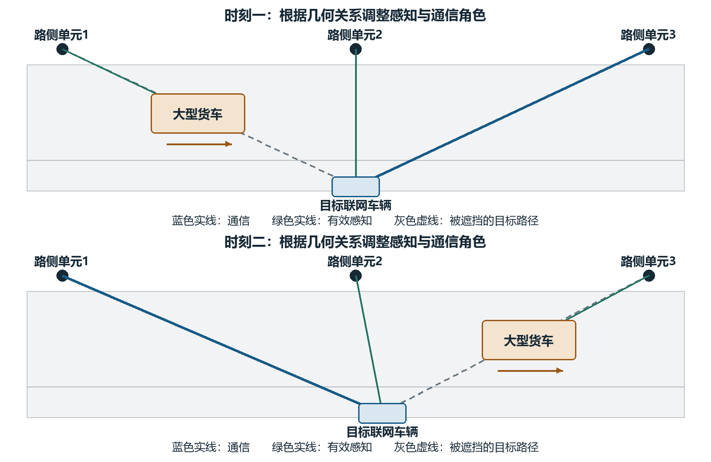
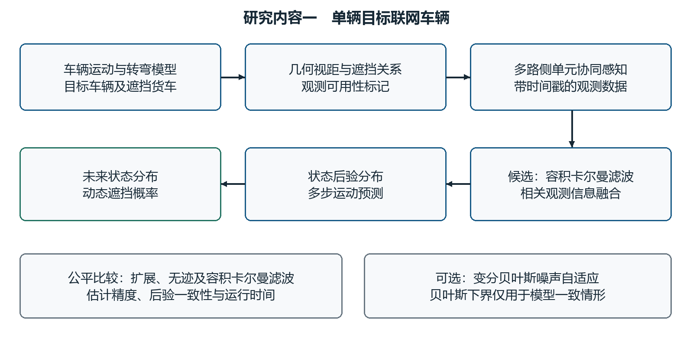
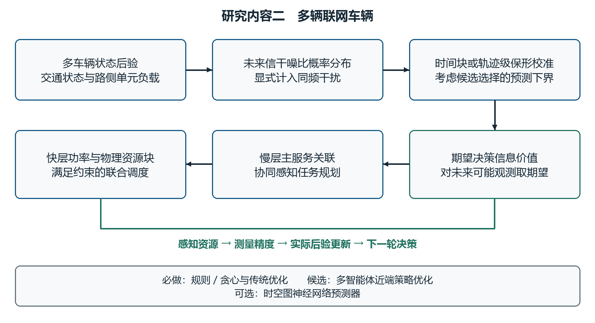
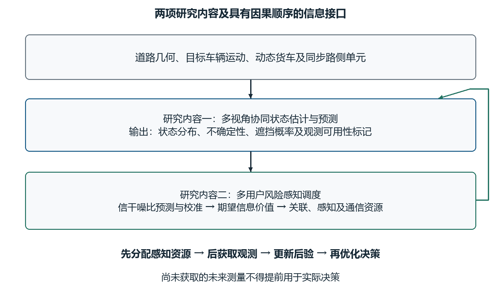
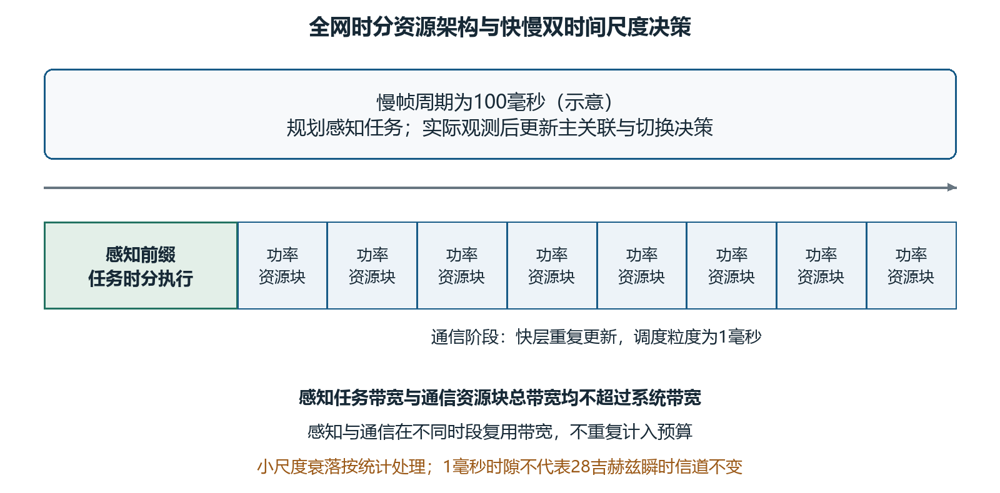

# 硕士学位研究生选题报告及论文工作计划

## 面向动态遮挡车联网的多 RSU 协同感知与感知价值驱动通感资源联合调度研究

研究生、学号、学院、专业、导师及科研项目等信息按本人实际情况填写；签名、成绩和审批意见留空。Word 版沿用附件2的封面、基本信息及审批表格。

## 1. 论文选题依据

### 1.1 论文选题的意义

车联网中的可靠通信不仅取决于当前信道质量，还受到车辆运动和道路遮挡关系变化的影响。大型货车或公交车进入路侧单元（Road Side Unit，RSU）与联网车辆之间时，原有视距链路可能衰减；车辆继续前进或转弯后，可用观测视角和适宜服务节点又会改变。仅依据当前接收功率触发切换，可能错过可提前采取措施的时间窗口。通感一体化（Integrated Sensing and Communications，ISAC）通过共享频谱、射频硬件及信号处理资源，使无线网络能够获得目标位置、速度等环境信息，并利用感知辅助通信设计[1]。对于动态遮挡车联网，重要问题是如何把这些信息转换为可执行、具有资源约束的通信决策。

单个 RSU 的视角具有局限。增加站点只有在不同 RSU 的几何视角具有互补性、观测被正确融合时，才可能缓解遮挡造成的信息缺失。多 RSU 协同感知并不等同于恢复被遮挡链路中的非视距信号，也不意味着所有站点在任何时刻都能观测目标。需要根据目标车辆、遮挡车辆和 RSU 的相对位置，区分哪些观测有效、哪些观测只能支持遮挡物跟踪，以及这些信息对未来状态预测的作用。

多车场景还存在另一层矛盾：有限的感知时间、发射功率和通信资源需要在不同车辆之间分配。位置协方差较大的车辆不一定最值得增加感知；例如，若它的所有候选通信链路都明显优于业务门限，更精确的位置可能不会改变关联动作。相反，位于遮挡边界、服务节点选择接近临界的车辆，即使协方差不大，新增观测也可能帮助系统避免不合适的关联。因而，感知投入的依据应从单纯降低估计误差，进一步转向判断信息能否改善后续通信决策。

本课题将上述问题组织为两个相互衔接的研究内容。研究内容一面向单辆目标联网车辆，研究动态遮挡环境中的多 RSU 协同感知与状态预测，形成带有不确定性的状态和遮挡输出。研究内容二面向多辆联网车辆，将这些输出接入未来信干噪比（Signal-to-Interference-plus-Noise Ratio，SINR）概率预测、风险校准和感知价值计算，研究预测式用户关联与通感资源联合调度。前者回答“有限视角下能够获得怎样的状态信息”，后者回答“这些信息值得占用多少资源、应如何服务多用户”。

本课题的意义在于形成可检验的跨层作用关系：感知资源影响测量精度，测量影响状态后验，后验影响未来链路风险，风险及信息的决策价值影响下一轮资源分配。研究不预设增加感知必然降低真实中断概率，而是通过同预算对照和端到端仿真，检验空间分集、概率预测及信息驱动调度在不同遮挡和负载条件下的适用范围。

### 1.2 国内外研究现状

#### 1.2.1 车联网 ISAC 与多 RSU 协同感知研究现状

ISAC 的共享资源设计同时涉及感知精度和通信性能权衡。Liu 等系统梳理了双功能无线网络的应用、波形与接收处理以及跨层设计，区分感知通信共享资源与相互辅助的不同作用[1]。面向车联网的综述进一步讨论了高移动性和资源配置等问题[2]。这些工作提供了问题分类和性能权衡框架，但具体系统仍需要确定哪些信息在决策时可用、感知开销如何计入通信预算。

感知辅助通信已在预测波束成形中得到研究。Mu 等围绕车辆网络研究了结合深度学习的 ISAC 预测波束成形[3]；Du 等考虑车辆扩展目标，在 V2I 场景下研究动态预测波束成形及感知通信阶段之间的关系[4]。这类研究说明状态感知能够服务通信预测，但其任务侧重于波束设计。本课题不将波束预测直接等同于多 RSU 用户关联，还需考虑不同服务节点之间的负载、同频干扰和切换代价。

多视角研究为应对遮挡提供了另一条路径。Tong 等在蜂窝环境感知中显式处理遮挡，并利用不同用户和基站的视角进行环境重建[5]。该工作的目标是散射环境重建，不能直接作为车辆滤波性能的结论，但支持从空间视角差异组织有效观测的研究思路。Cui 等研究毫米波网络中面向遮挡的多视角 ISAC 协作与任务分配[6]，与本课题的站点协作和任务规划密切相关。因此，多节点协同、遮挡感知和任务分配均不是空白；需要进一步比较其状态不确定性表示、通信动作集合及感知资源收益的定义，才能确定本课题拟贡献的边界。

本课题拟在上述基础上聚焦两点：首先，在单目标、可控几何场景中研究有效视角变化对状态后验及未来遮挡预测的影响；其次，在多用户场景中考察新增观测对后续最优通信动作的期望收益。与仅增加站点数或优化即时感知精度的设计相比，拟研究的区别在于把观测质量与未来关联、功率和时频资源决策联系起来，而非声称多 RSU 协作本身是新方法。

#### 1.2.2 动态遮挡下车辆状态估计与链路预测研究现状

动态遮挡具有明确的几何成因和时间相关性。Boban 等研究了 V2V 视距遮挡的时空演化，以离散状态模型描述不同传播条件[7]。这说明仅采用独立同分布的遮挡标签可能忽视连续交通运动。但 V2V 模型不能不加验证地作为 V2I 的转移参数：RSU 高度、车道位置、货车尺寸和目标运动均可能改变遮挡持续时间。本课题拟优先由几何轨迹生成遮挡，再根据需要建立条件化模式递推，而不是用固定转移矩阵替代几何关系。

车辆距离、角度和径向速度观测与笛卡尔状态之间具有非线性关系。扩展卡尔曼滤波（EKF）以一阶线性化处理非线性，需要雅可比矩阵；无迹卡尔曼滤波（UKF）利用 sigma 点传播均值和协方差，避免显式计算雅可比[8]；容积卡尔曼滤波（CKF）利用球面径向容积点近似非线性高斯积分[9]。三者均存在适用条件，CKF 并不必然优于 UKF。这里选择 CKF 作为主要候选，主要考虑距离角度观测非线性、统一正权重点规则及实现复杂度；是否具有精度或稳定性优势应由相同模型、初值和计算预算下的实验判断。

未知测量噪声会影响后验可信度。Yun 等研究了模型失配和异常观测条件下的变分贝叶斯鲁棒 CKF[10]；Tian 等研究了测量丢失和多步时延条件下的变分贝叶斯非线性滤波[11]。因此，变分贝叶斯（VB）与容积滤波结合已有研究基础，本课题仅将其作为噪声参数自适应的可选增强，不把算法名称组合列为创新。对于多 RSU 融合，公共时钟误差、共享先验和对同一遮挡物的估计会造成相关性；将各站后验直接相乘可能重复计入信息，必须明确测量相关性和融合层级。

估计下界能够提供理论参照。Fritsche 等针对混合 LoS/NLoS 移动终端跟踪研究了贝叶斯 Cramér–Rao 下界（BCRB）[12]。但其结论取决于具体状态、模式及似然模型，不能直接移植到具有观测丢失、资源自适应和几何遮挡的系统。本课题只在模型一致的简化场景中分析下界；复杂模型若无法得到可靠推导，则以蒙特卡洛误差、后验一致性和运行时间评价为主，不将 BCRB 当成滤波器或必须完成的理论创新。

#### 1.2.3 感知辅助通信与多 RSU 资源调度研究现状

在车联网 ISAC 资源配置方面，Liu 等利用深度强化学习研究信道、功率和带宽联合分配[13]；Li 等研究非视距条件下预测波束和功率设计[14]。后者表明 NLoS 传播可以成为专门的物理层研究对象，但本课题不引入其复杂信号恢复任务，而将 LoS/NLoS 作为条件化信道增益和观测可用性模型的一部分。Li 等及 Zhao 等还研究了车辆网络中的感知、通信与计算资源联合配置[15,16]。本课题保留通信与感知资源竞争这一问题，不把边缘计算卸载增加为新的研究内容。

未来链路预测还需要区分模型给出的概率和可检验的覆盖表现。Angelopoulos 和 Bates 介绍了保形预测（Conformal Prediction，CP）的基本构造及覆盖保证条件[17]；Su 等将生成信道模型与保形方法用于鲁棒波束成形[18]。在车联网中，相邻轨迹点高度相关，且最终使用的 RSU 是优化器从多个候选中选择的。单候选、随机样本切分下得到的覆盖率不能直接转化为每辆车、每个站点或所选动作的条件可靠性保证。因此，本课题将轨迹或时间块作为校准单位，并显式考虑候选选择，而不把 CP 设置为独立研究方向。

对于动态多站调度，多智能体近端策略优化（MAPPO）可在集中训练、分布式执行框架下学习协作策略。Yu 等对合作式多智能体任务中的 PPO 方法进行了系统研究[19]，提供了可供参考的算法实现原则，但并不能保证在本课题的非凸约束和稀有中断事件下仍具有优势。条件风险价值（CVaR）则提供了刻画尾部损失的风险度量工具[20]。两者在本课题中分别是候选求解方法和目标函数工具，不构成新的研究内容或创新点。

已有工作已覆盖感知辅助通信、资源分配、风险度量和协作学习。对于本课题，需进一步明确的是：在新增测量尚未发生时如何评价感知价值，以及测量发生后如何重新选择通信动作。只用协方差下降或固定动作下的风险变化衡量感知价值，会忽略信息可能改变关联决策这一关键机制；反过来，若让调度器提前看到未来观测，则会高估可实现收益。

#### 1.2.4 现有研究不足及发展趋势

围绕本课题，现有方法的可比较维度包括有效观测视角、状态与传播模式不确定性、预测风险的校准对象，以及调度时的可用信息。已有多视角工作说明遮挡与空间分集值得联合考虑，但环境重建、车辆跟踪和多用户关联具有不同任务目标，不能共享未经验证的性能结论。拟进一步研究在相同观测预算下，哪些视角互补机制能够改善目标预测，而不是通过无约束增加观测获取优势。

另一项需要研究的联系是信息收益与资源机会成本。更精确的状态估计可能帮助选择更合适的服务节点，也可能不改变决策；增加感知还会压缩通信时间。未来设计需要把“是否获取信息”和“根据什么信息做什么动作”放在同一因果框架下评价。相关方法应报告真实业务风险、计算时延和约束可行性，不仅报告预测均方误差或训练奖励。

据此，本课题拟以多 RSU 空间分集下的状态感知预测为基础，以多用户感知价值驱动调度为落点。两项拟创新均需经过针对性查新及实验验证；不主张首次采用 CKF、VB、CP 或 MAPPO，也不将所有相关文献概括为未考虑动态遮挡。研究范围以可实现的物理模型和传统优化为主，可选学习模块仅在基础方案验证后引入。

## 2. 论文研究方案

### 2.1 研究目标及研究内容

#### 2.1.1 系统模型与基本假设

考虑部署 $M$ 个 RSU 的道路覆盖区域，存在 $K$ 辆联网车辆和 $J$ 辆可能造成遮挡的大型车辆。研究内容一固定 $K=1$，以单辆目标联网车辆和相关遮挡物为状态估计对象；研究内容二将相同估计接口用于多辆联网车辆，重点研究资源竞争。基础场景为直线路段，扩展场景为 SUMO 十字路口，包括直行、左转、右转及多方向交汇。不在基础阶段引入多目标身份识别、复杂多径重建或计算卸载。

假设 RSU 位置、道路地图和天线方向已知，站间可通过边缘协调器交换带时间戳的测量及低维状态信息。基础实验采用集中式测量融合，计入协调时延并对时钟和坐标误差作敏感性分析，不假设无限速回传。车辆身份由通信标识或预处理给定，测量关联错误作为鲁棒性扩展，不作为必做多目标跟踪任务。三维 RSU 高度、车辆高度和货车长宽高用于几何遮挡判断，平面位置速度作为主要运动估计量。

选取全网同步时分 ISAC 架构：每个慢帧先设置感知前缀，其内部将 RSU—车辆任务按全局 TDMA 排列，一次只激活一个发射感知任务，避免将复杂感知互扰处理引入基础模型；不同视角测量按各自时间戳预测到公共融合时刻。随后进入下行通信阶段，各 RSU 复用相同频带、站内采用正交 PRB，因此通信同频干扰必须保留。感知阶段可分别观测目标和遮挡车辆，任务指向由角度和目标编号记录。感知与通信在不同时段复用频谱，不能再错误地要求两阶段带宽相加小于系统带宽。

通信采用单连接数据面，每辆车每个慢帧只有一个主服务 RSU；非服务 RSU 仍可参与感知。基础信道参考 3GPP TR 38.901 的适用场景和参数[21]，显式叠加动态车辆几何遮挡。若基础模型已含统计 NLoS 损耗，应明确区分建筑遮挡和车辆附加损耗，避免重复施加同一遮挡衰减。28 GHz 为基准载频，不假设每个毫秒内瞬时信道不变；调度侧主要使用大尺度状态与小尺度衰落统计形成的风险。

表 2-1 主要符号及量纲

| 符号 | 含义与维度 | 单位或取值 |
| --- | --- | --- |
| $k,i,j,n,t,s,h$ | RSU、联网车、遮挡车、PRB、慢帧、通信快时隙及预测步索引 | 离散索引；$s$ 在帧 $t$ 内重置 |
| $x_t,P_t$ | 单目标及遮挡物联合状态、状态协方差 | $d$ 维、$d\times d$；按分量单位 |
| $q_t(\cdot),D_t,D_t^+$ | 状态后验、感知前信息、实际新观测后的信息 | 概率分布与信息集 |
| $r_t,m_{ki,t},b_{ki,t+h}$ | 运动模式、传播模式、未来遮挡概率 | 直行/左转/右转；L/N；$[0,1]$ |
| $z_{ki,t},R_{ki,t}$ | 距离角度径向速度观测及噪声协方差 | 3维、$3\times3$；m、rad、m/s |
| $a_{ki,t},d_{ki,t}$ | 主关联、感知任务变量 | 0或1，二者不绑定 |
| $p^s_{ki,t},\tau_{ki,t},b^s_{ki,t}$ | 任务感知功率、时长、带宽 | W、s、Hz |
| $y_{ki,n,t,s},p^c_{ki,n,t,s}$ | 通信 PRB 指派、该 PRB 发射功率 | 0或1；W |
| $T_s,T_f,\tau_t^{\rm sen},B,\Delta f$ | 慢帧、快时隙、感知前缀、总带宽、PRB等效带宽 | s、s、s、Hz、Hz |
| $g_{ki,n,t,s},\gamma_{ki,n,t,s}$ | 等效功率增益、线性 SINR | 无量纲；$G=10\log_{10}\gamma$ 用dB |
| $N_0,P_k^{\max},E_k^{\max}$ | 噪声功率谱密度、峰值总功率、帧能量上限 | W/Hz、W、J |

图 2-1 给出动态货车案例。时刻 A 由 RSU 3 为目标车通信，RSU 1、RSU 2 执行感知；若货车遮住 RSU 1 到目标的视线，RSU 1 仍可测量货车，目标有效观测主要由 RSU 2 提供。时刻 B 货车向前移动，RSU 1 到目标的视线恢复，RSU 3 到目标的路径可能被货车遮住，此时可由 RSU 1 通信、RSU 2 感知目标、RSU 3 感知货车。示意中被阻断路径不作为有效目标测量。具体角色还需满足三维几何、回波信噪比和通信负载条件，不预先硬指定固定组合；在多个目标视角同时有效时才融合相应目标观测。这一案例强调多 RSU 的作用在于视角互补，而非保证任何站点都可绕过遮挡。

图 2-1 多 RSU 动态货车遮挡场景与角色变化示意

#### 2.1.2 研究内容一 动态遮挡环境下多 RSU 协同感知与目标车辆状态预测

本项面向单辆目标联网车辆。研究目标是在部分观测被遮挡、车辆可能转弯的条件下，输出目标及相关遮挡物的状态后验、未来状态不确定性和各 RSU 的遮挡概率。感知站点的基础启用规则由几何有效性和固定预算给定，研究不同空间视角怎样影响估计与预测；不在本项求解多车辆收益最大化或竞争性任务分配。

首先建立车辆直行与转弯运动模型，利用车辆和货车的长宽高占据区域判断视线是否相交。根据状态后验采样未来轨迹，得到遮挡发生概率、持续时间及有效观测掩码。其次建立各 RSU 距离、方位角和径向速度观测，区分目标观测缺失与噪声变大，避免把完全遮挡的路径继续作为无偏高斯测量使用。基础实验对有效测量进行集中融合，必要时显式保留跨站噪声协方差。

在此基础上，使用 CKF 作为候选非线性估计器，与 EKF、UKF 在相同数据下比较位置速度误差、后验一致性、发散率和耗时。VB 仅在噪声失配确有影响时用于在线更新测量噪声参数；分布式 VB 不列为基本完成条件。BCRB 仅用于模型一致的简化条件下解释可达到的估计精度，不承担状态估计算法角色。

本项交付与站点任务优化无关的估计预测接口：输入带时间戳观测、资源参数和有效性标记，输出状态分布、模式概率、未来遮挡概率及时间戳。研究内容二可以调用多份单车接口，并根据多车资源约束决定下一帧的观测预算。基础验证以直线路段和单货车为主，再在 SUMO 交叉口检验转弯及视角变化，不同时引入大规模调度训练。

#### 2.1.3 研究内容二 感知价值驱动的多 RSU 预测式用户关联与通感资源联合调度

本项面向多辆联网车辆，研究在站点容量、功率和时频资源有限时如何分配感知投入、主服务关联及通信资源。原先独立的 SINR 概率预测与风险校准在本项中作为调度前置模块，不再单设研究内容。研究内容一提供状态信息，本项只研究如何使用和采购信息，而不重复设计基础滤波器。

首先，根据各车状态后验及候选动作，结合 LoS/NLoS、路径损耗、阴影衰落、小尺度衰落和同频干扰，预测未来 SINR 分布。其次，以完整轨迹或有间隔的时间块构造 CP 校准数据，区分整体边际覆盖与分用户、分站点的条件覆盖，并对候选选择给出适用范围。随后，在未来观测尚未知时，对可能观测及其引起的后续最优通信决策取期望，以此构建感知价值，而不是把协方差下降直接当成通信收益。

联合调度采用两阶段因果设计：帧初基于现有信息规划感知任务和资源；实际测量完成后更新后验，确定该慢帧的主关联与切换，再在通信阶段快时隙分配 PRB 和功率。必须同时约束唯一主关联、站容量、通信资源与关联绑定、独立感知任务、时间带宽、总功率能量及可靠性。非服务 RSU 的感知投入可以改变另一站服务车辆的预测信息，体现多 RSU 协作与单连接通信的区别。

求解从规则或贪心开始，在小规模场景建立枚举关联加连续资源优化对照，再评估 MAPPO 的必要性。时空图神经网络（ST-GNN）只作为可选的时空特征或物理预测残差模型，不是调度算法，也不替代 MAPPO。训练不稳定、推理不可行或收益不足时，以传统优化保留主方案。

### 2.2 拟解决的关键问题及难点

第一项关键问题是动态遮挡下空间互补观测的有效融合与预测。难点不只是非线性滤波，而是遮挡造成的信息缺失与相关性：几何判定有状态误差，多个 RSU 可能共享时钟、运动先验和遮挡物信息，异步观测还可能在融合前失效。若错误地独立融合或将缺失测量当作高噪声测量，均可能得到过于自信的后验。需要建立有效性、时间对齐及相关性一致的测量模型，并检验转弯、长时遮挡及视角退化下的预测可信度。

第二项关键问题是具有决策意义的感知价值与多用户可行调度。帧初不能预知将来的测量结果，候选关联又会改变同频干扰和资源可行域；感知投入既可能改善信息，也会消耗通信时间。难点在于把对未来观测的期望、测量后重优化和多车资源竞争放入同一计算框架，并处理 CP 数据相关性及候选选择问题。需要防止“用未来真值决策”“所有站同时以最大功率却忽略互扰”和“预测区间覆盖等于每用户条件可靠”等不成立的简化。

### 2.3 拟采用的研究方案

#### 2.3.1 研究内容一的数学建模与估计预测

（1）车辆运动与动态遮挡模型

对目标车及每辆相关货车，采用平面运动状态 $x^{(j)}=[p_x,p_y,v,\psi,\omega]^T$，依次为位置、速率、航向和转向角速度；目标用上标0。联合状态 $x_t$ 的维度为 $d=5(J+1)$。以时间间隔 $\Delta$ 描述状态转移，$r_t$ 为直行或转弯模式，过程噪声协方差 $Q_{r_t}$ 按分量单位设置：

$$
x_{t+1}=f_{r_t}(x_t,\Delta)+w_t,\qquad w_t\sim\mathcal N(0,Q_{r_t}). \tag{2-1}
$$

对单车，采用协调转弯近似；$\omega$ 接近0时用其连续极限获得直行匀速模型，避免除零：

$$
\begin{aligned}
p_x'&=p_x+v[\sin(\psi+\omega\Delta)-\sin\psi]/\omega,\\
p_y'&=p_y+v[\cos\psi-\cos(\psi+\omega\Delta)]/\omega,\\
(v',\psi',\omega')&=(v,\psi+\omega\Delta,\omega).
\end{aligned}\tag{2-2}
$$

模式转移以车道允许方向、转向指示或历史运动为条件；SUMO 真值只用于生成和评价，不能直接给预测器未来转向。基础方案先比较单一协调转弯模型与有限运动模式混合预测；只有单模型误差确实影响结论时才加入模式混合，不无条件叠加复杂 IMM。

设 $\ell_{ki}(x)$ 为 RSU 到目标车参考点的三维线段，$\mathcal O_j(x)$ 为货车定向长方体占据区域。对联合预测分布 $q_{t+h|t}$，几何遮挡概率为：

$$
b_{ki,t+h}=\int\mathbf1\{\exists j:\ell_{ki}(x)\cap\mathcal O_j(x)\ne\varnothing\}\,q_{t+h|t}(x)\,\mathrm dx.\tag{2-3}
$$

该概率同时对目标与遮挡物位置误差积分，保留共同遮挡导致的跨链路依赖。实践中采用相同联合轨迹样本评价所有 RSU，不对每条链路独立生成互相矛盾的遮挡标签。观测可用性还需满足回波信噪比和视场门限，几何视距不等于必然可测。

对于需要压缩表示的传播模式 $m_{ki,t}\in\{L,N\}$，可拟合由几何特征决定的转移矩阵 $T_{ki,t}$。采用行向量模式概率，多步递推为：

$$
\pi_{ki,t+h|t}=\pi_{ki,t|t}\prod_{u=0}^{h-1}T_{ki,t+u|t},\qquad T\mathbf1=\mathbf1.\tag{2-4}
$$

每一步的 $T$ 根据该步预测几何更新，不能重复使用初始概率或忽略中间递推。随机几何条件下，式（2-4）是给定预测特征的近似；更精确的实现逐条轨迹递推后再求平均。若直接由式（2-3）的几何样本确定模式，则不再独立乘另一套马尔可夫模式概率，避免双重计算同一遮挡事件。

（2）多 RSU 有效观测及资源精度接口

对通过可用性检验的目标观测，令 $\delta p$ 为目标与 RSU 的三维相对位置、$\delta v$ 为相对速度、$\rho=\|\delta p\|$。观测为距离、平面方位角和径向速度：

$$
z_{ki,t}=\begin{bmatrix}\rho\\ \operatorname{atan2}(\delta p_y,\delta p_x)\\ \delta p^T\delta v/\rho\end{bmatrix}+v_{ki,t},\qquad v_{ki,t}\sim\mathcal N(0,R_{ki,t}).\tag{2-5}
$$

高度由地图和尺寸参数给定或加入扩展状态；航向误差按环形角度处理。对货车建立同类观测并选择联合状态中的对应分量。完全阻断的目标路径不使用式（2-5），只保留其他有效视角或运动预测；遮挡检测本身作为单独标记，不混同于无偏距离观测。

为了将调度资源接入估计，先采用具有正确量纲的近似噪声模型，并用回波仿真或参数扫描拟合其适用区间：

$$
\begin{aligned}
R_{ki}(u)&=\operatorname{diag}(\sigma_r^2,\sigma_\theta^2,\sigma_v^2),\\
\sigma_r^2&=c_r/[\eta_{ki}(b^s_{ki})^2]+r_0,\\
\sigma_\theta^2&=c_\theta/[\eta_{ki}A_k^2]+\theta_0,\\
\sigma_v^2&=c_v/[\eta_{ki}\tau_{ki}^2]+v_0,\quad
\eta_{ki}=p^s_{ki}\tau_{ki}\kappa_{ki}/(N_0F).
\end{aligned}\tag{2-6}
$$

$\eta$ 为匹配处理后的无量纲回波信噪比，$\kappa$ 含双程衰减、散射及阵列增益，$F$ 为线性噪声因子，$A_k$ 为以波长归一化的有效孔径。$c_r,c_\theta,c_v$ 分别具有使各式成立的量纲，$r_0,\theta_0,v_0$ 为噪声方差地板。距离使用均方根有效带宽，速度使用有效相干积累时长；这些尺度关系不是通用精确 CRB。任务不激活或回波不可用时不计算零功率下的倒数，而是删除该观测。低信噪比、长时积累及偏置条件需单独验证，不能无限增大资源推导无限精度。

对多个有效测量集中堆叠，观测协方差保留跨站相关项：

$$
z_t=\operatorname{col}_{k\in\mathcal V_t}z_{ki,t},\qquad
R_t=\begin{bmatrix}R_{11}&\cdots&R_{1M'}\\\vdots&\ddots&\vdots\\R_{M'1}&\cdots&R_{M'M'}\end{bmatrix}.\tag{2-7}
$$

$\mathcal V_t$ 为当前有效观测集合，$M'$ 为集合大小；每个块为 $3\times3$，若同时观测多个物体则按实际测量维度扩展。已建模的公共时钟或定位偏差可加入联合状态，从而在给定这些变量后使用条件独立噪声。未知相关性时，不直接乘各站共享先验的局部后验；优先保留测量级集中融合，并以协方差膨胀检验保守性。分布式扩展若实施，须定义局部 $q_k(x,R_k)$、交换的消息及公共先验扣除规则；无法追踪共享信息时采用保守融合，不宣称等价于集中式最优推断。

（3）CKF 候选实现及预测输出

对 $d$ 维高斯预测状态，设平方根矩阵 $S$ 满足 $SS^T=P$，容积点和权重为：

$$
\begin{aligned}
X_\ell&=\mu+S\xi_\ell,\qquad w_\ell=1/(2d),\\
\xi_j&=\sqrt d\,e_j,\qquad\xi_{j+d}=-\sqrt d\,e_j,\quad j=1,\ldots,d.
\end{aligned}\tag{2-8}
$$

将容积点通过运动和有效观测函数传播，计算预测矩、状态观测互协方差和滤波增益，完成均值协方差更新；角度残差使用主值区间并保持协方差正定。EKF、UKF 和 CKF 共用运动噪声、可用性掩码、测量资源和初始化，UKF 参数在独立验证集设置，不通过差异化调参人为制造 CKF 优势。

若采用运动模式混合，模式条件均值协方差为 $\mu_r,P_r$，概率为 $\nu_r$，输出矩为：

$$
\bar\mu=\sum_r\nu_r\mu_r,\qquad
\bar P=\sum_r\nu_r[P_r+(\mu_r-\bar\mu)(\mu_r-\bar\mu)^T].\tag{2-9}
$$

预测遮挡和风险时保留混合分量或轨迹样本，避免仅用矩匹配高斯掩盖转弯多峰性。VB 噪声自适应限定为可选项：在单个集中似然中更新噪声协方差后验，设置遗忘因子、方差下限和迭代上限，防止同一测量在多个节点重复更新。BCRB 若开展，仅在固定可用性、明确可微似然和一致先验的简化模型下计算，并与该条件的仿真比较；资源相关缺失、混合非正则模式下不直接套用标准信息递推。

图 2-2 总结本项技术路线。基础实验先确定几何和噪声模型，再比较估计器；不以叠加多个学习算法替代观测模型验证。

图 2-2 单目标多 RSU 协同感知与状态预测技术路线

#### 2.3.2 研究内容二的风险预测与感知价值建模

（1）包含同频干扰的未来 SINR 分布

固定慢帧 $t$，将帧内时隙 $s$ 的 $t$ 下标暂省。$p^c_{ki,n,s}$ 为发给车 $i$ 的单 PRB 功率，$g_{ki,n,s}$ 含距离、模式、波束增益及衰落。候选 RSU 的通信 SINR 为：

$$
\gamma_{ki,n,s}=\frac{p^c_{ki,n,s}g_{ki,n,s}}{I_{ki,n,s}+N_0F\Delta f}.\tag{2-10}
$$

其他 RSU 在同一 PRB 的发射均构成干扰，干扰增益取该发射波束到受扰车辆 $i$ 的增益，而非到其服务车辆的增益：

$$
I_{ki,n,s}=\sum_{\ell\ne k}\sum_{j=1}^{K}p^c_{\ell j,n,s}\,g_{\ell j\to i,n,s}.\tag{2-11}
$$

站内正交约束保证一个 RSU 在同一 PRB 最多服务一辆车。SINR 分布取决于其他站动作，不能在关联改变后仍使用固定、无干扰的链路预测。感知阶段通过全局 TDMA 避免并行感知互扰，通信阶段则保留式（2-11），二者架构口径一致。

令 $\Theta$ 包含所有车辆和遮挡物未来轨迹、传播模式、阴影及小尺度衰落，$c$ 表示候选通信联合动作，则未来预测分布为：

$$
F_{ki,h}(z\mid D_t,c)=\int\mathbf1\{\gamma_{ki,t+h}(\Theta,c)\le z\}\,q(\Theta\mid D_t)\,\mathrm d\Theta.\tag{2-12}
$$

通过同一批联合场景样本计算所有站点、车辆和动作的 SINR，保持共同遮挡和干扰的依赖。小尺度衰落可在每条几何样本内条件采样或统计平均；估计总体中断时须保留尾部事件，不能只把平均增益代入非线性 SINR 公式。基础预测长度为100—300 ms，围绕业务需求再调整；预测分布不等于实现了同样长的瞬时 CSI 预测。

（2）轨迹或时间块 CP 校准及候选选择

训练、调参、校准和测试按完整轨迹或交通运行种子分离。对时间块内相关性不要求逐点独立，块间尽可能间隔或采用独立交通运行；若块之间仍非交换，不宣称标准有限样本覆盖。对固定场景规模、有限候选动作目录 $\mathcal C_0$，可构造同时覆盖车辆、候选 RSU、预测时点和动作的单侧块分数：

$$
S_b=\max_{(i,k,n,h,c)\in\mathcal I_b}\{\widehat G_{ki,n,h}(D_b,c)-G_{ki,n,h}(c)\},\quad c\in\mathcal C_0.\tag{2-13}
$$

$G=10\log_{10}\gamma$，分数及下界单位均为dB；$\mathcal I_b$ 包括该块内预定义候选与评价时点。使用同一场景下的完整候选标签需要仿真器或可复现的全候选测量，不能把未服务链路的真实 SINR 当成天然可得。实测若无法获得反事实标签，则改用预先固定策略的校准，或独立数据重新评价最终策略，不维持全候选同时保证。

对 $N_{\rm cal}$ 个校准块，取升序第 $r$ 个分数：

$$
r=\lceil(N_{\rm cal}+1)(1-\varepsilon)\rceil,\quad
q=S_{(r)},\quad L_{ki,n,h}(c)=\widehat G_{ki,n,h}(c)-q.\tag{2-14}
$$

若 $r>N_{\rm cal}$，令 $q=+\infty$，不输出虚假的非平凡下界。在校准块与测试块交换、预测器预先固定且候选集一致的条件下，可获得块层面的边际同时覆盖；由于分数已取全候选最大值，在该预定义目录内再选择 RSU 不额外破坏这一同时事件。其代价是下界可能较保守。该结论不是每辆车、每个 RSU、每种交通条件的条件覆盖保证。若优化器连续改变功率、带宽或负载超出 $\mathcal C_0$，则只报告实测覆盖与模型风险，或将最终动作量化到目录后重新校准，不能外推原保证。

（3）从感知资源到后验及风险

式（2-6）的噪声模型提供资源精度接口。固定可用观测集合和工作点，令 $H$ 为堆叠测量对状态的雅可比；该雅可比仅用于局部信息分析，不表示 CKF 需要显式雅可比更新。资源可改变噪声时，局部 Fisher 信息及预测后验近似为：

$$
J_t^s(u)=H_t^T R_t(u)^{-1}H_t,\qquad
\widetilde P_t^+(u)\approx[P_t^{-1}+J_t^s(u)]^{-1}.\tag{2-15}
$$

$J^s$ 和 $P^{-1}$ 均为 $d\times d$。该近似只用于快速筛选资源候选，忽略了强非线性、多峰模式和未来缺失测量；可用性随机时需对其分支或采样，不可把所有计划测量视为已获得。$\widetilde P$ 也不是 BCRB。最终风险必须经未来测量更新和式（2-12）计算，不能把信息矩阵增大直接证明为真实中断下降。

（4）具有后续决策意义的期望感知价值

令 $u$ 为拟议感知方案，$Y$ 为该方案执行后可能获得的测量、缺失及有效性标记。由当前后验和观测模型构造 $p(Y\mid D_t,u)$。$\mathcal A(u)$ 为在相同剩余通信时间及硬件资源预算下固定的联合通信动作集合；为隔离纯信息收益，此处不随观测改变可行域，可靠性影响计入损失。$\ell(c,\Theta)$ 为所有车辆的加权通信损失，例如中断指示、切换损失和资源代价的归一化组合。定义：

$$
\begin{aligned}
\mathcal R_0(u)&=\min_{c\in\mathcal A(u)}\mathbb E[\ell(c,\Theta)\mid D_t],\\
\mathcal R_1(u)&=\mathbb E_{Y\mid D_t,u}\!\left[\min_{c\in\mathcal A(u)}\mathbb E[\ell(c,\Theta)\mid D_t,Y,u]\right],\\
\operatorname{VoI}_t(u)&=\mathcal R_0(u)-\mathcal R_1(u).
\end{aligned}\tag{2-16}
$$

第一项是在未获得新观测时选择最优通信动作的期望风险；第二项先对每种可能观测更新后验、重新选动作，再对观测取期望。该定义显式包含未来测量及其影响的后续决策，而不是固定动作的协方差收益。计算可用外层观测采样、内层重优化近似，使用相同场景样本降低比较方差；报告采样数、求解精度和耗时，不把有限样本估计当成严格期望。

在模型正确、动作集合相同且可忽略新增信息时，理论上信息不会提高最优贝叶斯期望损失；但单次实现、特定用户和模型失配条件下，真实中断不必单调下降。式（2-16）为隔离纯信息效应，保持通信预算相同；与完全不感知的系统比较时，后者具有更多通信时间，必须用完整联合目标重新比较，不能直接把非负 VoI 当成净收益。感知能量、通信时间损失和计算代价需要单独计入。若采用“VoI/成本”排序，分母包含固定测量和协调开销并设正下限，避免零成本比值。

因果顺序是：帧初 $D_t$ 形成候选收益预测并选择 $u$；执行感知得到真实 $Y_t$；形成 $D_t^+=D_t\cup\{Y_t,u\}$；重新预测风险并选择通信动作；执行通信后记录结果进入下一帧。计划阶段的虚拟观测仅用于对未来取期望，不能代替实际后验，也不能调用测试轨迹未来真值。

图 2-3 给出多车预测与调度路线。CP 输出风险信息，VoI 评价信息是否会改变决策，两者职责不同。

图 2-3 多用户风险预测与感知价值驱动调度技术路线

#### 2.3.3 多 RSU 通感联合调度模型与求解

（1）两阶段目标函数

感知前确定 $u_t=\{d,p^s,\tau,b^s\}$；测量后由策略 $\Pi(Y_t)$ 给出慢层关联及各快时隙通信动作。给定通信时隙数 $S_t$，帧归一化有效速率为：

$$
R_i=\frac{T_f}{T_s}\sum_{s=1}^{S_t}\sum_{k,n}y_{ki,n,t,s}\Delta f\log_2(1+\gamma_{ki,n,t,s}).\tag{2-17}
$$

量纲为 bit/s，感知时长增加时可用快时隙数减小，因而不再另乘一次相同时间损失。设 $N_H$ 为相邻帧主关联改变的车辆数，$V_L$ 为归一化站点负载的平方偏差，$E_s$ 为总感知能量。令 $L_i$ 为归一化通信短缺损失，采用以下候选目标：

$$
\begin{aligned}
\max_{u_t,\Pi}\quad&\mathbb E\!\left[U_t-\lambda_R\sum_i\operatorname{CVaR}_{\alpha}(L_i\mid D_t^+)\right]-\lambda_E E_s,\\
U_t&=\sum_i w_i\bar R_i-\lambda_HN_H-\lambda_LV_L.
\end{aligned}\tag{2-18}
$$

$\bar R_i$ 为以固定参考速率归一化的 $R_i$，所有权重取非负值并通过验证集做敏感性分析；能量项也使用参考能量归一化。外层期望覆盖未来观测及交通信道随机性；CVaR 在测量后后验下评价，不与外层风险混为同一量。负载可按已占 PRB 比例定义，避免仅按用户数评价异质业务压力。式（2-18）表示待求解的两阶段随机规划，不声称可一次解析求得全局最优。CVaR 采用[20]的辅助变量表示：

$$
\operatorname{CVaR}_{\alpha}(L)=\min_{\zeta\in\mathbb R}\left\{\zeta+\frac{\mathbb E[(L-\zeta)_+]}{1-\alpha}\right\},\qquad 0<\alpha<1.\tag{2-19}
$$

（2）关联、感知及通信资源约束

每辆车唯一主关联，且每站主服务车辆数不超过容量 $C_k$：

$$
a_{ki,t}\in\{0,1\},\qquad\sum_k a_{ki,t}=1,\qquad\sum_i a_{ki,t}\le C_k.\tag{2-20}
$$

PRB 和功率均绑定主关联；基础研究只考虑可被当前网络接纳的 $K$ 辆车，且每辆车每个有效通信快时隙至少获得一个 PRB：

$$
\begin{aligned}
&y_{ki,n,t,s}\in\{0,1\},\quad y_{ki,n,t,s}\le a_{ki,t},\quad\sum_i y_{ki,n,t,s}\le1,\\
&0\le p^c_{ki,n,t,s}\le P_k^{\max}y_{ki,n,t,s},\quad\sum_{k,n}y_{ki,n,t,s}\ge1.
\end{aligned}\tag{2-21}
$$

在需求过载或可靠性不可达时，模型可能不可行；需报告不可行率或另启显式接纳控制，不能默默删除未服务用户后仍声称满足所有用户约束。基础参数选择 $K\le MN$ 并不自动保证可靠性可行。

感知任务可以由非服务节点执行，不加 $d_{ki,t}\le a_{ki,t}$。任务激活约束为：

$$
\begin{aligned}
&d_{ki,t}\in\{0,1\},\quad0\le p^s_{ki,t}\le d_{ki,t}P_k^{\max},\\
&d_{ki,t}\tau_{\min}\le\tau_{ki,t}\le d_{ki,t}\tau_{\max},\\
&d_{ki,t}b_{\min}\le b^s_{ki,t}\le d_{ki,t}B.
\end{aligned}\tag{2-22}
$$

目标与遮挡物若需分开探测，将任务索引 $i$ 扩为对应物体编号，且共享本式和全局感知时间预算；不得将货车测量作为零成本额外信息。预期不可见的任务可有观测失败概率，不把 $d=1$ 当成观测必然有效。

时间和带宽约束与所选时分架构对应：

$$
\sum_{k,i}\tau_{ki,t}\le\tau_t^{\rm sen},\qquad
\tau_t^{\rm sen}+T_g+S_tT_f\le T_s,\qquad0\le\tau_t^{\rm sen}\le\tau_{\rm cap}.\tag{2-23}
$$

$$
b^s_{ki,t}\le B,\qquad N\Delta f\le B,\qquad\sum_{i,n}y_{ki,n,t,s}\Delta f\le B.\tag{2-24}
$$

$T_g$ 包含保护、协调和计算保留时间，$\tau_{\rm cap}<T_s-T_g$。感知任务在前缀内串行，全局总时长限制已防止冲突；每项感知带宽可以不同，但因不同时占用，无需对它们求和。通信阶段站内正交、站间复用，式（2-24）的末项按每站检查。这里不再施加 $B^{\rm sen}+B^{\rm com}\le B$，否则会与时间分隔复用的架构矛盾。

每个通信快时隙的 RSU 总功率受限，帧能量同时计入两个阶段：

$$
\sum_{i,n}p^c_{ki,n,t,s}\le P_k^{\max},\qquad
\sum_i p^s_{ki,t}\tau_{ki,t}+T_f\sum_{s,i,n}p^c_{ki,n,t,s}\le E_k^{\max}.\tag{2-25}
$$

感知单任务峰值已由式（2-22）限制；两阶段不同时发射，不把两阶段瞬时功率不加区分地相加作为同一峰值。$E_k^{\max}$ 取发射能量预算，若评价整机能耗则再加入射频、基带及回传功耗，避免把发射能量称为整机能耗。

基础可靠性定义为各车已分配 PRB 上的有效 SINR 不低于门限，$\gamma_i^{\rm eff}$ 取其使用 PRB 的最小 SINR；由式（2-21）避免无资源时该量无定义。测量后的模型约束为：

$$
\Pr\{\gamma^{\rm eff}_{i,t,s}<\gamma_i^{\min}\mid D_t^+,c\}\le\varepsilon_i,\qquad\forall i,s.\tag{2-26}
$$

式（2-26）通过后验场景采样近似，必须报告采样误差和测试集违规率，不能将数值约束称为现实条件概率的精确证明。采用经过全候选校准的有限动作目录时，可用每个已分配 PRB 的 CP 下界不低于 $10\log_{10}\gamma_i^{\min}$ 作为保守筛选；块边际覆盖与本式的逐用户条件概率不是同一保证。若业务关注吞吐或时延，则同步引入需求约束并按对应业务损失评价，不用 SINR 门限替代全部业务可靠性。

（3）分层求解与算法工作量

首先建立当前最强链路关联、固定周期感知、几何可见性贪心等规则基线。在相同感知时间、能量和通信约束下，比较固定投入、按协方差下降排序和按期望决策 VoI 排序。小规模场景枚举主关联和有限感知配置，对通信功率及 PRB 使用交替优化或逐次近似；通过与可枚举解比较判断近似损失，不未经证明声称全局最优。每次关联更新都重新计算干扰，最终动作必须通过真实约束检查。

慢层在感知前规划任务预算，在测量后确定本帧关联和切换；快层在该关联下优化功率和 PRB。VoI 的外层虚拟观测可以采用少量场景筛选，再对入选方案高精度重算，以控制内层求解次数；所有方法在相同墙钟时间或求解次数预算下对照。优化超时则执行上一可行方案或保守规则并记录回退次数；若可靠性已不可达，则如实报告服务失败，不能将回退包装为约束保证。

MAPPO 作为后续候选：RSU 为协作智能体，观测含本地状态后验摘要、候选风险、负载及邻站消息，集中评论器训练时可见联合状态；执行策略不能读取仿真真值。关联冲突、PRB 冲突和功率越界通过动作掩码、协调分配及投影处理，并在执行后重新检查可靠性。奖励对应式（2-18），约束违规单独统计，不能仅用软惩罚证明可行。训练效果或计算开销不理想时，不继续增加复杂网络，而以传统优化为主方案。

ST-GNN 如开展，仅用于从多车、多站历史数据提取时空特征或学习式（2-12）的预测残差；其训练数据、预测误差和覆盖变化单独评价。它不负责输出关联和资源动作，不能与 MAPPO 并列成两个可互换调度器。基础主线为物理概率预测加传统调度，MAPPO 为候选扩展，ST-GNN 为进一步可选增强。

#### 2.3.4 总体闭环与快慢时间尺度

图 2-4 展示两项研究的接口。研究内容一在给定观测预算和可用性下产生状态与遮挡分布；研究内容二将这些分布扩展到多车资源竞争，输出下一次感知预算及通信动作。反馈改变下一次测量质量，但不改变研究内容一负责估计、研究内容二负责调度的职责划分。

图 2-4 两项研究内容的输入输出及总体反馈闭环

慢帧初值设 $T_s=100$ ms，快通信时隙设 $T_f=1$ ms，均为算法调度粒度而非信道相干时间。以 $f_c=28$ GHz、速度 $v=15$ m/s 估算，最大多普勒 $f_D=vf_c/c_0\approx1400$ Hz，常用 $T_c\approx0.423/f_D\approx0.30$ ms；速度5—20 m/s时约为0.91—0.23 ms。该估算用于核查量级，定向波束和实际角谱会改变有效相干时间，不能作为精确标准值。

因此，1 ms 快时隙不等于瞬时小尺度信道静止。基础优化使用该粒度内统计平均速率和中断风险，并在更细的信道仿真采样下评估；若未来要基于瞬时 CSI 做逐符号优化，应缩短更新间隔并计入训练与反馈开销，不沿用本方案的统计假设。关联和感知任务保持在慢层以限制切换及控制开销，状态预测可在实际观测时间戳处更新，不要求等到帧末才滤波。

图 2-5 表示时分资源安排。每个感知前缀由若干串行测量组成，测量后的计算和协调计入 $T_g$；通信阶段的快动作多次更新，不在每个快时隙重新切换主服务节点。时间图只表示逻辑分层，不按绘图单元数推断真实时隙数。

图 2-5 感知前缀与快慢双时间尺度调度示意

#### 2.3.5 仿真场景与评价方案

表 2-2 初始仿真设置与分阶段规模

| 参数或场景 | 初始配置 | 说明 |
| --- | --- | --- |
| 单车基础场景 | 3个RSU、1辆目标车、1—2辆货车 | 先直路，固定感知预算；改变站点几何 |
| 单车扩展场景 | SUMO十字路口，直行及左/右转 | 多方向交通只提供遮挡，不做多用户调度 |
| 多车调度场景 | 3个RSU、5—15辆联网车 | 先小规模枚举验证，再考虑20—30辆扩展 |
| 载波与带宽 | 28 GHz、总带宽100 MHz | 3.5 GHz可作对照；明确PRB等效带宽 |
| 阵列与车速 | 16/32阵元；5—20 m/s | 车辆高度和货车尺寸作为几何参数扫描 |
| 时间与预测 | 慢帧100 ms、快时隙1 ms；预测100—300 ms | 感知前缀上限初取20 ms；$T_g$ 由开销测量确定 |
| 可靠性水平 | $\varepsilon_i$ 先比较0.05、0.10 | 仅为研究配置，不宣称满足URLLC标准 |
| 数据与随机性 | 独立运行种子分组训练、校准和测试 | 不把同轨迹相邻点随机拆分为独立样本 |

以上为拟定参数而非已完成实验。货车尺寸、位置、RSU 高度和波束方向共同决定遮挡；需先用确定性几何案例验证相交判定，再加入定位误差。研究内容一只用一辆联网目标车，多方向社会车辆视为遮挡对象，避免与研究内容二多用户调度重复。

表 2-3 两项研究的对照与判定口径

| 评价对象 | 对照与消融 | 主要观测及判定 |
| --- | --- | --- |
| 单目标协同感知 | 单站/多站、相同测量预算、无几何遮挡预测 | 位置速度RMSE、遮挡概率Brier分数、遮挡事件起止误差；区分视角收益与额外资源收益 |
| 非线性估计 | EKF、UKF、CKF；可选VB开/关 | 同真值和噪声、相同初始化；报告一致性、发散、耗时及转弯分组结果 |
| 融合相关性 | 正确块协方差、误设独立、保守膨胀 | 检查经验误差与后验置信范围；误差小但严重过置信不算全面改善 |
| 风险预测校准 | 点预测、未校准分布、块CP；固定策略/候选选择 | 测试覆盖、下界宽度、校准误差；分站分车分遮挡状态报告但不冒称条件保证 |
| 多用户调度 | 当前链路关联、预测但无主动感知、协方差收益、期望VoI | 相同功率时间和求解预算，比较真实中断、有效吞吐、切换、资源开销及负载 |
| 求解与部署 | 规则、枚举/传统优化、候选MAPPO | 目标值、可行率、超时率、推理耗时与回退；软奖励变高不等于满足硬约束 |

状态估计使用可获得的带噪测量，真值仅用于评价；调度不能调用未来轨迹和真实传播标签。滤波一致性以标准化估计误差及置信区域覆盖判断，BCRB 仅在对应简化模型下额外报告。风险预测报告整体和分场景结果，CP 覆盖不足时优先检查数据划分、选择范围和漂移，不通过测试集反复调分位数。

端到端实验以独立交通运行作为重复单位，记录均值、分位数、置信区间和事件数。稀有中断需足够暴露时长；即使测试未观察到中断，也不把真实概率写成0。对遮挡密度、转弯比例、回传时延、测量噪声、负载和资源权重做敏感性分析。若单车感知误差改善但吞吐未改善，则分析是否动作未改变、额外感知占用过多时间或通信风险模型失配，不强行宣称两项均获得收益。

#### 2.3.6 可行性与风险控制

必做工作限定为可控几何场景、单车多 RSU 估计预测、包含干扰的物理 SINR 分布、块级校准和小规模两阶段调度。研究内容一的接口通过后再扩展多车，先在小规模传统优化中检验 VoI 是否产生不同决策，不将大规模强化学习、分布式 VB、ST-GNN 或复杂 NLoS 信号处理作为毕业前提。

关键风险及替代方案如下。若式（2-6）的资源精度近似与回波仿真差异过大，采用实验拟合噪声表并限定参数区间；若跨站相关性难以识别，使用含公共误差状态的集中测量模型和保守膨胀，不直接重复融合后验。若 BCRB 条件不成立，则删除复杂下界推导，以一致性检验代替。若校准块不满足交换条件，则把覆盖作为经验指标并报告漂移，不作无条件理论承诺。

对于 VoI 的嵌套求解成本，先使用有限感知配置和有限通信动作，在可枚举场景确认计算正确，再扩展近似优化；用完美未来信息仅作不可实现的上界对照，明确其非在线算法。若 MAPPO 不稳定，保留贪心与传统优化完成主线。若网络负载或可靠性要求导致不可行，报告原因和失败范围，不能为了提高平均性能而隐去困难样本。

## 3. 预期达到的目标

研究内容一拟形成动态遮挡条件下的多 RSU 测量及几何模型、单辆目标车状态估计预测方法与可复现实验。完成标志是：能够在直路和 SUMO 十字路口输出带时间戳的状态分布、观测可用性及遮挡概率，并在相同感知预算下解释多视角融合的收益与失效条件；通过 EKF、UKF、CKF 对照给出精度、稳定性和耗时证据，不预设 CKF 必然最优。

研究内容二拟形成以单车估计接口为输入的多用户风险预测和通感联合调度模型，给出含同频干扰的 SINR 分布、具有明确适用条件的风险校准，以及对未来观测和后续决策取期望的感知价值计算方法。完成标志是：传统优化或贪心主方案能够输出满足已建模资源约束的动作，并与固定感知、无主动感知及协方差收益方法在相同预算下比较；对可靠性不可行、模型失配和计算超时如实报告，不以强行优于所有基线为唯一完成标准。

拟创新点一为动态遮挡环境下基于多 RSU 空间分集的协同感知与目标状态预测机制。拟在有效视角变化、目标及遮挡物联合几何和相关观测融合之间建立一致关系，研究同预算下空间互补对未来遮挡预测可信度的作用。该贡献不在于首次使用 CKF 或马尔可夫模型，需与已有多视角感知和遮挡跟踪工作进一步查新。

拟创新点二为感知价值驱动的多 RSU 预测式用户关联与通感资源联合调度机制。拟以未来观测后的通信重优化定义信息收益，在单连接关联、独立协同感知任务与严格时分资源约束下，研究信息投入和多用户可靠性之间的可验证权衡。该贡献不在于 CP、VB、MAPPO 或 ST-GNN 本身，成立范围取决于对照实验和现有工作的进一步比较。

最终拟完成系统模型、算法实现、可复现配置、图表及硕士论文。论文发表或专利申请视实际研究结果和导师意见安排，不作保证。BCRB、分布式 VB、MAPPO 和 ST-GNN 均按前述条件选择，不能将可选模块变成第三项独立研究内容。

## 4. 论文工作计划

沿用第三版拟定的2026年11月至2028年3月进度窗口，具体毕业及学院节点以实际培养安排为准。

表 4-1 论文工作计划

| 时间安排 | 主要工作与依赖 | 阶段交付 |
| --- | --- | --- |
| 2026.11—2027.01 | 文献调研、针对性查新；确定三维遮挡、观测有效性、时分架构和数据划分 | 两项研究边界、系统模型和开题修订稿 |
| 2027.02—2027.04 | 单车直路多RSU感知；实现EKF/UKF/CKF及相关性融合；依据结果选择VB增强 | 研究内容一基础算法、同预算对照和误差分析 |
| 2027.05—2027.07 | SUMO转弯和遮挡扩展；冻结估计接口；开展多车物理SINR预测、块校准及小规模VoI验证 | 研究内容一完整验证；研究内容二风险与信息价值模块 |
| 2027.08—2027.10 | 建立含全部约束的关联与资源优化；完成规则/传统优化，条件成熟再做MAPPO | 研究内容二主算法、可行性和计算开销比较 |
| 2027.11—2028.01 | 闭环联调、消融及敏感性实验；分析负面结果与边界，完成论文主体 | 完整实验、两项贡献论证和学位论文初稿 |
| 2028.02—2028.03 | 根据导师意见修改，核对理论假设、图式及文献，准备预答辩与答辩 | 论文定稿、复现实验包和答辩材料 |

前一阶段的模型和估计接口是调度研究的依赖；风险预测与调度属于研究内容二的连续步骤，不单列第三项研究。可选算法只在主线进度和实验价值允许时安排，不挤占论文分析与修改时间。

## 5. 主要参考文献

[1] Liu F, Cui Y, Masouros C, et al. Integrated Sensing and Communications: Toward Dual-Functional Wireless Networks for 6G and Beyond[J]. IEEE Journal on Selected Areas in Communications, 2022, 40(6): 1728-1767. DOI: 10.1109/JSAC.2022.3156632.

[2] Ma Z, Li Z, Fan A. Integrated sensing and communications for vehicular networks: a survey[J]. Journal on Advances in Signal Processing, 2026, 2026(1): 54. DOI: 10.1186/s13634-026-01332-0.

[3] Mu J, Gong Y, Zhang F, et al. Integrated Sensing and Communication-Enabled Predictive Beamforming With Deep Learning in Vehicular Networks[J]. IEEE Communications Letters, 2021, 25(10): 3301-3304. DOI: 10.1109/LCOMM.2021.3098748.

[4] Du Z, Liu F, Yuan W, et al. Integrated Sensing and Communications for V2I Networks: Dynamic Predictive Beamforming for Extended Vehicle Targets[J]. IEEE Transactions on Wireless Communications, 2023, 22(6): 3612-3627. DOI: 10.1109/TWC.2022.3219890.

[5] Tong X, Zhang Z, Zhang Y, et al. Environment Sensing Considering the Occlusion Effect: A Multi-View Approach[J]. IEEE Transactions on Signal Processing, 2022, 70: 3598-3615. DOI: 10.1109/TSP.2022.3185892.

[6] Cui Y, Ding H, Ma Y, et al. Blockage-Resilient Integrated Sensing and Communication in mmWave Networks: Multi-View Collaboration and Efficient Task Allocation[J]. IEEE Transactions on Mobile Computing, 2025, 24(8): 7237-7251. DOI: 10.1109/TMC.2025.3551099.

[7] Boban M, Gong X, Xu W. Modeling the Evolution of Line-of-Sight Blockage for V2V Channels[C]//2016 IEEE 84th Vehicular Technology Conference (VTC-Fall). 2016: 1-7. DOI: 10.1109/VTCFall.2016.7881090.

[8] Julier S J, Uhlmann J K. Unscented Filtering and Nonlinear Estimation[J]. Proceedings of the IEEE, 2004, 92(3): 401-422. DOI: 10.1109/JPROC.2003.823141.

[9] Arasaratnam I, Haykin S. Cubature Kalman Filters[J]. IEEE Transactions on Automatic Control, 2009, 54(6): 1254-1269. DOI: 10.1109/TAC.2009.2019800.

[10] Yun P, Wu P, He S, Li X. A variational Bayesian based robust cubature Kalman filter under dynamic model mismatch and outliers interference[J]. Measurement, 2022, 191: 110063. DOI: 10.1016/j.measurement.2021.110063.

[11] Tian Z, Fu H, Cheng Y. Variational Bayesian based robust nonlinear filter for systems with unknown measurement loss and multi-step delay[J]. Signal Processing, 2025, 230: 109871. DOI: 10.1016/j.sigpro.2024.109871.

[12] Fritsche C, Klein A, Gustafsson F. Bayesian Cramér-Rao Bound for Mobile Terminal Tracking in Mixed LOS/NLOS Environments[J]. IEEE Wireless Communications Letters, 2013, 2(3): 335-338. DOI: 10.1109/WCL.2013.032013.130073.

[13] Liu C, Xia M, Zhao J, et al. Optimal Resource Allocation for Integrated Sensing and Communications in Internet of Vehicles: A Deep Reinforcement Learning Approach[J]. IEEE Transactions on Vehicular Technology, 2025, 74(2): 3028-3038. DOI: 10.1109/TVT.2024.3480277.

[14] Li Z, Hu F, Ling Z, et al. Joint Non-Line-of-Sight Predictive Beamforming and Power Allocation for ISAC-Assisted Vehicular Networks[J]. IEEE Transactions on Intelligent Transportation Systems, 2025, 26(10): 16481-16495. DOI: 10.1109/TITS.2025.3574690.

[15] Li Z, Fu Y, Tian M, Li C. Cooperative sensing, communication and computation resource allocation in mobile edge computing-enabled vehicular networks[J]. Journal of Information and Intelligence, 2024, 2(4): 339-354. DOI: 10.1016/j.jiixd.2024.02.006.

[16] Zhao J, Ren R, Zou D, et al. IoV-Oriented Integrated Sensing, Computation, and Communication: System Design and Resource Allocation[J]. IEEE Transactions on Vehicular Technology, 2024, 73(11): 16283-16294. DOI: 10.1109/TVT.2024.3422270.

[17] Angelopoulos A N, Bates S. Conformal Prediction: A Gentle Introduction[J]. Foundations and Trends in Machine Learning, 2023, 16(4): 494-591. DOI: 10.1561/2200000101.

[18] Su X, Hou Q, He R, Simeone O. Conformal Robust Beamforming Via Generative Channel Models[C]//2025 IEEE 26th International Workshop on Signal Processing Advances in Wireless Communications (SPAWC). 2025: 1-5. DOI: 10.1109/SPAWC66079.2025.11143438.

[19] Yu C, Velu A, Vinitsky E, et al. The Surprising Effectiveness of PPO in Cooperative Multi-Agent Games[C]//Advances in Neural Information Processing Systems (Datasets and Benchmarks Track). 2022, 35: 24611-24624.

[20] Rockafellar R T, Uryasev S. Optimization of Conditional Value-at-Risk[J]. The Journal of Risk, 2000, 2(3): 21-41. DOI: 10.21314/jor.2000.038.

[21] 3GPP. Study on channel model for frequencies from 0.5 to 100 GHz: 3GPP TR 38.901, V17.0.0[S]. 2022.
