<!-- extraction_page_index: 1 -->

1
Random Access Control in NB-IoT with
Model-Based Reinforcement Learning
Juan J. Alcaraz, Juan-Carlos Sanchez-Aarnoutse, Alejandro-Santos, Martinez-Sala, Francisco-Javier
Gonzalez-Casta˜no,
Abstract—In NB-IoT, the cell can be divided into up to
three coverage enhancement (CE) levels, each associated with
a narrowband Physical Random Access Channel (NPRACH)
that has a CE level-specific configuration. Providing resources
to NPRACHs increases the success rate of the random access
procedure but detracts resources from the uplink carrier for
other transmissions. To effectively address this trade-off we
propose to adjust the NPRACH parameters along with the power
thresholds that determine the CE levels, which allows to control
at the same time the traffic distribution between CE levels and the
resources allocated to each CE level. Since the traffic is dynamic
and random, reinforcement learning (RL) is a suitable approach
for finding an optimal control policy, but its inherent sample
inefficiency is a drawback for online learning in an operational
network. To overcome this issue, we propose a new model-based
RL algorithm that achieves high efficiency even in the early stages
of learning.
Index Terms—Narrowband Internet of things (NB-IoT), rein-
forcement learning, NPRACH, resource allocation.
I. I NTRODUCTION
N
ARROWBAND Internet of Things (NB-IoT) is an IoT
cellular technology specified by the Third Generation
Partnership Project (3GPP) to provide efficient connectivity to
a massive number of low-complexity devices, and is crucial
for machine-type communications in 5G and beyond networks
[1]. It finds applications in fields like smart metering, logistics,
tracking, and smart cities. Its radio interface operates on a
minimal bandwidth of 180 kHz for both downlink and uplink,
facilitating deployment within legacy LTE networks, or on a
GSM carrier [2]. Its physical layer [3]–[5] utilizes repetition
and signal combining techniques to extend reach to low power
devices in unfavorable locations [6]. NB-IoT introduces three
coverage enhancement (CE) levels to accommodate devices
under diverse path loss conditions [6], [7], ensuring equitable
access. Each CE level has specific time-frequency resources in
the uplink carrier, known as narrowband Physical Random Ac-
cess Channel (NPRACH), which provide access opportunities
to the devices of each CE level.
The work of J.J. Alcaraz, J.-C. Sanchez-Aarnoutse and A.-S., Martinez-
Sala was supported by Grant PID2020-116329GB-C22 funded by MI-
CIU/AEI/10.13039/501100011033. The work of F.-J. Gonzalez-Casta ˜no
was supported by Grant ED481B-2022-019 funded by Xunta de Gali-
cia (Spain), and by Grant PID2020-116329GB-C21 funded by MI-
CIU/AEI/10.13039/501100011033.
J.J. Alcaraz, J.-C. Sanchez-Aarnoutse and A.-S., Martinez-Sala are with the
Department of Information and Communication Technologies of the Technical
Universitiy of Cartagena (UPCT), Spain (e-mail: juan.alcaraz@upct.es;
juanc.sanchez@upct.es; AlejandroS.Martinez@upct.es.) F.-J. Gonzalez-
Casta˜no is with the Telematics Engineering Department, University of Vigo,
Spain. (e-mail: javier@det.uvigo.es)
To access the network, a device must first assess its CE
level by measuring its reference signal receive power (RSRP),
and compare it to the RSRP thresholds of each CE level.
The device must then initiate a random access (RA) pro-
cedure, similar to a framed slotted ALOHA, in which the
device transmits a signal (preamble) over the NPRACH of
its CE level. To reduce collisions, each device can choose
randomly among the set of orthogonal preambles available
in the NPRACH, determined by the amount of 3.75 KHz
subcarriers assigned to that NPRACH. For each CE level,
the preambles are repeated a predefined number of times to
ensure a high probability of detection by the base station. The
NPRACH appears periodically in the uplink carrier based on
a predefined period.
The configuration of the number of subcarriers and the
period length of the NPRACH raises a challenging trade-
off, since allocating more subcarriers and shorter periods
provides more access opportunities to devices but detracts
more resources from the uplink carrier, which are needed
for other transmissions. Therefore, the optimal setting of
NPRACH resources depends on the traffic load generated from
each CE level, ( i.e. number of devices, access attempt rate,
and generated data), while the traffic load of each CE level
depends on the RSRP threshold configuration. Although there
have been previous works [8]–[10] studying the configuration
of NPRACH parameters, none have addressed it together with
the definition of the CE levels.
The configuration of the RSRP thresholds and NPRACH
channels is broadcast by the base station through periodic sig-
naling messages called system information block 2 (SIB2-NB).
Figure 1 illustrates the system configuration before and after
a SIB2-NB update. In the uplink carrier, we observe a change
in the number of subcarriers n(0)sc and the period length p(0) of
the NPRACH of CE0. Uplink transmissions such as signaling
messages (e.g., msg3) and data transmissions (NPUSCH) must
occupy resources that do not overlap the NPRACHs. We also
note how an update of the RSRP thresholds ( δ0, δ1) modifies
the coverage of each CE area, and thus the ratio of UEs in
each CE level. Given the characteristics of the radio receivers
at the base station, the number of preamble repetitions can be
predetermined for each RSRP level. However, the remaining
NPRACH parameters depend on the spatial distribution of the
incoming traffic, which is time-varying, random, and unknown
a priori . To address this challenge, we propose an adaptive
mechanism that adjusts these parameters dynamically based on
the observations obtained from the network in operation. This
type of problem fits perfectly in the reinforcement learning

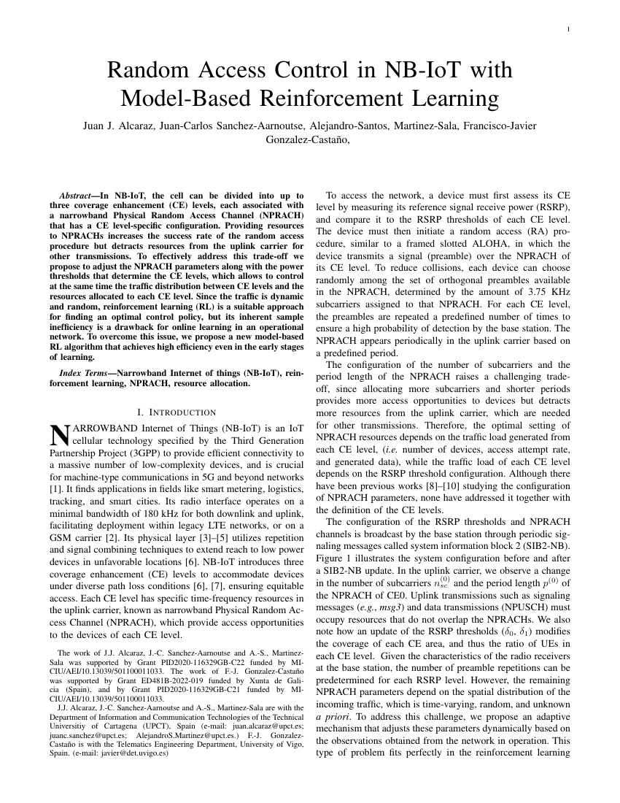

<!-- extraction_page_index: 2 -->

2
-114
-113
-112
-111
-110
-108
-106
-107
-100
-102
-104
-114
-113
-112
-111
-110
-108
-106
-107
-100
-102
-104
p(1), p(2)
p(0)
CE2
CE1
CE0
msg3 NPUSCH
δ0 = −108 dBm, δ1 = −113 dBm
CE area 0
CE area 1
CE area 2
22% 43%
35% 37% 18%44%
n(0)scn(2)sc
n(1)sc
time (subframes)frequency (subcarriers)
δ0 = −106 dBm, δ1 = −110 dBm
Uplink Carrier
Cell
coverage
area
User
distribution
per RSRP
values
n(0)sc = 24 sc, p(0) = 160 sfn(0)sc = 36 sc, p(0) = 80 sf
n(1)sc = n(2)sc = 24 sc, p(1) = p(2) = 160 sf n(1)sc = n(2)sc = 24 sc, p(1) = p(2) = 160 sf
NPRACH
Configuration
δ0 δ1 δ0 δ1
Configuration after SIB2-NB update:
Fig. 1: Example of the carrier and the CE coverage areas before and after a SIB2-NB update. The number of subcarriers (sc)
of NPRACH CE level 0 is rearranged from n(0)sc = 36 sc, to n(0)sc = 24 sc, and its period in subframes (sf) is updated from
p(0) = 80 sf to , p(0) = 160 sf. In addition, the RSRP thresholds are updated from δ0 = −106 dBm, δ1 = −110 dBm, to
δ0 = −108 dBm, δ1 = −113 dBm. As a consequence, the percentage of users in each CE area changes, as well as the number
of NPRACH preamble repetitions for CE0, according to the configuration rules described in Section IV.
(RL) domain. However, conventional RL algorithms, even
the most advanced ones, are very sample inefficient, which,
together with the need to explore the action space extensively,
result in poor network performance during the initial learning
stages, which can last from a few hours to several days. For
this reason, we propose a new model-based RL approach
that drastically improves sample efficiency and the initial
performance.
A. Related Works
In recent years, NB-IoT has attracted significant research
interest, with works focusing on the configuration and op-
timization of diverse system parameters and control mech-
anisms. This includes, for example, the allocation of time-
frequency resources to narrowband Physical Uplink Shared
Shannel (NPUSCH) transmissions, [11]–[14], the selection
(scheduling) of devices for downlink [15] or uplink [16]
transmissions, link-adaptation of NPUSCH transmissions [17],
[18], uplink scheduling in combination with link-adaptation
[19], and the configuration of the downlink signalling channel
NPDCCH [20], [21].
In this context, the analysis and configuration of the RA
procedure stands out as a particularly relevant area of study.
Previous works have analyzed the success probability of the
RA procedure [24], [25], and the estimation of the the number
of devices attempting to access the network (traffic load) [26],
[27]. A crucial aspect of RA is the configuration of NPRACH
resources because of the trade-off between increasing the RA
success rate and ensuring sufficient resources for NPUSCH
transmissions. This trade-off was studied in [8] and addressed
by a means of an analytical model in [9]. Other aspects
of NPRACH configuration were considered in [28], focused
on the optimization of preamble repetitions, and [29], which
proposed a heuristic approach for the adjustment of several
RA parameters including the number of NPRACH subcarriers
and the BO timer. The closest antecedent to our work is [10],
which proposes the use of RL to determine the NPRACH
subcarriers and periodicity for each CE level. Our work is
fundamentally different from this one for two reasons: first,
because we extend the scope of the problem by also consider-
ing the configuration of RSRP thresholds, and second, because
we propose a novel model-based approach to overcome the
inherent limitations of conventional RL algorithms in this

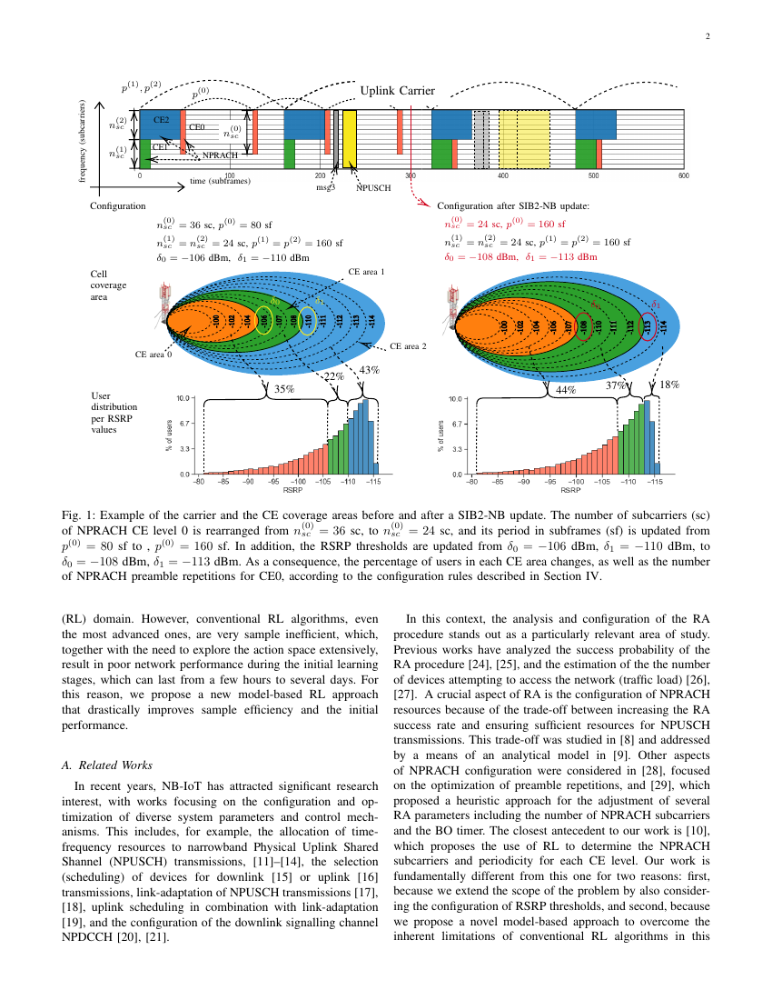

<!-- extraction_page_index: 3 -->

3
environment.
There are other precedents of the use of RL for controling
NB-IoT functionalities. For example, [30] employs a deep
RL algorithm (DDPG) for the configuration of access class
barring ACB, and [31] proposes the use of multiple agents for
controlling the backoff (BO), ACB, and distributed queueing
(DQ) mechanisms in parallel. RL has been used in [19] for
NPUSCH scheduling and link-adaptation, and has been also
used for random access in heterogeneous networks in [32],
and for dynamic multi-channel access, in [33]. As pointed out
in [10], RL algorithms need, in general, to be trained offline
in a simulator before deployment and, once deployed, real
network conditions can be very different from the simulation
environment, rendering control policies ineffective.
Our proposal is especially tailored to learn autonomously
once deployed in the network ( online learning ), a task that
state-of-the-art RL algorithms struggle to accomplish without
deteriorating the transmission delay during their initial stages
of learning, as verified by our numerical results in Section
IV. The reason is the low sample efficiency of model-free RL
(MFRL) algorithms. They need to explore multiple policies
before converging to an efficient one, which implies selecting
very ineffective actions during long periods. To overcome this
limitation, we leverage the higher sample efficiency of model-
based RL (MBRL) [35] with respect to MFRL.
This work is framed within a broader trend focused on
developing online learning algorithms to control network
functions. Previous works in this line have addressed resource
allocation for network slices [36], interference coordination
in LTE [38], energy saving for small cells, [39], and uplink
transmission control in NB-IoT [19].
B. Contributions
This is the first work focused on NPRACH configuration
together with the definition of CE levels in NB-IoT. Our
contributions are:
• We present and address problem of RA control in NB-
IoT, which is more general than previous ones as we aim
at maximizing the resource efficiency by controlling not
only the resources allocated to each NPRACH but also
the RSRP thresholds that determine the CE areas and thus
the incoming traffic at each NPRACH.
• We propose a new MBRL approach with a higher sample
efficiency compared to conventional MFRL schemes,
which makes our approach especially suitable for online
learning. Specifically, our proposal prevents the low per-
formance associated to the action space exploration in the
early stages of a learning episode.
• We develop a novel agent architecture that combines
modeling techniques historically used for network design
(queueing theory, combinatorial analysis, maximum like-
lihood estimation), and the learning and control capabil-
ities of RL, leveraging both approaches.
The rest of the paper is organized as follows: Section II
describes the NB-IoT mechanisms related to random access
and uplink transmission, and formulates the problem within
the RL framework. Section III details our novel model-based
proposal. Section IV explains our evaluation methodology,
describes the baselines with which we compare our proposal,
and presents the numerical results. Finally, Section V summa-
rizes our findings and points out future enhancements to our
proposal.
II. S YSTEM DESCRIPTION AND PROBLEM STATEMENT
A. System Description
The system under study consists of a base station serving
several thousands of NB-IoT devices. These devices must
complete a random access procedure, making use of the
NPRACH resources, a connection procedure and, once con-
nected, they must wait for the base station to send them an
uplink grant for a NPUSCH data tranmission. We consider one
carrier for each transmission direction (uplink and downlink)
with a bandwidth of 180 KHz and the time dimension divided
into frames comprising 10 subframes of 1 ms.
1) Coverage enhancement levels: As shown in Figure 1,
the coverage area of the eNB is divided into several zones
called coverage enhancement levels (CE levels) to address
the different radio conditions. Up to three CE levels can be
defined by the eNB through power thresholds according to
the requirements of the network. These thresholds ( δ0 and δ1)
are based on the values of the RSRP (reference signal receive
power). The RSRP value is computed at each UE by averaging
the power received over a specific set of resource elements in
the downlink carrier. The UE compares its measured RSRP
with the threshold levels to determine which CE level it
belongs to:
• If RSRP ≤ δ1, the UE belongs to CE level 2 (CE2)
• If δ1 < RSRP ≤ δ0, the UE belongs to CE level 1 (CE1)
• If δ0 < RSRP, the UE belongs to CE level 0 (CE0)
2) Random access through the NPRACH: The NB-IoT
carrier contains an NPRACH for each CE level. To request
access to the network, a UE initiates a RA procedure by
transmitting a specific signal through the NPRACH of its
CE level. This signal, known as preamble, must be repeated
a number of times in order to guarantee a high detection
probability. The number of repetitions depends on the CE level
and is specified by a NPRACH parameter n(i)rep, for i = 0, 1, 2.
The subcarrier spacing used in NPRACH is 3.75 kHz, leading
to 48 subcarriers over the 180 kHz of an uplink carrier. An
NPRACH can be configured to use 12, 24, 36 or 48 contiguous
subcarriers. The number of NPRACH subcarriers for CE level
i is denoted by n(i)sc . Each NPRACH subcarrier is associated
to a specific preamble, which is orthogonal to all the other
preambles, such that devices selecting a different preambles do
not collide. The larger n(i)sc , the more preambles can be used
by the UEs of CE level i, hence reducing the probability of
collisions in this CE level. The NPRACH of each CE appears
periodically in the carrier with a period p(i) of 40, 80, 160,
320, 640, 1280, or 2560 subframes. For each CE level, p(i)
and n(i)sc should be determined according to the UE access
attempt rate ( arrival rate) in this CE level, while n(i)rep should
be configured according to the worst-case pathloss in the CE
level.

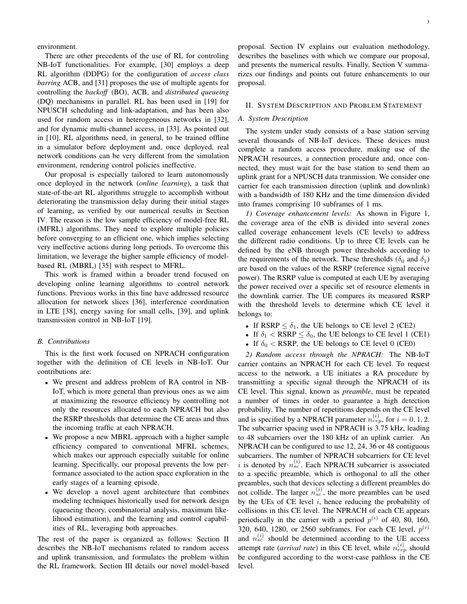

<!-- extraction_page_index: 4 -->

4
3) Connection establishment: After detecting the pream-
bles, the eNB sends a RAR (random access response) message,
called msg2, to the devices whose preambles have been
detected. The UEs that have transmitted a preamble, expect to
receive this msg2 within a RAR window, otherwise they will
start a new RA procedure. The msg2 identifies the preamble
and contains an uplink grant for the UE response, the msg3.
The uplink carrier bandwidth not reserved for NPRACH
is divided into 12 subcarriers of 15 kHz. Thus the uplink
grant allocates a specific set of subframes and subcarriers
in the uplink carrier for the msg3 transmission, avoiding
any overlap with other transmissions, and specifies the link-
adaptation parameters (modulation and coding scheme, and
repetitions) for the transmission. If the msg3 is received, the
eNB sets the device to connected state. Otherwise, the eNB can
schedule an msg3 retransmission. The base station can detect
preamble collisions on the NPRACH [26], or as corrupted
msg3 responses [8], [40].
4) Data transmission over the NPUSCH: Once connected,
a UE waits for an uplink grant from the eNB allowing a
NPUSCH data transmission in the uplink carrier. The UE will
transmit a transport block over the allocated resources with the
prescribed link-adaptation configuration. Then, the device can
receive either an ACK, if the packet was decoded, or another
uplink grant for an HARQ retransmission, if the packet was not
decoded. After receiving an ACK for the transmitted packet,
the device disconnects from the base station.
5) Signaling channels: The NPBCH (narrowband Physical
Broadcast Channel) is the first to be decoded by the UEs before
initiating a RA procedure. The NPBCH carriers essential
information like the SIB2-NB holding the RSRP thresholds
and the NPRACH configuration. The SIB2-NB is regularly
transmitted based on a predefined update period.
The base station uses the NPDCCH (narrowband Physical
Downlink Control Channel) to transmit control messages to
the UEs that have initiated an RA procedure or are already
connected to the network. NPDCCHs appear periodically on
the downlink carrier. The number of subframes and the period
of the NPDCCH are system parameters. Control information,
such as the msg2 or msg4 messages, is carried in a logical
block called downlink control information (DCI). DCIs are
repeated a number of times depending on the pathloss or CE
level of the destination device.
B. Problem description
We consider a base station that automatically configures the
parameters that regulate random access in NB-IoT: the RSRP
thresholds (δ0, δ1), and the NPRACH parameters n(i)sc , and p(i)
for i = 0, 1, 2. This information is updated and broadcast to the
devices in the periodically transmitted SIB2-NBs. Therefore,
between consecutive updates, the base station must observe
the evolution of relevant system variables ( e.g., number of
detected preambles, number of collisions) and select the most
suitable configuration for the upcoming update, in order to
maximize the number of devices that complete their NPUSCH
transmission ( departures). The station must learn the control
policy autonomously by interacting with the network.
When configuring the NPRACH parameters we face a
fundamental trade-off: Assigning more resources to NPRACH
channels increases the preamble detection rate, but reduces
the available resources for msg3 and NPUSCH transmissions.
Choking the msg3 transmission rate limits the UE throughput,
and insufficient resources for NPUSCH lead to an unbounded
increase in delay, and even to stuck NPUSCH transmissions
when it is not possible to fit them in the carrier.
The preamble repetitions n(i)rep in the NPRACH of each CE
level i, can be pre-configured based on offline experimental
measurements, i.e. for a given pair of threshold values δ =
(δ0, δ1), the value of n(i)rep is determined by the largest loss in
CE level i and the desired preamble detection probability (see
Section IV for further details). The link-adaptation parameters
for msg3 transmissions in each CE level can be determined
similarly.
Therefore, we see that the selection of δ is highly inter-
twined with the NPRACH configuration: first, it determines
the incoming traffic load for each NPRACH, and second, it
affects the amount of time-frequency resources consumed by
NPRACHs and msg3 messages. To properly configure δ, the
control agent should consider how the devices are distributed
among the possible RSRP levels.
Summarizing, the control problem addressed consists of
determining, for each SIB2-NB update period, the RSRP
thresholds (δ0, δ1) and the NPRACH parameters, n(i)sc and p(i)
for i = 0 , 1, 2, maximizing the UE throughput in terms of
successful NPUSCH transmissions (departures) per second.
Both the incoming traffic intensity and the distribution of users
are random and unknown a priori to the base station; therefore,
the configuration policy of these parameters must be learned
online by the control algorithm. In this work we explore two
RL approaches to this problem: MFRL, and a new MBRL
scheme, which we evaluate and compare to existing state-of-
the-art proposals.
C. Reinforcement Learning Elements
In this subsection we present the elements common to both
RL approaches: the objective function, the observation of the
system, and the selected action.
Reinforcement Learning (RL) is a type of machine learning
algorithm where an agent learns to make decisions by inter-
acting with the environment. The agent’s goal is to maximize
the expected value of a cumulative reward, which is the sum
of rewards received over time. At each time step t, the agent
observes the current state St of the environment and selects
a control action At which is applied to the environment. As
a result of this action, the agent receives a reward Rt+1 and
the environment transitions to a new state St+1. The agent’s
objective is to learn a policy π, which is a mapping from
states to actions, such that the expected value of the sum
of discounted rewards (return) is maximized. The discount
factor γ ∈ [0, 1] controls the importance of future rewards.
The expected value of the return from t is given by:
E[Rt + γRt+1 + γ2Rt+2 + . . .] = E
" ∞X
i=0
γiRt+i
#
(1)

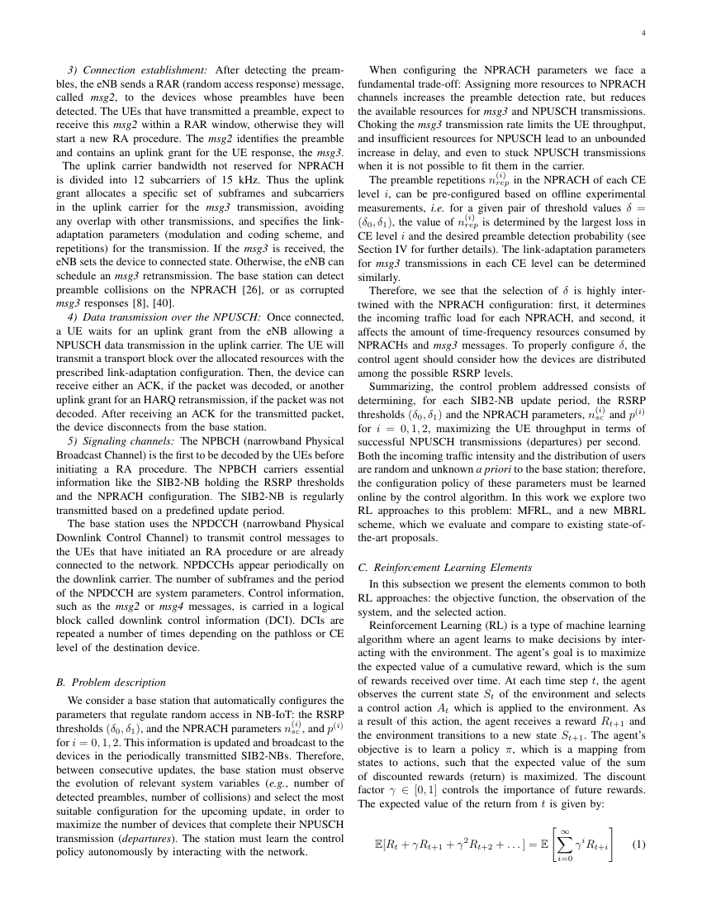

<!-- extraction_page_index: 5 -->

5
Variable Meaning
n(i)sc number of subcarriers allocated to NPRACH for CE level i
p(i) NPRACH periodicity in ms for CE level i
c(i) NPRACH configuration for CE level i: c(i) = (n(i)sc , p(i))
δ0, δ1 RSRP threshold levels for CE levels 0 and 1 respectively
δ a specific RSRP threshold configuration δ = (δ0, δ1)
∆ set of RSRP threshold configurations
l1, . . . , lL Possible RSRP thresholds levels
h(lk) estimated fraction of devices whose RSRPs lie within the range (lk−1, lk)
h(i)(δ) fraction of UEs belonging to CE level i given δ
e(i)(δ) msg3 reception probability for CE level i given δ
λ(i) arrival rate for CE level i UEs
bλ overall estimated arrival rate
β adjustment factor for the estimated arrival rate
µ(i)(n(i)sc , p(i), δ) maximum NPRACH detection rate in CE level i ˆA·
n(i)sf (δ) number of subframes of the NPRACH for CE level i
r(i)(n(i)sc , p(i), δ) ratio of resources consumed by the RA of CE level i
Pn(d, c, nsc) Probabilty of observing d non-colliding preambles when n UEs chose among nsc preambles
A⋆(d, c, nsc) lookup table mapping ( d, c, nsc) tuples to estimated UE access attempts in a NPRACH
m(i)max maximum msg3 transmissions for CE level i per NPRACH period
pDCCH NPDCCH period in subframes
wRAR ResponseWindowSize parameter in NPDCCH periods
n(i)RU number of RUs of a msg3 for CE level i
n(i)DCI number of DCI repetitions for CE level i
w(i)RU RUs per RAR window for CE level i
w(i)DCI DCIs per RAR window for CE level i
D⋆(i, n(i)sc , p(i), δ) lookup table mapping (i, n(i)sc , p(i), δ) tuples to the expected number of UEs detected per NPRACH in CE i
c⋆i (δ, βbλ) best possible NPRACH configuration for CE level i at a given δ and βbλ
(βbλ)i elements of a finite set of evenly spaced values of βbλ
C⋆ lookup table mapping (βbλ)i values to the optimal configuration of δ and NPRACH parameters
TABLE I: Definitions of variables used in the paper.
where the expectation is taken over the probabilities of the
trajectories (sequences of state-action pairs) determined by π.
In our environment, the time steps t = 0 , 1, 2, . . .are the
instants when the agent makes a configuration decision ( i.e.
the SIB2 updates).
Action: At contains the RSRP thresholds for CE0 and CE1
(δ0, and δ1) and the NPRACH configuration parameters for
CE0 ( n(0)sc , p(0)), CE1 ( n(1)sc , p(1)), and CE2 ( n(2)sc , p(2)).
Observation: St contains a selection of the observable
variables of the system that can be useful for an agent to
configure the RSRP levels and the NPRACHs:
• For each CE, average preamble detections and average
preamble collisions per NPRACH.
• For each CE, the ratio between received msg3 messages
and preamble detections.
• The ratio of carrier resources devoted to RA.
• The ratio of non-RA carrier resources occupied by
NPUSCH transmissions.
• Total number of connected UEs.
• Estimation of the RSRP distribution, h.
To simplify notation, let h(lk) for k = 1, . . . L+ 1 denote
the ratio of UEs whose reported RSRPs lie within the interval
(lk−1, lk], where l0 and lL+1 are two auxiliary levels corre-
sponding to −∞ and +∞ respectively. The update of h can be
efficiently performed with an incremental update, as follows:
h(lk) = k(lk) + 1n (I{RSRPn∈(lk−1,lk]} − h(lk)) (2)
for k = 1, . . . , L+ 1, where n is a counter of connected UEs,
and I{RSRPn∈(lk−1,lk]} is an indicator function that equals 1 if
the RSRP of the n-th UE lies within (lk−1, lk], and equals 0
otherwise.
Reward: Rt simply indicates the number of NPUSCH
successfully transmitted during the last SIB2 update period.
III. M ODEL -BASED APPROACH
A. Design Principles of the Model
Our model divides the system into four sub-systems: three
access sub-systems, each one corresponding to the NPRACH
preamble detection of each CE level, and one NPUSCH
transmission sub-system. As shown in Figure 2, the RSRP
thresholds (δ0, δ1) determine the arrival rate ( λ(0), λ(1), λ(2))
to each access sub-system, and the NPRACH parameters n(i)sc ,
p(i), determine the service rate of sub-system i (µ(i)), referred
to as access rate for CE i, since it expresses the rate of UEs
successfully accessing the system ( i.e. establishing a connec-
tion). These three UE flows merge back into the NPUSCH
transmission sub-system, where each connected UEs waits
for an uplink grant that schedules its NPUSCH transmission
within the resources available on the uplink carrier. The
critical aspect is that all 4 subsystems share the same time-
frequency resources in the uplink carrier.
Considering the above model, our proposal estimates the UE
arrival rate and the access rates of each CE level to configure
each NPRACH as efficiently as possible. The higher the

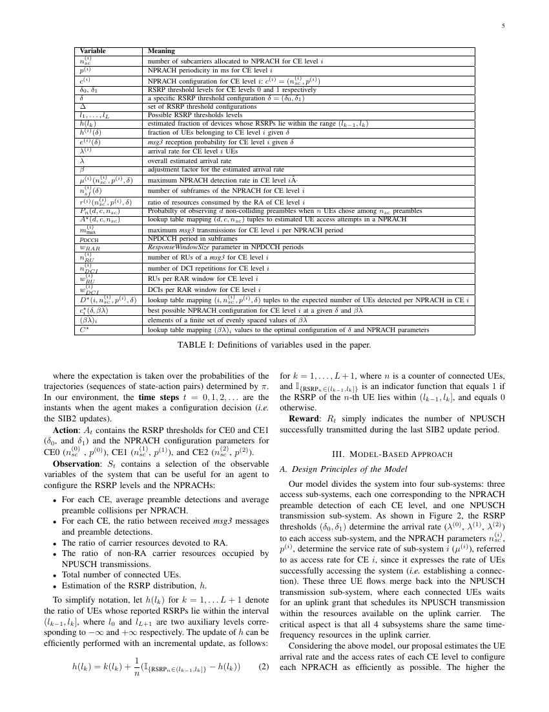

<!-- extraction_page_index: 6 -->

6
δ1δ0
λ(0) λ(1) λ(2)
µ(0)
n(0)sc
p(0) µ(1)
n(1)sc
p(1) µ(2)
n(2)sc
p(2)
UEs waiting
for a NPUSCH
uplink grant
Fig. 2: Queueing model of the four sub-systems sharing the
time-frequency resources of the uplink carrier. The controlled
parameters are the RSRP thresholds (δ0, δ1) and the NPRACH
configuration for each CE level ( n(i)sc , p(i), for i = 0, 1, 2).
efficiency, the more radio resources are available for NPUSCH
transmissions.
Let A(i)(t) be the number of CE level i UEs that have
attempted to access the system up to instant t. We define the
arrival rate at CE level i as
λ(i) = lim
t→∞
A(i)(t)
t (3)
And let D(i)(t) be the number of UEs that have gained
access to the system up to instant t. We define the access rate
for CE level i as
µ(i) = lim
t→∞
D(i)(t)
t (4)
Assuming that the system has sufficient capacity, the con-
figuration of the NPRACH resources must guarantee that all
UEs trying to access the system succeed. In other words, in
terms of queuing theory, we must guarantee that
µ(i) > λ(i) for i = 0, 1, 2 (5)
These quantities are determined by the control variables δ
and c(i) for i = 0, 1, 2. When the sub-system operates under
condition (5) we say that it is stable. Ensuring stability involves
several difficulties. For example, λ(i) must be estimated from
incomplete observations (e.g., detections and collisions in each
NPRACH) and during a limited observation time (the SIB2 pe-
riod). Likewise, the estimation of µ(i) requires simplifications
that may entail additional inaccuracies.
Since δ distributes the arrivals among the sub-systems,
we use bλ(i)(δ) to refer to the estimated λ(i) for a given δ.
This estimate depends on the observation St, which we omit
for the sake of clarity. To estimate µ(i) we use a function
µ(i)(n(i)sc , p(i), δ), detailed in the next subsection, that takes
δ and the NPRACH configuration parameters ( n(i)sc , p(i)) as
inputs. Considering the estimated variables, we replace the
normalization condition (5) by the following one
µ(i)(n(i)sc , p(i), δ) ≥ βbλ(i)(δ) for i = 0, 1, 2 (6)
where β >1 is a configurable parameter with three interpreta-
tions: First, β acts as an additional slack factor for the access
rate with respect to the estimated arrival rate, compensating
for inaccuracies in the estimates that may result in under-
provisioning of resources and thus instability. Second, 1/β
acts as an upper bound on the load of each access sub-system,
i.e.:
1
β ≥
bλ(i)(δ)
µ(i)(n(i)sc , p(i), δ) ≈ ρ(i) for i = 0, 1, 2 (7)
Consequently, if each sub-system operates with ρ(i) close to
this upper bound, a properly tuned β should attain the optimal
balance between delay reduction (small ρ(i)) and low resource
occupation (large ρ(i)). And third, a far-sighted agent ( e.g.,
an RL agent), and thus capable of anticipating increments
or decrements of the UE arrival intensity, can reflect this
forecast in β allowing the system to adjust its access rate to the
expected arrivals during the upcoming SIB2 period. Figure 3
summarizes the general structure of our model-based proposal.
-114
-113
-112
-111
-110
-108
-106
-107
-100
-102
-104
Rt
n(0)sc
p(0)
n(1)sc
n(2)sc
p(1) p(2) δ1δ0
ˆλ
δ0, δ1
n(0)sc , p(0)
n(1)sc , p(1)
n(2)sc , p(2)
Model
RL Agent
β
System
St
At
(a)(b)
(a): arrival rate estimation
(b): configuration problem (8)
Fig. 3: Diagram of the proposed model-based control archi-
tecture, where the RL agent determines the parameter β of the
model.

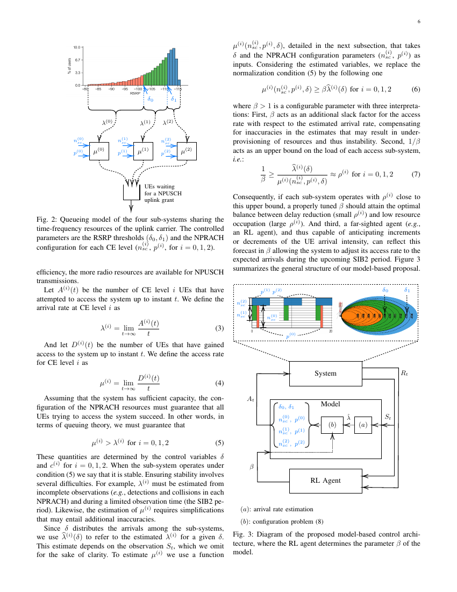

<!-- extraction_page_index: 7 -->

7
The configuration problem consists of guaranteeing the
access of as many incoming UEs as possible, while assigning
the minimum amount of time-frequency resources from the
carrier to NPRACHs. Defining the function r(i)(n(i)sc , p(i), δ)
as the ratio of resources consumed by the access sub-system
i, we can formulate the configuration problem as follows:
minimize
2X
i=0
r(i)(n(i)sc , p(i), δ)
subject to µ(i)(n(i)sc , p(i), δ) ≥ βbλ(i)(δ), for i = 0, 1, 2.
(8)
where the optimization variables are δ, and ( n(i)sc , p(i)) for
i = 0, 1, 2.
B. Elements of the Model
1) Estimation of the incoming traffic λ(i)(δ): The estima-
tion of the incoming traffic relies on a result from [26], which
provides the following recursive expression for estimating the
probability of d preambles being selected by exaclty one UE,
and c preambles being selected by two or more UEs, when n
UEs choose among r preambles:
Pn(d, c, r) = r − (d − 1 + c)r Pn−1(d − 1, c, r)
+ d + 1r Pn−1(d + 1, c− 1, r) + cr Pn−1(d, c, r), (9)
where, P0(0, 0, r) = 1 , and Pn(d, c, r) = 0 if (d, c) /∈ Rn,
defined as Rn = {(d, c) ∈ N0 × N0|d + c ≤ r; d + αc =
n, α≥ 2}. During the SIB2 update period, i.e. between two
configuration stages, the controller observes the outcomes of
N (i) NPRACH instances for CE level i, consisting on the
number of detected ( d(i)τ ) and collided ( c(i)τ ) preambles for
τ = 1 , . . . , N(i). For each NPRACH instance we can use a
maximum likelihood estimator (see [26]) of the arrivals:
ba(i)τ = arg maxn Pn(d(i)τ , c(i)τ , n(i)sc ). (10)
and obtain the estimation of the arrival rates (in arrivals per
subframe) during the last observation period as
bλ(i) = 1N (i)
N (i)X
τ =1
ba(i)τ
p(i) , for i = 0, 1, 2 (11)
The aggregate arrival rate estimation is thenbλ = Pi=0,1,2 bλ(i),
which allows us to estimate the arrival rates at each CE for a
given δ:
bλ(i)(δ) = bλh(i)(δ), for i = 0, 1, 2 (12)
where h(i)(δ) represents the fraction of users belonging to CE
level i, and is obtained from the estimated RSRP distribution
h as follows:
h(i)(δ) = X
k∈Li(δ)
h(lk), for i = 0, 1, 2 (13)
where Li(δ) denotes the set of RSRP intervals in CE level i:
L0(δ) = {k : δ0 < lk} (14)
L1(δ) = {k : δ1 < lk ≤ δ0} (15)
L2(δ) = {k : lk ≤ δ1} (16)
Efficient implementation: In terms of computational over-
head, the critial part of the above procedure is the estimation
of ba(i)τ at each NPRACH period with (10), given the values of
d(i)τ , c(i)τ , and n(i)sc . Note that n(i)sc can only take values from
a very small set ( e.g., n(i)sc ∈ {12, 24, 36, 48} = Nsc for a
single carrier system), and the pair ( d(i)τ , c(i)τ ) can only take
values from the set {(d(i)τ , c(i)τ ) ∈ N0 × N0 : d(i)τ + c(i)τ ≤ n(i)sc }
containing (n(i)sc + 1)n(i)sc /2 elements. Therefore, it is feasible
to pre-compute the estimator (10) offline for all the possible
combinations of d(i)τ , c(i)τ , and n(i)sc , and store them in a
lookup table ( A⋆), such that ba(i)τ = A⋆(d(i)τ , c(i)τ , n(i)sc ), thus
trading computational effort for memory storage. The memory
requirement for this A⋆ is
|A⋆| = 12 X
n(i)sc ∈Nsc

n(i)sc + 1 n(i)sc (17)
During online operation, the model only needs the computation
of bλ(i) (11), bounded by the maximum number of NPRACH
periods within a SIB2 period ( Nmax), and h(i)(δ) (13),
bounded by the number of RSRP threshold values K. The
resulting computational complexity is then O(3Nmax + K).
Section IV provides specific values for the memory and the
computation requirements in a realistic scenario.
2) Estimation of the access rate µ: To estimate the maxi-
mum number of UE access detections per NPRACH we need
to consider, for each CE, the maximum number of msg3
messages, m(i)max, that can be allocated within the RAR window
before the start of the next NPRACH resource of this CE.
Thus we need to consider the length of the RAR window and
the NPRACH period for each CE. The duration of the RAR
window is determined by the ResponseWindowSize parameter
(wRAR), given in NPDCCH periods. Between two consecutive
NPRACH resources, there are up to p(i)−n(i)sf (δ)−4 subframes
available for msg3 transmissions, where n(i)sf (δ) denotes the
number of subframes of the NPRACH from which we must
subtract a guard time interval of 4 subframes. Therefore the
available number of NPDCCH periods for RAR signaling in
CE level i is:
w(i)RAR = max
 $
p(i) − n(i)sf (δ) − 4
pDCCH
%
, wRAR
!
(18)
where pDCCH denotes the NPDCCH period length in sub-
frames. We must determine the available capacity in DCIs
for sending msg2 messages, and the available capacity in
subframes of the uplink carrier for sending msg3 messages.
Denoting by nDCI the number of DCIs that fit into each
NPDCCH, there are w(i)DCI = nDCIw(i)RAR DCIs, and w(i)RU =
pDCCHw(i)RAR subframes per NPRACH period. For CE level i,
the number of DCI repetitions for msg2 is denoted by n(i)DCI,
and the number of RUs of a msg3 is denoted by n(i)RU , thus
the limit m(i)max imposed by the RAR window capacity is given
by
m(i)max = min
 $
w(i)RU
n(i)RU
%
,
$
w(i)DCI
n(i)DCI
%!
(19)

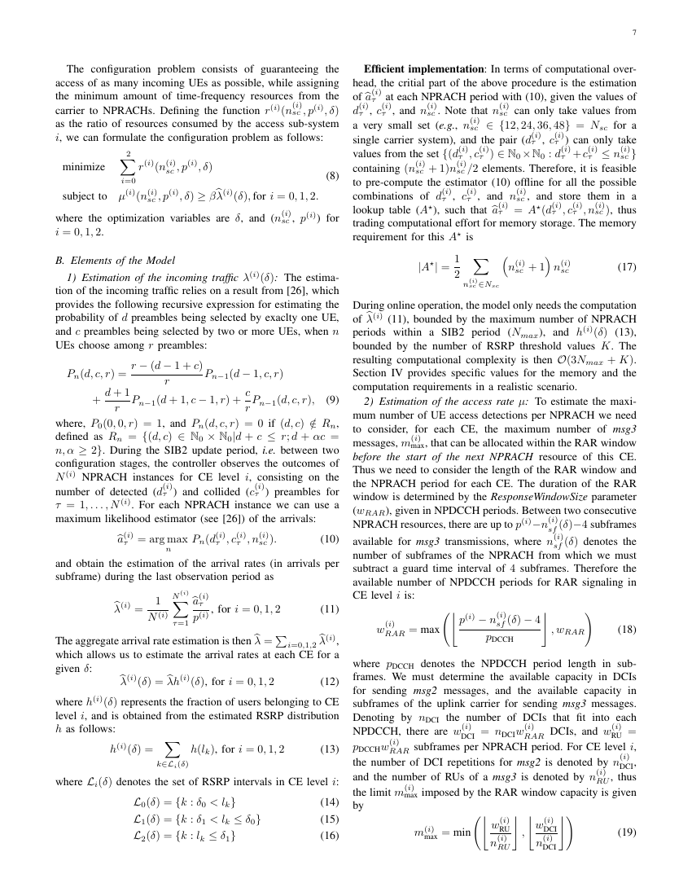

<!-- extraction_page_index: 8 -->

8
where the dependency on p(i) and δ is omitted for the sake of
clarity.
The maximum expected number of UEs gaining access per
NPRACH period in CE level i is given by:
d⋆i (n(i)sc , p(i), δ) = maxn
n(i)scX
d=1
min(d, m(i)max)Pn(d, n(i)sc ) (20)
where Pn(d, n(i)sc ) denotes the probability of d preamble de-
tections when n UEs choose among n(i)sc preambles, given by
the marginal distribution of (9) over collisions:
Pn(d, n(i)sc ) =
n−dX
c=0
Pn(d, c, n(i)sc ) (21)
The access rate function is defined as follows
µ(i)(n(i)sc , p(i), δ) = d⋆i (n(i)sc , p(i), δ)p(i) e(i)(δ) (22)
where e(i)(δ) denotes the msg3 detection efficiency. To
estimate e(i)(δ), let us define e(i)k (δ) as the pre-estimated
detection probability of a msg3 from a device in the k-th RSRP
interval, using the msg3 configuration determined by δ for CE
level i. Then, the expected detection rate for users in CE level
i can be estimated with h:
e(i)(δ) =
P
k∈Li(δ) e(i)k (δ)h(lk)
h(i)(δ) , for i = 0, 1, 2 (23)
with Li(δ) given by (14, 15, 16).
Efficient implementation : Obtaining d⋆i (n(i)sc , p(i), δ) (20)
is the critical step in terms in computational complexity.
Similarly to previous subsection, we define a lookup table
D⋆ storing the pre-computed values of d⋆i for all the possible
combinations of i, n(i)sc , p(i), and δ. The set ∆ denotes the
possible values of δ. For K RSRP threshold values, we
have |∆| = (K+1)K2 . Therefore, the memory requirement for
D⋆ is O(3|∆|Nc), where Nc denotes the possible NPRACH
configurations ( n(i)sc , p(i)). During online operation, the only
required computation is e(i)(δ) (23), bounded by the number
of RSRP threshold values K. Section IV provides a numerical
estimation of these requirements.
3) Estimation of the resource occupation r(i): The resource
occupation function r(i) provides the ratio between resources
devoted to RA (NPRACH and msg3 transmissions) for CE i,
and the total uplink carrier resources. Given δ, n(i)sc and p(i),
the NPRACH occupies n(i)sf (δ)n(i)sc time-frequency resources
out of the 48p(i) resources available during a NPRACH period
lasting p(i) subframes. During that period, msg3 messages are
transmitted at the access rate µ(i)(n(i)sc , p(i), δ), in messages per
subframe, consuming n(i)RU (δ) resources, which is equivalent to
one subframe in terms of time-frequency resources. Therefore
we have:
r(i)(n(i)sc , p(i), δ) = n(i)sf (δ)n(i)sc48p(i) + µ(i)(n(i)sc , p(i), δ)n(i)RU (δ)
(24)
C. Efficient Solution Strategy
For a given δ, the configuration problem (8) is separable
into 3 sub-problems defined as:
minimize
c(i)
r(i)(c(i), δ)
subject to µ(i)(c(i), δ) ≥ βbλh(i)(δ) (25)
for i = 0 , 1, 2, where c(i) = ( n(i)sc , p(i)) represents the
NPRACH configuration for CE i. There exists a solution to
(25) provided the following condition holds:
βbλh(i)(δ) ≤ µ(i)max(δ) (26)
where µ(i)max(δ) denotes the maximum achievable access rate
for CE i given δ. Note that h(i)(δ) represents the fraction
of incoming traffic going to sub-system i given the RSRP
thresholds defined by δ. Therefore, (26) implies that there
exists a stable configuration for sub-system i. Let ∆f (βbλ)
denote the subset of δ values in ∆ fulfilling (26) for i = 0, 1, 2
When the feasibility condition (26) holds, we define
c⋆i (δ, βbλ) as the solution of (25) for a given δ and βbλ.
Otherwise, c⋆i (δ, βbλ) equals the rate maximizing configuration
(i.e. µ(i)c⋆i (δ, βbλ), δ = µ(i)max(δ)).
The optimal δ is given by
minimize
δ∈∆f (βbλ)
" 2X
i=0
r(i)c⋆i (δ, βbλ), δ
#
(27)
If one or more sub-systems do not fulfill the feasibility
condition (26), i.e. if ∆f (βbλ) = ∅, the system is considered to
be under heavy incoming traffic. Then, the objective becomes
to bring the access and the arrival rates as close as possible:
minimize
δ
" 2X
i=0

µ(i)c⋆i (δ, βbλ), δ − βbλh(i)(δ)2
#
(28)
Because of the low mobility of NB-IoT devices, we can
expect negligible variations on the RSRP distribution estima-
tion h after a sufficient amount of samples. To allow for a
more efficient implementation of the configuration problem,
we leverage the fact that, once h is stabilized, the only variable
factor is the product βbλ. Thus, instead of solving (27, 28) at
each decision step, it is much more computationally efficient to
define a lookup table C ⋆ mapping a set of pre-defined values
of βbλ, denoted by (βbλ)0, (βbλ)1, . . ., to optimal configurations.
These (βbλ)j values are evenly spaced, ranging fromβminbλmin
to βmaxbλmax, where (βmin, βmax) and (bλmin, bλmax) denote
the extreme ranges for β and bλ respectively. At each decision
stage, βbλ is approximated by its nearest value (βbλ)j, and is
used to retrieve the optimal configuration if it was already
computed from a previous stage. If not, it is computed using
the previously described procedure and stored for later reuse.
The memory requirement for C ⋆ is limited to the number of
βbλ values defined.
D. Model-Based Configuration
The model-based selection of configuration operates in two
phases. The first one, summarized in Algorithm 1, corresponds
to the initialization of the estimated distribution h. During this

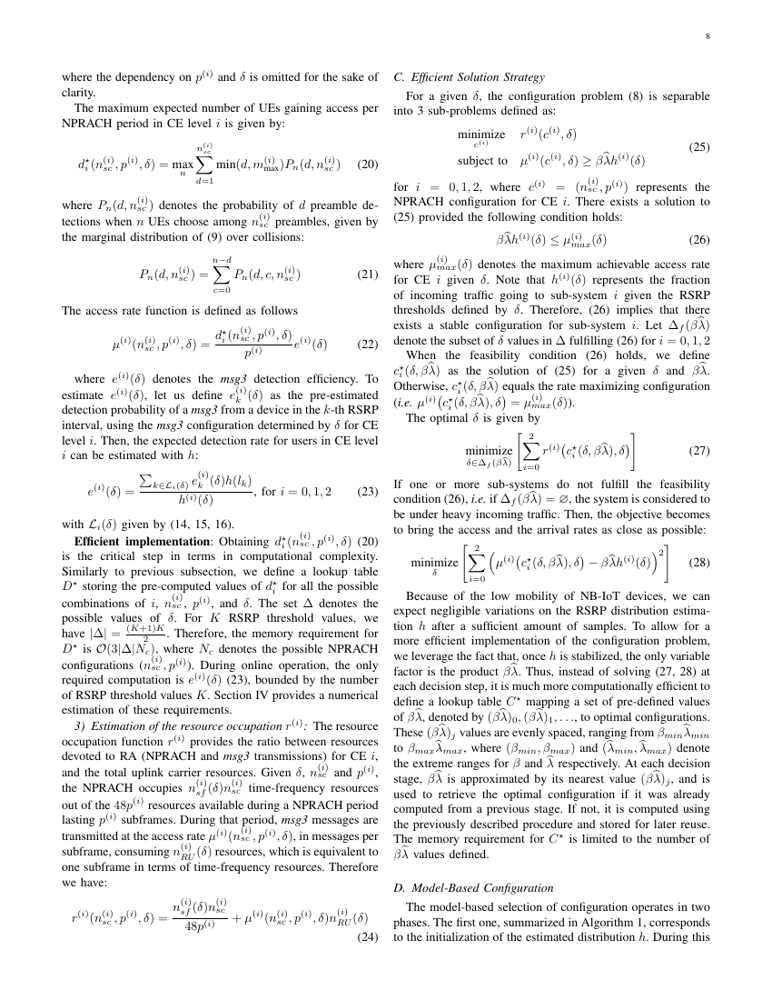

<!-- extraction_page_index: 9 -->

9
phase, the model operates with a predefined δ configuration,
and obtains the NPRACH parameters by solving (27) for
the given δ. The initialization phase ends when h has been
updated with at least ninit RSRP samples. The variable βt
refers to the value of the controlled parameter β generated
by the control agent at time t. After the initialization phase,
the model operates according to Algorithm 2.
Algorithm 1 Model initialization
1: Inputs: δ, nmax, lookup tables A⋆, D⋆
2: n = 0 ▷ arrivals counter
3: while n < ninit do
4: for t = 1, 2, . . .do
5: Receive observation St and control variable βt.
6: Update n and h
7: Estimate bλ with A⋆ and (11)
8: Obtain (c⋆0, c⋆1, c⋆2) by solving (25) for βtbλ
9: return (δ, c⋆0, c⋆1, c⋆2)
10: end for
11: end while
Algorithm 2 Model-based configuration selection
1: Inputs: h, lookup tables A⋆, D⋆, and C ⋆ (empty)
2: for t = 1, 2, . . .do
3: Receive observation St and control variable βt.
4: Estimate bλ with A⋆ and (11)
5: Find (βbλ)j closest to βtbλ
6: if (βbλ)j in C ⋆ then
7: (δ⋆, c⋆0, c⋆1, c⋆2) ← C ⋆[(βbλ)j] ▷ retrieve
8: else
9: if ∆f (βbλ) ̸= ∅ then
10: Obtain (δ⋆, c⋆0, c⋆1, c⋆2) by solving (25, 27)
11: else
12: Obtain (δ⋆, c⋆0, c⋆1, c⋆2) by solving (25, 28)
13: end if
14: C ⋆[(βbλ)j] ← (δ⋆, c⋆0, c⋆1, c⋆2) ▷ store
15: end if
16: return (δ⋆, c⋆0, c⋆1, c⋆2)
17: end for
Computational complexity Finding the optimal config-
uration for a given (βbλ)j value, requires solving (25) for
each δ ∈ ∆. In the worst case, this implies evaluating the
access rate of all the configurations in D⋆. Therefore, the
worst case complexity of finding an optimal configuration is
O(|D⋆|) = O(3|∆|Nc|), the first time this (βbλ)j value is
encountered, and just 1 query to C ⋆ afterwards. As discussed
in Section III-B1, the computational complexity of estimating
the incoming traffic at each decision stage is O(3Nmax + K),
which is the only computational overhead required by the
model during online operation once C ⋆ is completed.
IV. E VALUATION
A. Methodology
1) Simulation Environment: The proposal was evaluated us-
ing an NB-IoT simulation environment, created using Python1,
The main elements of the simulator are: 1) a population of
devices randomly distributed in an hexagonal cell, attempting
to access the system for transmitting their data packets, 2)
a base station, located in one edge of the hexagonal cell,
that manages the access procedure and arranges transmission
opportunities for the devices, 3) one uplink carrier, and 4) the
channel models for NPRACH and NPUSCH transmissions.
Devices are idle until they become active according to
a probabilistic traffic model. In particular, we use the two
mMTC traffic models defined in 3GPP TR 37.868 [41]. Traffic
model 1 considers time periods of T = 60 seconds over which
each device attempts to access the network with a uniform
probability. Traffic model 2 defines shorter periods of time
T = 10 seconds, such that the number of users becoming
active during a time interval defined by t1 < t2 ≤ T is given
by
arrivals = N
Z t2
t1
p(t)dt (29)
where N is the number of (model 2) devices in the cell, and
p(t) is the Beta distribution given by:
p(t) = ta−1(T − t)b−1
T a+b−1B(a, b) (30)
where a >0, b >0 and B(a, b) is the Beta function.
We define two scenarios according to the traffic:
1) uniform, in which all users follow traffic model 1.
2) mixed, where UE traffic is split between model 1 and
model 2 with equal probability
The environment employs the propagation conditions and
antenna patterns outlined in sections 4.2 and 4.5 of 3GPP
TR 36.942 [42], respectively. It incorporates a block fading
model in which a channel realization remains constant for
each (NPRACH or NPUSCH) transmission and varies in-
dependently from one transmission to the next, following a
lognormal shadow fading model with a standard deviation of
σ = 8 dB. The identification of a preamble sequence relies
on the probability model provided by [43], and the detection
of NPUSCH transmissions employs the block error rate tables
provided in [44] for each link-adaptation parameter setting.
The control agent selects the RSRP thresholds ( δ0 δ1), and
the NPRACH parameters ( p(i) and n(i)sc for i = 0, 1, 2). The
values of these controlled parameters are shown in Table II.
The number of repetitions, for CE level 2, is set to n(2)rep = 8,
and for CE levels i = 0, 1 n(i)rep is determined by δi as shown
in Table III.
These values provided a detection probability higher than
0.98 in our environment. Similarly, the link-adaptation param-
eters for msg3 tansmissions in CE level i are predetermined
1The simulator’s code, the proposed algorithm, and the scripts needed for
experiment replication can be found at https://github.com/jjalcaraz-upct/nb-
iot-environment

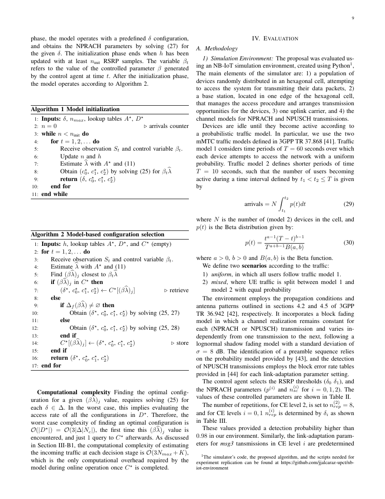

<!-- extraction_page_index: 10 -->

10
Parameter (Unit) Values
δi (dBm) −115, −114, −113, −112, −110, −109,
−108, −106, −104, −102, −100, −98,
−96
p(i) (ms) 80, 160, 240, 320, 640, 1280
n(i)sc (preambles) 12, 24, 36, 48
TABLE II: Possible values of the controlled parameters.
Range n(i)rep
δi ≤ −115 8
−115 < δi ≤ −112 4
−112 < δi ≤ −108 2
−108 < δi 1
TABLE III: Preamble repetitions for CE level i given δi.
according to the δi configuration. In particular, each msg3
transmission uses one resource unit and QPSK modulation in
all CE levels, and differs in the number of repetitions. For CE
level 2, this number is set to 16, and for CE levels 1 and 0
the msg3 repetitions are given by Table IV.
Range msg3 repetitions
δi ≤ −113 16
−113 < δi ≤ −108 8
−108 < δi ≤ −104 4
−104 < δi ≤ −101 2
−101 < δi 1
TABLE IV: msg3 repetitions for CE level i given δi.
The backoff time is set to 1024 ms or to 4096 ms, depending
on the NPRACH periodicity. The remaining parameters are
configured according to Table V. The configuration of these
parameters is usual, and we can find similar values in previous
works [10], [19], [20], [45]
Parameter Value
Device transmission power 23 dBm
Base station antenna gain 15 dBi
Receiver noise figure 3 dB
Receiver effective noise power −121 dBm
Reference signal receive power 35 dBm
Number of devices in the cell 1000
Cell range 10 Km
NPDCCH periodicity 30 ms
NPDCCH consecutive subframes 8
SIB2-NB update period 3 s
RAR window 8 NPDCCH periods
Contention timer 3 NPDCCH periods
Maximum access attempts 5
Length of a preamble sequence 5.6 ms (format 0)
Packet size Between 100 and 700 bits
MBRL range of values for β [0.3, 2.0]
MBRL initialization samples, ninit 1000
TABLE V: Parameter setting of the simulation environment.
The NPUSCH scheduling and transmission parameters are
determined by a simple decision rule: The UE with the
longest connection time is selected first, and HARQ retrans-
missions are prioritized. The link-adaptation parameters are
automatically selected based on the reported pathloss value,
the transport block size required to transmit its data buffer, and
a target error rate of 10%. Other NPUSCH control approaches
can be used, even policies learned by RL agents as in [36], but
the interaction between RL agents learning different network
functionalities concurrently is a challenge in itself that falls
outside the scope of this paper.
2) Computation and memory requirements: Table II defines
13 RSRP threshold values, resulting in 14 × 13/2 = 91 values
of δ, 13 of which correspond to 2 CE levels, and 78 to 3 CE
levels. For the NPRACH configuration, there are 4 possible
values for n(i)sc and 6 values for p(i), thus the size of the action
space for an RL agent is 78 × 243 + 13 × 242 = 1085760
actions, which makes the control task challenging.
Our MBRL approach substantially simplifies the action
space by reducing it to a single continuous variable, β. The
model is based on two pre-computed tables A⋆ and D⋆
whose storage requirements in our simulation scenario are
2220 and 6240 items respectively, according to the memory
requirements defined in Sections III-B1 and III-B2. At each
time step, the model needs to estimate the traffic intensity,
with a reduced computational cost thanks to the use of A⋆, and
then obtain the best performing configuration, which requires
at most 6240 queries to D⋆, each one having a negligible cost,
e.g., 2.8 × 10−7 seconds in a conventional 2.4 GHz Core i7
Intel processor, resulting in a total computation time under 2
ms, two orders of magnitude smaller than the duration of a
step.
3) RL Agents: The MBRL proposal combines the model
described in section III with an RL agent that, at each time step
t, receives the observation St from the system and generates
a value for the β parameter, βt, that is used by the model
to generate action At. For the RL agent, we consider the
following state-of-the-art deep RL algorithms.
• Proximal policy optimization (PPO) [46] is a model-
free deep policy gradient algorithm that updates policies
preventing the new policy to diverge too much with
respect to the previous one, in order to avoid unstable
behavior during the learning process.
• Synchronous advantage actor critic (A2C) [47] is an
on-policy deep actor-critic algorithm that uses the advan-
tage function to evaluate actions. The term synchronous
indicates that it can execute multiple instances of the
algorithm in parallel, but this feature is not applicable
in online learning, where only one instance of the envi-
ronment is available.
• Soft Actor Critic (SAC) [48] is an off-policy deep actor-
critic algorithm that optimizes a stochastic policy in an
entropy-augmented reward framework, leading to more
exploratory and robust policy learning. It is designed
for continuous action spaces and combines the benefits
of actor-critic methods with those of maximum entropy
reinforcement learning.
• Truncated Quantile Critics (TQC) [49] is an off-policy
actor-critic algorithm for continuous control tasks than
incorporates the idea of estimating the reward distribution
into the SAC framework to attain a more stable and
accurate learning.
• CrossQ [50] is one of the most recent off-policy actor-
critic state-of-the-art proposals. Based on SAC, it in-
corporates several improvements aimed at accelerating

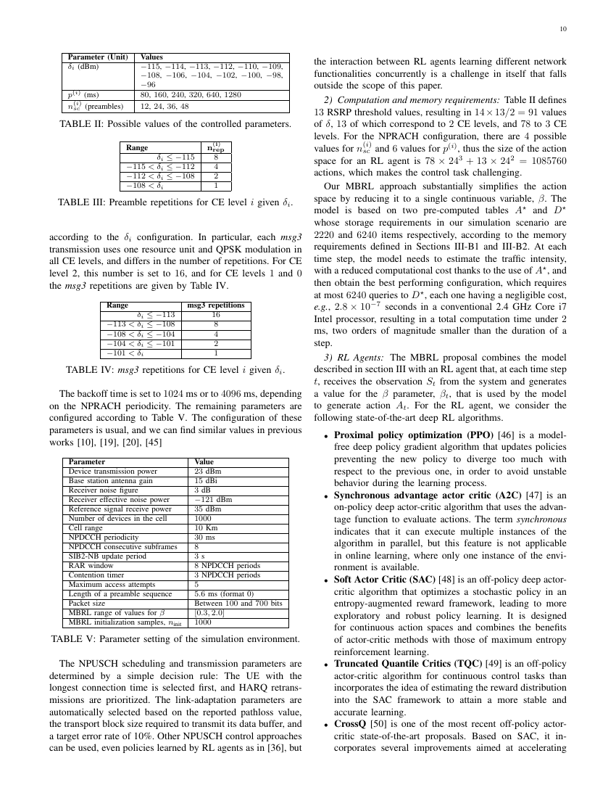

<!-- extraction_page_index: 11 -->

11
training and reducing complexity. It is also designed for
continuous action spaces.
We use the RL implementations provided by Stable Base-
lines 3 [51], which is an improved version of the OpenAI
Baselines [52]. Other RL algorithms were evaluated: Deep
Deterministic Policy Gradient (DDPG), Twin Delayed DDPG
(TD3) but their results are not included because of their poor
performance compared to the previous ones.
4) Baselines: To verify the effectiveness of our proposal,
we have considered the following state-of-the-art alternatives
to compare with.
• Model-free RL (MFRL) agents . As MBRL baselines,
we use two of the above algorithms, PPO and A2C, op-
erating without the model. Model-free versions of SAC,
TQC and CrossQ are not included as baselines because
they are only suitable for continuous action spaces.
• MFRL agents without RSRP threshold control . In
order to evaluate the effect of controlling the RSRP
thresholds (δ0, δ1), we have also considered PPO and
A2C with no threshold control. Instead, they use the
default configuration used in [53] ( δ0 = −101 dBm,
δ1 = −106 dBm).
• Multi-agent DQN (MADQN) . This is the scheme pro-
posed in the closest precedent to our work [10]. It is
also MFRL, but instead of one agent, it uses three
coordinated Deep Q-Networks (DQN) agents, each one
in charge of the NPRACH configuration of each CE
level. MADQN uses the default (δ0, δ1) setting above.
To replicate MADQN, we have refactored the DQN
implementation provided by the CleanRL library [53] into
multiple coordinated DQN agents.
• Model-based configuration. To verify the benefit of us-
ing an RL agent in combination with our model, we have
evaluated the performance attained by the configuration
provided by the model in absence of RL-based β control,
i.e., setting β = 1.
5) Evaluation Experiments: Each agent has been evaluated
in 20 independent simulation runs on each scenario. Each sim-
ulation run consists of a 100000-step online learning episode
in which the agent starts with no prior knowledge and learns
over time. We consider three metrics:
1) the departures defined as the number of UEs that
have successfully completed a NPUSCH transmission
between consecutive decision steps,
2) the service time , defined as the time elapsed from
the moment a UE initiates the access process until it
completes its NPUSCH transmission, and
3) the NPRACH resources, defined as the ratio of carrier
resources devoted to NPRACH.
We estimate the average of each metric over 20 runs, and its
confidence interval with a confidence level of 90%.
B. Numerical Results
1) Uniform Scenario: Figure 4 shows how the average
number of UE departures per step evolves over the 100000
decision steps in the uniform scenario for MBRL, MFRL
and MADQN agents. The performance figures for the other
baselines are summarized later in this section. We found
that MBRL and MFRL agents converge to a similar value,
with MFRL agents converging at a slower rate. MADQN
performed similarly to MFRL agents in the earlier stages but
showed instability afterwards due to its multi-agent nature.
This limitation restricts the application of MADQN to offline
learning, for which it was conceived.
Fig. 4: Average departures per time step during the learning
episodes of each algorithm in the uniform traffic scenario.
The difference in performance is more pronounced in terms
of service time, as shown by Figure 5, where we observe that
the mean service times of MBRL remain clearly smaller than
the baselines throughout the learning episode. It is noteworthy
that 100000 steps (of 3 second each) correspond to a real time
duration of 3 days, 11 hours and 20 minutes. This time scale
illustrates the significance of the problem, and remarks the
impact of our MBRL proposal.
Fig. 5: Average service time measured per time step during
the learning episodes of each algorithm in the uniform traffic
scenario.
Figure 6 summarizes the performance evaluations of the
MBRL proposals and all the baselines, including MFRL
without RSRP threshold control (PPO-no-th, and A2C-no-th),
and the model-based configuration without RL agent (MB-no-
RL). The plots in the figure show the average departures and
service rates of each algorithm during three different stages of
the learning episodes: at the beginning (the first 5000 steps), in
the middle (from step 45000 to 50000), and in the end (from
step 95000 to 100000). The performance of an algorithm is

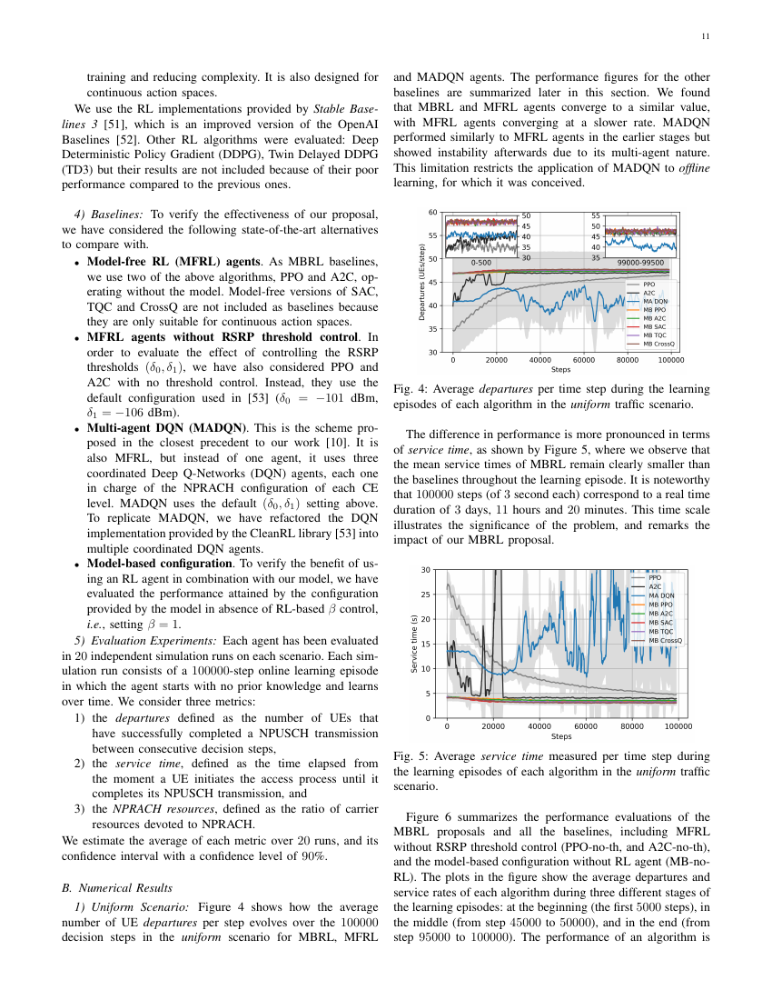

<!-- extraction_page_index: 12 -->

12
better the closer its operating point is to the upper left corner of
the plot. These results confirm the higher suitability of MBRF
agents compared to MFRL and MADQN, especially at the
beginning of the episode. We see that the performance of
MFRL agents worsens when their control is restricted only
to NPRACH configuration (no-th agents). And we also find
that MB-no-RL maintains constant performance at all stages
of the episode and is eventually outperformed by the MBRL
agents.
MBRL
MB no RL
MA DQN
MB no RL MB no RL
A2C
A2C no th
PPO
PPO no th
MBRL MBRL
MA DQNMA DQN
Fig. 6: Average performances of all the algorithms at different
periods of the learning episodes (uniform traffic scenario). The
performance of an algorithm is better the closer it appears to
the upper left corner of the plot.
Figure 7 shows the evolution of the NPRACH resources
ratio. Interestingly, MFRL agents converge to MBRL agents
in this metric, which indicates that their learned policies
are similar to those of MBRL agents in terms of resource
allocation, and validates to some extent the assumptions made
to develop the model. Finally, Figure 8 shows the evolution
of the control parameter β selected by the MBRL agents over
time. We see that in all three algorithms, the average β value
lies between 1.2 and 1.6 in the long term, which suggests that
the model either slightly underestimates the incoming traffic,
or overestimates the access rate, or both.
Fig. 7: Ratio of NPRACH resources over carrier resources
during the learning episodes of each algorithm in the uniform
traffic scenario.
2) Mixed Traffic Scenario: Figure 9 shows the outputs
for the mixed scenario. For the sake of clarity, the MBRL
algorithms are limited to PPO, A2C and SAC, since TQC and
CrossQ performance is very similar to SAC. In the enlarged
Fig. 8: Evolution of the control parameter β selected by the
MBRL agents during the learning episodes in the uniform
traffic scenario.
areas of the figure we can perceive the bursty nature of the
departures, replicating the arrival pattern.
Fig. 9: Average departures per time step during the learning
episodes of each algorithm in the mixed traffic scenario.
In this scenario we observe instability not only in MA-
DQN but in A2C as well. Figure 10, shows that that these
oscillations correspond to spikes in the service time. To com-
plete this evaluation, Figure 11 summarizes the performance
of all the algorithms in this scenario, measured in terms of
average departures and service rates during different stages of
the episodes. We highlight three important findings: 1) The
general trend is similar to previous scenario: all RL agents
improve over time, with MBRL outperforming MBRF. 2) The
MBRL algorithms using SAC, TQN and CrossQ show a better
performance than the rest. This is consistent with the fact that
they are state-of-the-art algorithms for continuous control. 3)
The improvement of MBRL over MB-no-RL has increased.
This indicates that the use of RL is especially beneficial under
varying traffic intensity, and validates the use of RL with the
proposed model. This also suggests that the foresighted nature
of RL plays a significant role in this control task, as we will
discuss below.
Figure 12 shows the evolution of the NPRACH resources
ratio during learning, where we see how the MBRL agents
converge to policies that are more efficient than the base-
lines, assigning approximately 5% of the carrier resources to
NPRACH. Finally, Figure 13 shows the average value of
the control action β selected by the agents as the learning

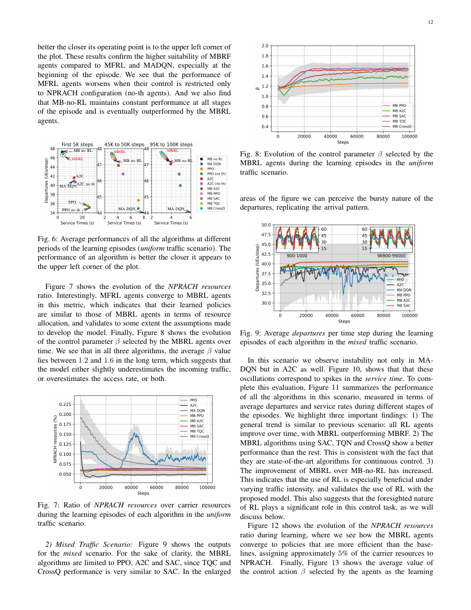

<!-- extraction_page_index: 13 -->

13
Fig. 10: Average service time measured per time step during
the learning episodes of each algorithm in the mixed traffic
scenario.
MB no RL
MA DQN
MBRL
A2C
A2C no th
PPO
PPO no th
MB no RL
MB SAC
MB TQC
MB CrossQ
MB SAC
MB TQC
MB CrossQ
MB PPOMB A2C, MB PPO
MA DQN MA DQN
MB no RL
MB A2C
Fig. 11: Average performances of all the algorithms at different
periods of the learning episodes ( mixed traffic scenario). The
performance of an algorithm is better the closer it appears to
the upper left corner of the plot.
episode progresses. Zooming in on the earlier steps, we see
how β still lacks structure, whereas in the later steps β follows
the oscillatory pattern of the arrivals, which suggests that the
RL agent learns a predictive policy, such that the resulting
traffic estimation ( βbλ) anticipates the incoming traffic in the
upcoming step.
Fig. 12: Ratio of NPRACH resources over carrier resources
during the learning episodes of each algorithm in the mixed
traffic scenario.
Fig. 13: Evolution of the control parameter β selected by the
MBRL agents during the learning episodes in the mixed traffic
scenario.
V. C ONCLUSION
This paper presents a novel approach for the automatic
configuration of NPRACH parameters and the RSRP thresh-
olds that define the coverage area for each CE level in
NB-IoT networks. Our proposal consists of a new MBRL
algorithm that integrates classic network modeling techniques,
such as queueing theory and combinatorial analysis into a
parameterized model. In this architecture, the model and the
agent operate together: both receive the observation of the
environment, the agent adjusts the model parameter, and the
model then generates the control action. The main advantage
of using an MBRL approach is the significant increase in
sample efficiency compared to the MFRL counterpart, en-
abling the agent to opeate online, making efficient decisions
even during the early stages of learning. For instance, the
average service time using the state-of-the-art PPO algorithm
exceeds 20 seconds in the initial hours of operation, but with
our MBRL scheme, it drops to less than 5 seconds. This
improvement stems from embedding environmental dynamics
into the model, offering a specialized solution for NB-IoT
while also showing that RL algorithms for network control
can leverage decades of network modeling knowledge. A
very promising future research line is integrating MBRL with
automatic generation of models of the controlled system using
generative artificial intelligence techniques.
REFERENCES
[1] E. M. Migabo, K. D. Djouani, and A. M. Kurien, “The narrowband
Internet of Things (NB-IoT) resources management performance state
of art, challenges, and opportunities,” IEEE Access, vol. 8, pp. 97 658–
97 675, 2020.
[2] Y .-P. E. Wang, X. Lin et al., “A primer on 3GPP narrowband Internet of
Things,” IEEE communications magazine , vol. 55, no. 3, pp. 117–123,
2017.
[3] 3GPP, “Evolved Universal Terrestrial Radio Access (E-UTRA) and
Evolved Universal Terrestrial Radio Access Network (E-UTRAN);
Physical Channels and Modulation,” 3rd Generation Partnership Project
(3GPP), Technical Specification (TS) 36.211, 2022, version 17.2.0.
[4] ——, “Evolved Universal Terrestrial Radio Access (E-UTRA) and
Evolved Universal Terrestrial Radio Access Network (E-UTRAN);
Multiplexing and channel coding,” 3rd Generation Partnership Project
(3GPP), Technical Specification (TS) 36.212, 2022, version 17.1.0.
[5] ——, “Evolved Universal Terrestrial Radio Access (E-UTRA) and
Evolved Universal Terrestrial Radio Access Network (E-UTRAN); Phys-
ical Layer Procedures,” 3rd Generation Partnership Project (3GPP),
Technical Specification (TS) 36.213, 2022, version 17.4.0.

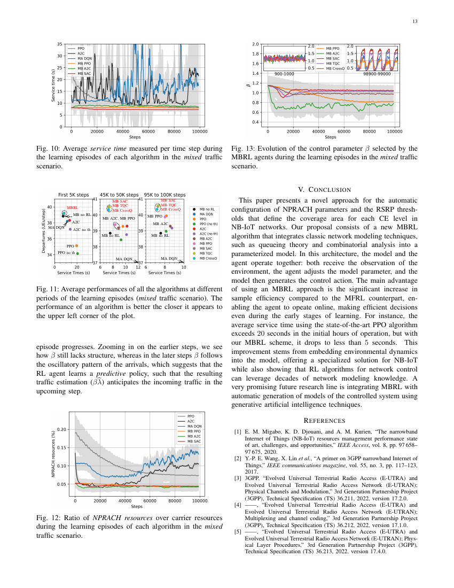

<!-- extraction_page_index: 14 -->

14
[6] M. Kanj, V . Savaux, and M. Le Guen, “A tutorial on NB-IoT physical
layer design,” IEEE Communications Surveys & Tutorials, vol. 22, no. 4,
pp. 2408–2446, 2020.
[7] H. Fattah, 5G LTE Narrowband Internet of Things (NB-IoT) . CRC
Press, 2018.
[8] L. Feltrin, G. Tsoukaneri et al., “Narrowband IoT: A survey on downlink
and uplink perspectives,” IEEE Wireless Communications, vol. 26, no. 1,
pp. 78–86, 2019.
[9] R. Barbau, V . Deslandes et al., “An Analytical Model for Assessing the
Performance of NB-IoT,” in ICC 2021-IEEE International Conference
on Communications. IEEE, 2021, pp. 1–6.
[10] N. Jiang, Y . Deng, A. Nallanathan, and J. A. Chambers, “Reinforcement
learning for real-time optimization in NB-IoT networks,” IEEE Journal
on Selected Areas in Communications , vol. 37, no. 6, pp. 1424–1440,
2019.
[11] B.-Z. Hsieh, Y .-H. Chao, R.-G. Cheng, and N. Nikaein, “Design of
a UE-specific uplink scheduler for narrowband Internet-of-Things (NB-
IoT) systems,” in 2018 3rd International Conference on Intelligent Green
Building and Smart Grid (IGBSG) . IEEE, 2018, pp. 1–5.
[12] O. Elgarhy, L. Reggiani et al. , “Rate-latency optimization for NB-IoT
with adaptive resource unit configuration in uplink transmission,” IEEE
Systems Journal, vol. 15, no. 1, pp. 265–276, 2020.
[13] Y .-J. Yu and J.-K. Wang, “NPRACH-Aware Link Adaptation and Uplink
Resource Allocation in NB-IoT Cellular Networks,” IEEE Transactions
on Vehicular Technology, vol. 70, no. 5, pp. 4894–4906, 2021.
[14] Y .-J. Yu and L.-X. Li, “Offset-Aware Resource Allocation in NB-IoT
Networks,” IEEE Internet of Things Journal , vol. 9, no. 23, pp. 23 967–
23 980, 2022.
[15] Y .-J. Yu, “NPDCCH period adaptation and downlink scheduling for NB-
IoT networks,” IEEE Internet of Things Journal , vol. 8, no. 2, pp. 962–
975, 2020.
[16] X. Chen, Z. Li, Y . Chen, and X. Wang, “Performance analysis and uplink
scheduling for QoS-aware NB-IoT networks in mobile computing,”
IEEE Access, vol. 7, pp. 44 404–44 415, 2019.
[17] C. Yu, L. Yu et al., “Uplink scheduling and link adaptation for narrow-
band Internet of Things systems,” IEEE Access, vol. 5, pp. 1724–1734,
2017.
[18] R. Karmakar, G. Kaddoum, and S. Chattopadhyay, “SmartCon: Deep
probabilistic learning-based intelligent link-configuration in narrowband-
IoT toward 5G and B5G,” IEEE Transactions on Cognitive Communi-
cations and Networking , vol. 8, no. 2, pp. 1147–1158, 2021.
[19] J. J. Alcaraz, F. Losilla, and F.-J. Gonzalez-Casta ˜no, “Transmission
Control in NB-IoT with Model-Based Reinforcement Learning,” IEEE
Access, 2023.
[20] C.-W. Huang, S.-C. Tseng, P. Lin, and Y . Kawamoto, “Radio resource
scheduling for narrowband internet of things systems: A performance
study,” IEEE Network, vol. 33, no. 3, pp. 108–115, 2019.
[21] Y .-J. Yu, Y .-C. Wang, and C.-H. Fan, “Control Period Adaptation
and Resource Allocation for Joint Uplink and Downlink in NB-IoT
Networks,” IEEE Internet of Things Journal , 2024.
[22] N. Jiang, Y . Deng, X. Kang, and A. Nallanathan, “Random access
analysis for massive iot networks under a new spatio-temporal model: A
stochastic geometry approach,” IEEE Transactions on Communications,
vol. 66, no. 11, pp. 5788–5803, 2018.
[23] N. Jiang, Y . Deng et al., “Analyzing random access collisions in massive
IoT networks,” IEEE Transactions on Wireless Communications, vol. 17,
no. 10, pp. 6853–6870, 2018.
[24] Y . Liu, Y . Deng, M. Elkashlan, and A. Nallanathan, “Random access per-
formance for three coverage enhancement groups in NB-IoT networks,”
in 2019 IEEE Global Communications Conference (GLOBECOM) .
IEEE, 2019, pp. 1–6.
[25] Y . Liu, Y . Deng et al., “Analysis of random access in NB-IoT networks
with three coverage enhancement groups: A stochastic geometry ap-
proach,” IEEE Transactions on Wireless Communications, vol. 20, no. 1,
pp. 549–564, 2020.
[26] L. Tello-Oquendo, V . Pla et al. , “Efficient random access channel
evaluation and load estimation in LTE-A with massive MTC,” IEEE
Transactions on Vehicular Technology , vol. 68, no. 2, pp. 1998–2002,
2018.
[27] N. Jiang, Y . Deng, O. Simeone, and A. Nallanathan, “Online supervised
learning for traffic load prediction in framed-ALOHA networks,” IEEE
Communications Letters, vol. 23, no. 10, pp. 1778–1782, 2019.
[28] R. Harwahyu, R.-G. Cheng et al. , “Repetitions versus retransmissions:
Tradeoff in configuring NB-IoT random access channels,” IEEE Internet
of Things Journal , vol. 6, no. 2, pp. 3796–3805, 2019.
[29] R. Harwahyu, R.-G. Cheng, D.-H. Liu, and R. F. Sari, “Fair config-
uration scheme for random access in NB-IoT with multiple coverage
enhancement levels,” IEEE Transactions on Mobile Computing , vol. 20,
no. 4, pp. 1408–1419, 2019.
[30] D. Pacheco-Paramo, L. Tello-Oquendo, V . Pla, and J. Martinez-Bauset,
“Deep reinforcement learning mechanism for dynamic access control
in wireless networks handling mMTC,” Ad Hoc Networks , vol. 94, p.
101939, 2019.
[31] N. Jiang, Y . Deng, A. Nallanathan, and J. Yuan, “A decoupled learning
strategy for massive access optimization in cellular IoT networks,” IEEE
Journal on Selected Areas in Communications , vol. 39, no. 3, pp. 668–
685, 2020.
[32] Y . Yu, T. Wang, and S. C. Liew, “Deep-reinforcement learning multiple
access for heterogeneous wireless networks,” IEEE Journal on Selected
Areas in Communications , vol. 37, no. 6, pp. 1277–1290, 2019.
[33] S. Wang, H. Liu, P. H. Gomes, and B. Krishnamachari, “Deep reinforce-
ment learning for dynamic multichannel access in wireless networks,”
IEEE Transactions on Cognitive Communications and Networking ,
vol. 4, no. 2, pp. 257–265, 2018.
[34] K. Chua, R. Calandra, R. McAllister, and S. Levine, “Deep rein-
forcement learning in a handful of trials using probabilistic dynamics
models,” in Proceedings of the 32nd International Conference on Neural
Information Processing Systems, NeurIPS , Dec. 2018, pp. 4759–4770.
[35] L. Kaiser, M. Babaeizadeh et al., “Model-based reinforcement learning
for Atari,” arXiv preprint arXiv:1903.00374 , Feb. 2020.
[36] J. J. Alcaraz, F. Losilla, A. Zanella, and M. Zorzi, “Model-Based
Reinforcement Learning With Kernels for Resource Allocation in RAN
Slices,” IEEE Transactions on Wireless Communications, vol. 22, no. 1,
pp. 486–501, 2022.
[37] J. A. Ayala-Romero, J. J. Alcaraz, J. Vales-Alonso, and E. Egea-Lopez,
“Online optimization of interference coordination parameters in small
cell networks,” IEEE Transactions on Wireless Communications, vol. 16,
no. 10, pp. 6635–6647, Oct. 2017.
[38] J. J. Alcaraz, J. A. Ayala-Romero, J. Vales-Alonso, and F. Losilla-L ´opez,
“Online reinforcement learning for adaptive interference coordination,”
Transactions on Emerging Telecommunications Technologies , vol. 31,
no. 10, pp. 1–24, Aug. 2020.
[39] J. A. Ayala-Romero, J. J. Alcaraz, A. Zanella, and M. Zorzi, “Online
Learning for Energy Saving and Interference Coordination in HetNets,”
IEEE Journal on Selected Areas in Communications , vol. 37, no. 6, pp.
1374–1388, Jun. 2019.
[40] S. Riolo, D. Panno, and L. Miuccio, “Modeling and analysis of tagged
preamble transmissions in random access procedure for mmtc scenarios,”
IEEE Transactions on Wireless Communications , vol. 20, no. 7, pp.
4296–4312, 2021.
[41] 3GPP, “RAN Improvements for Machine-type Communications,” 3rd
Generation Partnership Project (3GPP), Technical Report (TR) 37.868,
2011, version 11.0.0.
[42] ——, “Evolved Universal Terrestrial Radio Access (E-UTRA); Radio
Frequency (RF) system scenarios,” 3rd Generation Partnership Project
(3GPP), Technical Report (TR) 36.942, 2018, version 15.0.0.
[43] J.-K. Hwang, C.-F. Li, and C. Ma, “Efficient detection and synchroniza-
tion of superimposed NB-IoT NPRACH preambles,” IEEE Internet of
Things Journal, vol. 6, no. 1, pp. 1173–1182, 2018.
[44] J. A. Z. Emmanuel Lujan, “Lite NBIoT NPUSCH Simulator,”
https://github.com/CSC-CONICET/Lite-NBIoT-NPUSCH-Simulator,
2019.
[45] R. Ratasuk, N. Mangalvedhe et al., “Overview of narrowband iot in lte
rel-13,” in 2016 IEEE conference on standards for communications and
networking (CSCN). IEEE, 2016, pp. 1–7.
[46] J. Schulman, F. Wolski et al., “Proximal policy optimization algorithms,”
arXiv preprint arXiv:1707.06347 , Aug. 2017.
[47] V . Mnih, A. P. Badia et al. , “Asynchronous methods for deep rein-
forcement learning,” in International conference on machine learning .
PMLR, Jun. 2016, pp. 1928–1937.
[48] T. Haarnoja, A. Zhou, P. Abbeel, and S. Levine, “Soft actor-critic: Off-
policy maximum entropy deep reinforcement learning with a stochastic
actor,” in International conference on machine learning . PMLR, 2018,
pp. 1861–1870.
[49] A. Kuznetsov, P. Shvechikov, A. Grishin, and D. Vetrov, “Controlling
overestimation bias with truncated mixture of continuous distributional
quantile critics,” in International Conference on Machine Learning .
PMLR, 2020, pp. 5556–5566.
[50] A. Bhatt, D. Palenicek et al. , “CrossQ: Batch Normalization in Deep
Reinforcement Learning for Greater Sample Efficiency and Simplicity,”
in The Twelfth International Conference on Learning Representations ,
2024.

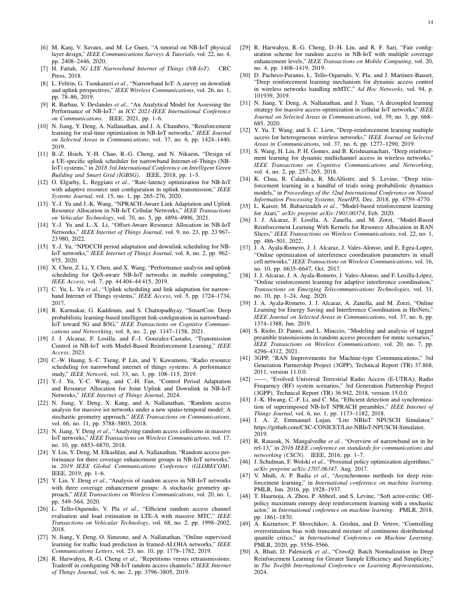

<!-- extraction_page_index: 15 -->

15
[51] A. Raffin, A. Hill et al. , “Stable-baselines3: Reliable reinforcement
learning implementations,” Journal of Machine Learning Research ,
vol. 22, no. 268, pp. 1–8, 2021. [Online]. Available:
http://jmlr.org/papers/v22/20-1364.html
[52] P. Dhariwal, C. Hesse et al. , “OpenAI Baselines,”
https://github.com/openai/baselines, 2017.
[53] S. Huang, R. F. J. Dossa et al. , “Cleanrl: High-quality single-file
implementations of deep reinforcement learning algorithms,” Journal
of Machine Learning Research , vol. 23, no. 274, pp. 1–18, 2022.
[Online]. Available: http://jmlr.org/papers/v23/21-1342.html
AYA L A - RO M E ROet al.:O N L I N E O P T I M I Z A T I O N O F I N T E R F E R E N C E C O O R D I N A T I O N P A R A M E T E R S 6 6 4 7
[18] M. S. Ali, P . Coucheney, and M. Coupechoux, “Load balancing in
heterogeneous networks based on distributed learning in near-potential
games,”IEEE Trans. Wireless Commun.,v o l .1 5 ,n o .7 ,p p .5 0 4 6 – 5 0 5 9 ,
Jul. 2016.
[19] O.-C. Iacoboaiea, B. Sayrac, S. B. Jemaa, and P . Bianchi, “SoN coor-
dination in heterogeneous networks:Ar e i n f o r c e m e n tl e a r n i n gf r a m e -
work,”IEEE Trans. Wireless Commun.,v o l .1 5 ,n o .9 ,p p .5 8 3 5 – 5 8 4 7 ,
Sep. 2016.
[20] D.-H. Sung and J. S. Baras, “Utility-based almost blank subframe
optimization in heterogeneous cellular networks,” inProc. IEEE Global
Commun. Conf.,D e c .2 0 1 4 ,p p .3 6 2 2 – 3 6 2 7 .
[21] W. Jin, J. Huilin, P . Zhiwen, L. Nan, Y . Xiaohu, and D. Tianle, “Joint
user association and ABS proportionoptimization for load balancing in
HetNet,” inProc. Int. Conf. Wireless Commun. Signal Process. (WCSP),
Nanjing, China, Oct. 2015, pp. 1–6.
[22] M. Al-Rawi, J. Huschke, and M. Sedra, “Dynamic protected-subframe
density configuration in LTE heterogeneous networks,” inProc. 21st Int.
Conf. Comput. Commun. Netw. (ICCCN),M u n i c h ,G e r m a n y ,J u l .2 0 1 2 ,
pp. 1–6.
[23] M. Cierny, H. Wang, R. Wichman, Z. Ding, and C. Wijting, “On number
of almost blank subframes in heterogeneous cellular networks,” IEEE
Trans. Wireless Commun.,v o l .1 2 ,n o .1 0 ,p p .5 0 6 1 – 5 0 7 3 ,O c t .2 0 1 3 .
[24] Y . Wang, H. Ji, and H. Zhang, “Spectrum-efficiency enhancement
in small cell networks with biasing cell association and eICIC:
An analytical framework,” Int. J. Commun. Syst. ,v o l .2 9 ,n o .2 ,
pp. 362–377, 2016.
[25] L. Zhouet al.,“ Ad y n a m i cg r a p h - b a s e ds c heduling and interference
coordination approach in heterogeneous cellular networks,”IEEE Trans.
Veh . Tech n o l .,v o l .6 5 ,n o .5 ,p p .3 7 3 5 – 3 7 4 8 ,M a y2 0 1 6 .
[26]Evolved Universal T errestrial Radio Access (E-UTRA) and Evolved Uni-
versal Terrestrial Radio Access Network (E-UTRAN); Overall Descrip-
tion (Release 10),d o c u m e n t3 6 . 3 0 0v 1 0 . 5 . 0 ,3 r dG e n e r a t i o nP a r t n e r s h i p
Project (3GPP), 2011.
[27]System Performance of Heterogeneous Networks With Range Expansion,
document 3GPP R1-100142, 3rd GenerationP a r t n e r s h i pP r o j e c t( 3 G P P ) ,
2010.
[28] J. P . Kleijnen,Design and Analysis of Simulation Experiments,v o l .2 0 .
New Y ork, NY , USA: Springer, 2008.
[29] K. Marti,Stochastic Optimization Methods.B e r l i n ,G e r m a n y :S p r i n g e r ,
2005.
[30] S. A. van der Geer, “Least squares estimation,” in Encyclopedia of
Statistics in Behavioral Science,H o b o k e n ,N J ,U S A :W i l e y ,2 0 0 5 ,d o i :
10.1002/0470013192.bsa199.
[31] J. N. Tsitsiklis and D. P . Bertsekas, Neuro-Dynamic Programming.
Belmont, MA, USA: Athenea Scientific, 1996.
[32] V . S. Borkar et al.,Stochastic Approximation.C a m b r i d g e ,U . K . :
Cambridge Univ. Press, 2008.
[33] E. Angün, J. Kleijnen, D. den Hertog, and G. Gürkan, “Response sur-
face methodology with stochastic constraints for expensive simulation,”
J. Oper. Res. Soc.,v o l .6 0 ,n o .6 ,p p .7 3 5 – 7 4 6 ,2 0 0 9 .
[34] E. R. Barnes, “A variation on karmarkar’s algorithm for solving linear
programming problems,”Math. Program.,v o l .3 6 ,n o .2 ,p p .1 7 4 – 1 8 2 ,
1986.
[35] K. Min and J. So, “Scheduling and positioning for the expanded region
of an indoor cell in heterogeneous networks,” inProc. Int. Conf. Indoor
Positioning Indoor Navigat. (IPIN),B u s a n ,S o u t hK o r e a ,O c t .2 0 1 4 ,
pp. 685–692.
[36]Summary of Ad Hoc Session on FeICIC Simulation Assumptions ,
document 3GPP R1-112856, 3rd GenerationP a r t n e r s h i pP r o j e c t( 3 G P P ) ,
2011.
[37]Performance Evaluation for FeICIC ,d o c u m e n t3 G P PR 1 - 1 1 3 5 5 9 ,
3rd Generation Partnership Project (3GPP), 2011.
[38] S. Hämäläinen, H. Sanneck, and C. Sartori, Eds., LTE Self-Organising
Networks (SON): Network Management Automation for Operational
Efficiency.H o b o k e n ,N J ,U S A :W i l e y ,2 0 1 2 .
Jose A. Ayala-Romeroobtained his B.Sc. degree
in telematics engineering and the M.Sc. degree in
telecommunication engineering from the Technical
University of Cartagena (UPCT), Spain, in 2012
and 2014, respectively. He is currently pursuing
the Ph.D. degree in the Department of Information
and Communications Technologies at UPCT. His
research interests are cellular networks and learning
algorithms.
Juan J. Alcarazreceived the degree in telecom-
munications engineering from the Polytechnical
University of V alencia (UPV) in 1999. After working
in the telecommunications industry he joined the
Technical University of Cartagena (UPCT) in 2004,
where he obtained his Ph.D. in telecommunications
engineering in 2007. He is currently an Associate
Professor with the Department of Information and
Communication Technologies at UPCT. He was a
Fulbright visiting scholar at the Electrical Engi-
neering department at UCLA in 2013. His current
research focuses on learning algorithms for wireless network management.
Javier Vales-Alonsoreceived the M.Sc. degree in
telecommunication engineering from the University
of Vigo, Vigo, Spain, in 2000, the Ph.D. degree in
telecommunication engineering from the Technical
University of Cartagena, Cartagena, Spain, in 2005,
and the M.Sc. degree in mathematics from the
National University of Distance Education, Madrid,
Spain, in 2015. He is involved in different research
topics related to modeling and optimization.
Esteban Egea-López received the degree in
telecommunications engineering from the Univer-
sitat Politècnica de V alència, Spain, in 2002, the
master’s degree in electronics from the University
of Gävle, Sweden, in 2001, and the Ph.D. degree in
telecommunications from the Technical University
of Cartagena in 2006. He is currently an Associate
Professor with the Department of Information Tech-
nologies and Communications, Technical University
of Cartagena. His research interest is focused on
vehicular networks and MAC protocols.
Juan J. Alcaraz obtained his MS degree in telecom-
munications engineering from the Polytechnic Uni-
versity of Valencia, Spain, in 1999, and his PhD in
telecommunications engineering from the Technical
University of Cartagena (UPCT), Spain, in 2007.
He joined UPCT in 2004, where he is currently a
Professor with the Department of Information and
Communication Technologies. He was a Fulbright
Visiting Scholar with the Electrical Engineering
Department of the University of California, Los
Angeles (UCLA), in 2013, and a visiting researcher
with the Department of Information Engineering, University of Padova, in
2017 and in 2019. His current research focuses on learning algorithms for
wireless networks.
Juan-Carlos Sanchez-Aarnoutse received the M.S.
degree in Automation and Electronics Engineering
(2002) and the Ph.D. degree in Telecommunications
Engineering (2006) from the Technical University
of Cartagena (UPCT), Spain. Since 2002, he is
Assistant Professor in the Department of Information
Technologies and Communications at the Universi-
dad Polit ˜A©cnica de Cartagena (Spain). He has au-
thored several papers, book chapters, and conference
proceedings in the areas of multicast protocols and
P2P traffic measurement, as well as smart grid and
power line communications and network capacity estimation. In the last years,
he has been working in the field of IoT, UA Vs and their applications.
Alejandro S. Martinez-Sala received the M.S. de-
gree in Automation and Electronics Engineering in
2000 and the Ph.D. in Telecommunications from the
Technical University of Cartagena (UPCT), Spain,
in 2006. In 2001 he joined the UPCT where he
is assistant professor at the Communications and
Information Technologies Department. His research
interests include IoT technology, location systems
and services, and innovation management and tech-
nology transfer to industry.
Francisco-Javier Gonzalez-Casta ˜no is a Full Pro-
fessor with the Telematics Engineering Department,
University of Vigo, Spain, where he leads the Infor-
mation Technology Group. He has authored more
than 100 papers in international journals in the
fields of telecommunications and computer science,
and has participated in several relevant national and
international projects. He holds three U.S. patents.

